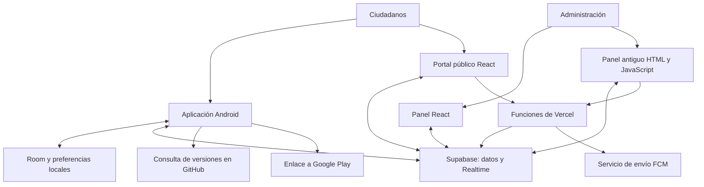

# Análisis del sistema PAC Barinas

**Fecha de revisión:** 15 de octubre de 2026.  
**Alcance:** documentación y código disponibles en `E:\LUZ BARINAS`, incluidos los dos repositorios Android y web.  
**Naturaleza:** auditoría documental y técnica local. No se modificó el código del producto ni se consultaron o alteraron servicios de producción.

## 1. Dictamen

PAC Barinas resuelve una necesidad concreta: ayudar a los habitantes de Barinas a organizarse ante los cortes eléctricos mediante horarios, avisos y reportes comunitarios. La combinación de aplicación Android, almacenamiento local, panel administrativo y servicio de datos es adecuada para ese propósito.

El principal problema actual es la confianza en la información y en las operaciones administrativas. El código local permite encontrar errores que pueden asignar alertas al bloque incorrecto, duplicar o perder reportes, presentar datos precargados como actuales y confirmar publicaciones que no se realizaron. A esto se suman controles administrativos insuficientes y una documentación que describe capacidades ausentes o modificadas.

Mi evaluación es que existe una base funcional que conviene consolidar. La siguiente inversión debería centrarse en seguridad, integridad de datos y exactitud de horarios antes de ampliar funciones o presentar las predicciones como porcentajes de acierto.

**Límite de la conclusión:** los defectos de código y las políticas de los scripts están comprobados localmente. No se verificó qué versión del APK, panel o políticas de Supabase está desplegada. Cuando un impacto depende de esa configuración, se indica expresamente.

## 2. De qué trata realmente el sistema

La plataforma reúne cuatro funciones principales:

1. **Consulta del PAC:** relaciona un sector con un bloque y calcula sus franjas de corte a partir de una matriz configurable.
2. **Colaboración ciudadana:** recibe reportes de presencia o ausencia de electricidad y propuestas de nuevas comunidades.
3. **Avisos al usuario:** programa notificaciones y alarmas locales, además de mostrar avisos recibidos mientras existe sincronización.
4. **Administración:** permite editar horarios, sectores, avisos, donaciones y otros parámetros mediante la web.

También incorpora mapas, perfiles Casa/Trabajo, widget, anuncios y enlaces de actualización.

Su fuente principal de observación son los reportes de personas. En el código revisado no aparece una integración con medidores eléctricos que justifique presentar el voltaje como una lectura automática del teléfono. Hay voltajes predeterminados y datos precargados. Esta diferencia debería quedar clara en la interfaz y la documentación.

El motor predictivo actual utiliza reglas: combina el cronograma con concentraciones de reportes por hora. No encontré un modelo entrenado ni una evaluación histórica que permita interpretar sus porcentajes de confianza como probabilidades calibradas.

## 3. Arquitectura encontrada

El envío FCM existe en el servidor web, pero el Android revisado no contiene el cliente FCM descrito por la documentación. Esa parte del diagrama no constituye un canal completo de recepción en la aplicación actual.

| Área | Implementación local | Valor y limitación |
|---|---|---|
| Android | Kotlin, Compose, ViewModel, StateFlow | Buena base para interfaz y estado reactivo; varias reglas de negocio están repartidas entre componentes. |
| Persistencia | Room v3 y SharedPreferences | Permite uso sin conexión; la cola y la carga de horarios en segundo plano necesitan correcciones. |
| Datos remotos | Supabase PostgreSQL y Realtime | Adecuado para este producto; sus permisos y contratos actuales requieren revisión prioritaria. |
| Web pública | React, Vite y Tailwind | No queda bien reflejada en el documento maestro. |
| Administración | Panel React y panel antiguo | Dos implementaciones con funciones y formatos diferentes. |
| Funciones web | Predicción, semanas y envío de alertas | Hay problemas de autorización y de cálculo temporal. |
| Actualización Android | Consulta GitHub y apertura de Google Play | Difiere del flujo de descarga e instalación de APK documentado. |

Conservar Supabase para datos y FCM para notificaciones sería una decisión razonable si ambos canales están completos. La coexistencia de esos servicios no es, por sí sola, un error. La prioridad es definir sus responsabilidades y verificar su funcionamiento.

## 4. Calidad de la documentación

### Aciertos

El documento maestro contiene un inventario amplio: propósito, componentes, tablas, archivos, flujos, permisos, despliegue y problemas conocidos. La separación de los dos repositorios está explicada y los diagramas de flujo ayudan a localizar responsabilidades. Es un buen punto de partida para incorporar a otro desarrollador.

### Problemas comprobados

| Tema | Lo documentado | Lo encontrado | Consecuencia |
|---|---|---|---|
| Versión | Encabezado documental 2.0, tabla Android 1.2/code 4 y cierre que afirma cubrir 1.2 | Gradle usa 1.3.1/code 7; README presenta el producto como 2.0 | No queda clara la versión de referencia. |
| Web | Panel principalmente Vanilla en `index.html` | Portal React, panel React y `admin.html` antiguo | La guía omite la arquitectura web actual. |
| Push | Servicio Android FCM y suscripción por bloques | No hay clase, dependencia Messaging ni declaración de servicio en el Android revisado | Se promete una entrega remota que este código no implementa. |
| Actualizaciones | DownloadManager e instalación de APK | `AppUpdater` abre Google Play | Instrucciones de publicación y soporte incorrectas. |
| Mapa | Figura como pestaña deshabilitada en deuda técnica | La navegación actual muestra y abre Mapa | La lista de pendientes está desactualizada. |
| Duplicación | Se atribuye al fallback Supabase/Retrofit | Los caminos actuales revisados envían por Supabase y pueden competir entre sí | Se orientaría una corrección hacia la causa equivocada. |
| Pruebas | Se afirma que no hay evidencia de tests activos | Sí existen tests de motor, Room, captura visual y contexto | Debe distinguirse existencia de pruebas de ejecución verificada. |
| Aprobación comunitaria | Solicitud pendiente y aprobación posterior | Android también inserta directamente en sectores activos | El flujo descrito no es una garantía del sistema. |
| Publicar desde Android | Sincronización real | La función devuelve éxito sin escribir | El documento atribuye una capacidad incompleta. |
| Esquema | Catálogo de columnas y flujos | Hay campos usados que faltan en los SQL, y consultas que usan nombres locales en tablas remotas | Una instalación nueva no reproduce necesariamente el comportamiento esperado. |

Referencias: [versión documentada](<E:/LUZ BARINAS/DOCUMENTACION_SISTEMA.md:450>), [cierre del documento](<E:/LUZ BARINAS/DOCUMENTACION_SISTEMA.md:1432>), [versión real](<E:/LUZ BARINAS/app/build.gradle.kts:18>), [mapa habilitado](<E:/LUZ BARINAS/app/src/main/java/com/example/MainActivity.kt:515>), [actualizador](<E:/LUZ BARINAS/app/src/main/java/com/example/utils/AppUpdater.kt:71>).

Las dos copias de `DOCUMENTACION_SISTEMA.md` son idénticas por SHA-256 en esta revisión. Eso evita diferencias actuales entre ellas, aunque no evita su desactualización respecto del código. `DESIGN.md` y `MERCURY.md` son referencias visuales de otras marcas; conviene identificarlas como inspiración y mantener por separado las decisiones visuales propias de PAC Barinas.

Faltan especificaciones verificables de reglas del PAC, contratos de API, permisos por rol, recuperación ante fallos, procedencia de datos, conservación de reportes y criterios de aceptación. La frase que presenta la documentación como cobertura total del sistema transmite más certeza de la que permite su estado actual.

## 5. Seguridad y control administrativo

### S1. Crítica: el acceso administrativo se valida en el navegador

Ambos paneles incluyen una contraseña en el código cliente y representan la sesión con un valor de `localStorage`. Esto controla la presentación de la pantalla, pero no acredita una identidad administrativa ante la base de datos o las funciones del servidor.

**Impacto:** el diseño no ofrece una frontera de autorización confiable para las operaciones administrativas. La explotación sobre datos depende además de los permisos del servicio desplegado.

**Mejora:** cuentas administrativas reales, sesiones verificables, roles y comprobación de autorización en cada operación protegida. Eliminar credenciales administrativas del código distribuido.

Evidencia: [panel antiguo](<E:/LUZ BARINAS/admin-web/public/app.js:102>), [panel React](<E:/LUZ BARINAS/admin-web/src/pages/AdminPortal.jsx:64>).

### S2. Crítica: los SQL permiten escritura anónima de configuración y sectores

Las políticas versionadas permiten insertar y actualizar `app_config` y `sectors` sin condiciones de propietario o rol administrativo. `app_config` incluye cronogramas, avisos, donaciones y versiones.

**Impacto condicionado:** si esas políticas y los permisos de tabla correspondientes siguen activos en producción, un cliente anónimo podría modificar información de alcance global. No se comprobó el catálogo de permisos del servidor.

**Mejora:** lectura pública deliberada de información aprobada; escritura administrativa autorizada; envío ciudadano acotado a solicitudes y reportes. Revisar grants y políticas conjuntamente, retirando reglas permisivas anteriores. La clave pública `anon` puede estar en el cliente: el defecto es el acceso que recibe. Este criterio coincide con la [documentación oficial de RLS](https://supabase.com/docs/guides/database/postgres/row-level-security).

Evidencia: [políticas SQL](<E:/LUZ BARINAS/supabase_schema.sql:63>).

El asistente web para reparar el esquema agrava el riesgo porque propone `FOR ALL TO anon` sobre sectores y solicitudes. Una reparación de columnas no debería ampliar autorizaciones. Evidencia: [SQL generado por el panel](<E:/LUZ BARINAS/admin-web/public/app.js:4053>).

### S3. Crítica: el endpoint de alertas masivas no autentica al solicitante

`sendPushAlert` no comprueba identidad, rol administrativo ni método POST. Una prueba local con servicios simulados confirmó que un GET sin autenticación alcanza el envío y recibe respuesta 200.

**Impacto:** permite invocar un envío global desde esta implementación si la función se despliega con credenciales válidas y sin otra protección externa. No se enviaron notificaciones reales ni se comprobó qué dispositivos reciben el tema.

**Mejora:** autenticación y autorización en servidor, POST obligatorio, validación de contenido, límites de frecuencia y registro del administrador que emite cada aviso. CORS no sustituye estas comprobaciones.

Evidencia: [función de envío](<E:/LUZ BARINAS/admin-web/api/sendPushAlert.js:21>).

### S4. Alta: datos ciudadanos llegan a HTML sin escapar

El panel antiguo concatena nombres y observaciones dentro de `innerHTML`. Una etiqueta HTML inocua llegó intacta al destino en una prueba local. Esto demuestra inyección de HTML y establece un riesgo de XSS persistente; no se ejecutó contenido malicioso.

**Mejora:** renderizar datos como texto con nodos seguros o componentes React. Retirar interpolaciones de datos dentro de manejadores `onclick`. Si alguna función necesita HTML enriquecido, definir y sanear expresamente el formato permitido.

Evidencia: [solicitudes comunitarias](<E:/LUZ BARINAS/admin-web/public/app.js:2178>), [feed de reportes](<E:/LUZ BARINAS/admin-web/public/app.js:209>).

### S5. Media: información interna y credenciales de firma

La documentación llama internas a las notas de sectores, pero el esquema las mantiene en una tabla con lectura pública. Hay que separar los campos privados del conjunto público. No se verificó qué contenido está almacenado.

La documentación y Gradle también contienen valores de respaldo para la firma. El keystore local está excluido y no apareció como archivo versionado en la comprobación realizada; por tanto, no corresponde afirmar que la clave privada esté publicada. Conviene retirar contraseñas operativas de la documentación y exigir configuración segura al generar una versión. Cualquier cambio de clave debe respetar la continuidad de actualizaciones.

Evidencia: [notas y esquema](<E:/LUZ BARINAS/DOCUMENTACION_SISTEMA.md:352>), [firma](<E:/LUZ BARINAS/app/build.gradle.kts:27>).

## 6. Errores funcionales y de integridad

| ID / prioridad | Problema confirmado y escenario | Mejora concreta | Evidencia |
|---|---|---|---|
| F1 / Alta | `Regex("[ABCD]")` toma la B de BLOQUE: «Bloque A», «Bloque C» y «Bloque D» resultan B. Afecta preferencias, selección y alertas. | Una función única que elimine el prefijo, valide A/B/C/D y persista el código canónico. | [ViewModel](<E:/LUZ BARINAS/app/src/main/java/com/example/ui/viewmodel/LuzBarinasViewModel.kt:181>), [scheduler](<E:/LUZ BARINAS/app/src/main/java/com/example/notification/PacAlarmScheduler.kt:23>). |
| F2 / Alta | Se ignora el ID insertado y, tras subir un reporte, se marca el último pendiente. Con dos envíos concurrentes puede marcarse como enviado otro reporte que falló. | Conservar y confirmar exclusivamente el ID original; estados de cola y transacciones. | [inserción](<E:/LUZ BARINAS/app/src/main/java/com/example/data/repository/EnergyRepository.kt:246>), [confirmación](<E:/LUZ BARINAS/app/src/main/java/com/example/data/repository/EnergyRepository.kt:309>). |
| F3 / Alta | Envío inmediato, worker y sincronización manual compiten; el INSERT remoto no lleva identidad estable del evento. Un reintento también puede repetir una operación que el servidor ya recibió. | UUID generado al crear el reporte, restricción única remota y un único proceso de envío idempotente. | [encolado y envío](<E:/LUZ BARINAS/app/src/main/java/com/example/data/repository/EnergyRepository.kt:291>), [INSERT remoto](<E:/LUZ BARINAS/app/src/main/java/com/example/data/repository/CloudSyncRepository.kt:377>). |
| F4 / Alta | Un reporte offline de las 19:00 enviado a las 23:00 se guarda remotamente con hora 23:00. Esto altera el patrón que analiza el motor. | Separar fecha del evento y fecha de recepción; preservar el evento original en todos los reintentos. | [timestamp remoto](<E:/LUZ BARINAS/app/src/main/java/com/example/data/repository/CloudSyncRepository.kt:394>), [worker](<E:/LUZ BARINAS/app/src/main/java/com/example/worker/ReportPowerWorker.kt:60>). |
| F5 / Alta | El horario persistido se carga en el ViewModel, pero receiver y worker pueden calcular con el singleton de fábrica en un proceso nuevo. | Cargar la configuración persistida antes de cualquier cálculo en segundo plano. Rearmar alarmas al aplicar un horario nuevo. | [carga](<E:/LUZ BARINAS/app/src/main/java/com/example/ui/viewmodel/LuzBarinasViewModel.kt:91>), [reinicio](<E:/LUZ BARINAS/app/src/main/java/com/example/notification/PacAlarmReceiver.kt:68>), [worker](<E:/LUZ BARINAS/app/src/main/java/com/example/worker/PredictiveNotificationWorker.kt:56>). |
| F6 / Alta | Android y la API buscan desde el día actual y omiten el tramo 23–03 que empezó ayer. A la 01:00 pueden anunciar un corte futuro aunque el programado siga activo. | Evaluar también el día anterior, usar intervalos con fin exclusivo y aplicar America/Caracas coherentemente. | [Kotlin](<E:/LUZ BARINAS/app/src/main/java/com/example/data/model/PacSchedule.kt:658>), [API](<E:/LUZ BARINAS/admin-web/api/getOutagePrediction.js:78>). |
| F7 / Alta | Un error al leer el PAC en la web provoca publicar automáticamente la configuración local. Una lectura transitoriamente fallida puede terminar sobrescribiendo datos válidos. | Mantener el último estado válido; separar lectura, inicialización y publicación. No escribir como recuperación de una lectura fallida. | [manejo de error](<E:/LUZ BARINAS/admin-web/public/app.js:295>), [publicación](<E:/LUZ BARINAS/admin-web/public/app.js:991>). |
| F8 / Alta | Abrir `/admin` desde React y recargarlo entrega paneles distintos. El panel React además reemplaza `pac_schedule` sin las asignaciones `sectorsA-D`. | Un único panel y una ruta consistente. Contrato completo, validado y con control de versión al guardar. | [rutas React](<E:/LUZ BARINAS/admin-web/src/App.jsx:47>), [rewrite](<E:/LUZ BARINAS/admin-web/vercel.json:8>), [guardado](<E:/LUZ BARINAS/admin-web/src/pages/AdminPortal.jsx:179>). |
| F9 / Alta | Crear una comunidad también la inserta en sectores activos, saltándose la aprobación descrita. Además se ignora un fallo de envío y no hay cola persistente de esa alta. | Solicitud pendiente durable; aprobación autorizada y transaccional. Mensajes distintos para guardado local, enviado y aprobado. | [alta remota](<E:/LUZ BARINAS/app/src/main/java/com/example/data/repository/CloudSyncRepository.kt:465>), [resultado ignorado](<E:/LUZ BARINAS/app/src/main/java/com/example/data/repository/EnergyRepository.kt:373>). |
| F10 / Media | Publicar PAC desde Android devuelve `true` sin escribir y puede mostrar confirmación de éxito. | Implementar la operación autorizada y confirmar persistencia, o retirar el flujo incompleto. | [función incompleta](<E:/LUZ BARINAS/app/src/main/java/com/example/data/repository/CloudSyncRepository.kt:430>), [mensaje](<E:/LUZ BARINAS/app/src/main/java/com/example/ui/viewmodel/LuzBarinasViewModel.kt:550>). |
| F11 / Media | El worker vuelve a incrementar métricas ya cambiadas por el repositorio, incluso en reintentos. También convierte una avería en corte programado y fuerza voltaje 118/0. | El worker debe transportar y confirmar; aplicar el evento una sola vez y calcular agregados con reglas compartidas. | [cambio inicial](<E:/LUZ BARINAS/app/src/main/java/com/example/data/repository/EnergyRepository.kt:248>), [segundo cambio](<E:/LUZ BARINAS/app/src/main/java/com/example/worker/ReportPowerWorker.kt:29>). |
| F12 / Media | El widget consulta y reporta un ID fijo de Alto Barinas I, aunque el usuario haya elegido otra ubicación. | Leer el perfil y sector activos del mismo repositorio utilizado por la app. | [widget](<E:/LUZ BARINAS/app/src/main/java/com/example/glance/LuzBarinasWidget.kt:50>), [botón](<E:/LUZ BARINAS/app/src/main/java/com/example/glance/LuzBarinasWidget.kt:127>). |
| F13 / Media | La sincronización inicial agrupa varias operaciones en un solo try. Un fallo temprano omite etapas posteriores y no programa una recuperación completa. | Estados independientes, reintentos con backoff y reconciliación al recuperar conectividad. | [inicialización](<E:/LUZ BARINAS/app/src/main/java/com/example/data/repository/CloudSyncRepository.kt:141>). |

Hay un error adicional de estructura: `updateMatrix()` limita el recorrido a seis filas, pero no al tamaño de la matriz activa. Tras eliminar filas, una llamada con una matriz mayor puede acceder fuera de rango; las filas añadidas por encima de seis tampoco se actualizan por ese método. Evidencia: [actualización](<E:/LUZ BARINAS/app/src/main/java/com/example/data/model/PacSchedule.kt:155>), [eliminación y alta](<E:/LUZ BARINAS/app/src/main/java/com/example/data/model/PacSchedule.kt:172>). Su impacto depende de los flujos que invoquen esa combinación de operaciones.

## 7. Credibilidad de métricas, mapa y predicción

### Datos precargados presentados como estado reciente

`initializePreloadedDataIfEmpty()` introduce sectores con voltajes, contadores, porcentajes y marcas temporales calculadas como «hace pocos minutos». Se ejecuta cuando hay menos de 60 sectores, no únicamente cuando la base está vacía. Esto mezcla el catálogo territorial con un supuesto estado actual e incluso puede reemplazar registros existentes mediante upsert.

Los valores de catálogo necesarios para trabajar offline deben conservarse. Los estados no observados deberían ser «sin datos» y tener una procedencia explícita. Los ejemplos de demostración deben quedar aislados de producción.

Evidencia: [condición y precarga](<E:/LUZ BARINAS/app/src/main/java/com/example/data/repository/EnergyRepository.kt:60>).

El módulo web también usa sustitutos como 2000/2002 al formar estadísticas. El uso de `||` puede reemplazar un cero legítimo. Un contador debería mostrar cero, falta de datos o error según corresponda, conservando su última actualización verificable.

Evidencia: [conteo](<E:/LUZ BARINAS/admin-web/src/lib/telemetry.js:227>), [sustitución posterior](<E:/LUZ BARINAS/admin-web/src/lib/telemetry.js:326>).

### El mapa no refleja el volumen anunciado

El README dice que radio e intensidad se adaptan al volumen de confirmaciones. En el mapa Android revisado, el radio es 30 y el peso es 1.0 o 0.25 según el estado. El puente tampoco envía los contadores que permitirían ese cálculo.

**Mejora:** definir intensidad con reportes recientes, aportes independientes y antigüedad. Mostrar tamaño de muestra y ausencia de observaciones. No representar una ubicación sin coordenadas mediante un polígono inventado.

Evidencia: [cálculo de calor](<E:/LUZ BARINAS/app/src/main/assets/map/map.html:366>), [datos enviados al mapa](<E:/LUZ BARINAS/app/src/main/java/com/example/ui/components/InteractiveBarinasMap.kt:70>).

### La confianza predictiva no está calibrada

El motor local asigna 88 o 94 por reglas de presencia de historial; el ajuste ciudadano usa `min(99, 70 + 2 * cantidad)`. Tres reportes en una hora pueden modificar la predicción. No distingue allí tres personas de tres envíos de una persona, ni relaciona esa cifra con aciertos observados. Los duplicados y la pérdida de hora original agravan el problema.

Además:

- Agrupa por hora y pierde parte de la relación con día de semana, rotación y tipo de incidente.
- Compara horas con diferencia absoluta; 23 y 0 se tratan como 23 horas de separación aunque sean contiguas.
- `findNextWindowForBlock()` fabrica una ventana de una hora en el futuro cuando no encuentra el bloque. Como la matriz predeterminada no contiene D, ese caso es posible con datos iniciales. El motor puede presentarla con la confianza teórica de 88/94.
- El final de la predicción local se calcula con la duración histórica o cuatro horas, aunque la franja configurada tenga otra duración.
- Se insertan historiales de ejemplo y no se encontró un flujo actual que construya episodios reales de corte y retorno en `outage_records`.

Evidencia: [reglas ciudadanas](<E:/LUZ BARINAS/app/src/main/java/com/example/engine/OutagePredictionEngine.kt:62>), [confianza y duración](<E:/LUZ BARINAS/app/src/main/java/com/example/engine/OutagePredictionEngine.kt:137>), [ventana fabricada](<E:/LUZ BARINAS/app/src/main/java/com/example/data/model/PacSchedule.kt:729>), [historial de ejemplo](<E:/LUZ BARINAS/app/src/main/java/com/example/data/repository/EnergyRepository.kt:141>).

**Mejora propuesta:** mostrar por separado «programado según PAC», «reportado por la comunidad» y «estimación». Permitir «sin estimación suficiente». Registrar predicciones antes de su resultado y medir error de inicio/fin, falsos avisos y calibración por bloque. Solo después tendría sentido presentar una probabilidad como porcentaje. Para la primera corrección basta con reglas transparentes y datos fiables; no hace falta incorporar aprendizaje automático.

## 8. Base de datos y contratos entre componentes

| Problema | Efecto | Recomendación |
|---|---|---|
| `isCommunity` se envía desde la web pero no existe en el esquema/migración Supabase entregados | Guardados fallidos o fallback que elimina campos territoriales y coordenadas | Migración explícita y contrato compartido. Una recarga de caché no crea columnas. |
| Feed antiguo consulta `reportedAtMillis` y `voltageObserved`, mientras Supabase define `timestamp` y `voltage` | Consultas fallidas o representación incorrecta | Adaptadores de datos comprobados entre Room, Kotlin y web. |
| React consulta `community_sectors` y `created_at`, ausentes en los SQL revisados | Bandeja vacía si se instala con el esquema versionado; errores silenciosos | Usar tabla y campos reales, y comprobar `{ error }`. |
| Añadir/quitar sectores en React solo modifica estado local | Los cambios desaparecen al recargar | Persistencia administrativa real y confirmación del resultado. |
| El borrado antiguo oculta primero el sector localmente y no comprueba el error remoto | Puede parecer eliminado solo en ese navegador | Confirmar error y filas afectadas antes de actualizar la interfaz. |
| Los SQL publican en Realtime únicamente sectores y configuración; la web espera además reportes y solicitudes | Instalación nueva no reproduce todos los eventos | Versionar la publicación y comprobar inserción→evento en pruebas. |
| ID comunitario basado solo en nombre | Dos localidades homónimas pueden colisionar | UUID estable y atributos territoriales separados. |
| No hay restricciones suficientes de rangos y relaciones en el SQL entregado | Se aceptan porcentajes, bloques o referencias incoherentes | FK y CHECK después de limpiar datos; reglas consistentes de eliminación. |
| No se encontraron índices secundarios para consultas temporales remotas | Riesgo de mayor costo al crecer; no se midió una lentitud actual | Evaluar índices por `sectorId` y `timestamp` con planes de consulta. |
| Room permite migración destructiva y no exporta esquema | Una actualización sin ruta puede borrar pendientes | Migraciones completas y pruebas que preserven la cola. Es un riesgo condicionado, no una pérdida observada. |
| Configuración remota modifica listas antes de terminar su validación | Un JSON erróneo puede dejar horarios parcialmente aplicados | Validar una copia completa e intercambiar el estado de forma atómica. |

Referencias: [fallback de columnas](<E:/LUZ BARINAS/admin-web/public/app.js:1808>), [feed](<E:/LUZ BARINAS/admin-web/public/app.js:177>), [consultas React](<E:/LUZ BARINAS/admin-web/src/pages/AdminPortal.jsx:113>), [sectores en memoria](<E:/LUZ BARINAS/admin-web/src/pages/AdminPortal.jsx:222>), [borrado](<E:/LUZ BARINAS/admin-web/public/app.js:3911>), [publicación Realtime](<E:/LUZ BARINAS/supabase_schema.sql:77>), [Room](<E:/LUZ BARINAS/app/src/main/java/com/example/data/local/AppDatabase.kt:47>), [aplicación remota](<E:/LUZ BARINAS/app/src/main/java/com/example/data/repository/CloudSyncRepository.kt:497>).

Supabase requiere incorporar las tablas a la publicación para recibir sus cambios; esa configuración puede existir manualmente en producción, pero no está reproducida para esas dos tablas en los SQL encontrados. Véase [Postgres Changes](https://supabase.com/docs/guides/realtime/postgres-changes).

Otros puntos menores: `missing_policies.sql` tiene errores de sintaxis; el saneamiento de la migración no cubre todos los vacíos/nulos que promete; siguen presentes el botón de reconexión con nombre de función incorrecto y la falta de carga inicial de donaciones en el panel antiguo.

## 9. Mejoras de producto y operación

La pantalla principal debería responder con claridad: qué está programado, qué reporta la comunidad, cuán reciente es la información y si el reporte propio ya llegó al servidor. Un estado «sin datos» es más útil que una certeza fabricada.

| Mejora | Beneficio | Condición de aceptación |
|---|---|---|
| Mostrar fuente, fecha y vigencia del cronograma | Permite evaluar si el PAC sigue aplicando | Cada versión conserva procedencia, publicación y período de vigencia. |
| Estados separados de reporte | Evita falsos éxitos | Guardado local, pendiente, enviado y rechazado representan resultados reales. |
| «Retorno programado» separado de «servicio restablecido» | Evita afirmar un retorno que no se ha observado | La segunda frase requiere evidencia reciente. |
| Agregación en servidor con antigüedad e identidad seudónima proporcional | Reduce duplicados y abuso sin exigir identidad pública | Un evento cuenta una vez; hay límites de frecuencia y política de conservación. |
| Perfil activo coherente en app, alarmas y widget | Evita reportes del sector equivocado | Cambiar Casa/Trabajo actualiza todos los componentes. |
| Indicador de información antigua y modo sin conexión | Hace útil el producto durante apagones | Conserva la última información válida e indica su fecha. |
| Publicidad compatible con consulta urgente | Reduce fricción al revisar un corte | Consultar estado o responder una alerta no queda bloqueado por un anuncio. |
| Registro administrativo y versión de publicación | Permite investigar y revertir errores | Se conoce quién cambió qué, cuándo y desde qué versión. |
| Métricas operativas | Permite detectar fallos antes que el usuario | Se observan pendientes antiguos, errores de envío, edad del PAC y disponibilidad de sincronización. |

En privacidad, conviene documentar los campos enviados realmente, las observaciones libres, los servicios externos y el plazo de conservación. Es una mejora de coherencia técnica; esta revisión no constituye una evaluación de cumplimiento jurídico.

## 10. Plan priorizado

Las fases siguientes expresan dependencia y prioridad; no son una estimación de calendario sin conocer equipo, acceso a despliegue y datos actuales.

| Fase | Trabajo | Resultado comprobable |
|---|---|---|
| **1. Proteger administración** | Autenticación real, roles, políticas/grants mínimos, proteger envío masivo, eliminar inyección HTML y SQL de reparación permisivo | Un visitante no puede publicar, modificar donaciones o enviar alertas; un administrador autorizado sí puede. |
| **2. Corregir eventos y horarios** | Normalización de bloques, cruce de medianoche, UUID de reporte, confirmación por ID, fecha original, carga persistente de horarios, widget | Un reporte offline llega una sola vez con su hora y sector correctos; las alertas corresponden al bloque y horario guardados. |
| **3. Unificar administración y datos** | Elegir un solo panel, contrato PAC completo, migraciones reproducibles, aprobación comunitaria, comprobación de errores, publicación real o retirada de funciones incompletas | Llegar, recargar y editar producen el mismo comportamiento; no se borran asignaciones ni se confirman escrituras inexistentes. |
| **4. Hacer fiables las métricas** | Retirar estados ficticios de producción, definir agregación, muestra/antigüedad, validar predicción y geometrías | Cada indicador tiene procedencia y representa datos reales o ausencia explícita de ellos. |
| **5. Mejorar mantenimiento** | Documentación alineada, pruebas de regresión, comprobaciones automáticas y guía de recuperación | Otro desarrollador reproduce un entorno y detecta una regresión antes de publicar. |

No recomiendo empezar con una reescritura completa, microservicios o más funciones predictivas. La tecnología principal puede mantenerse mientras se corrigen las fronteras de autorización, los contratos y la lógica que comparte el producto.

## 11. Cómo reorganizar la documentación

1. **README breve:** propósito, versión del producto, capacidades verificadas y puesta en marcha mínima.
2. **Arquitectura:** componentes actuales, responsabilidades, límites de confianza y diferencias entre alertas locales, Realtime y FCM.
3. **Reglas del PAC:** zona horaria, fecha de vigencia, rotación, madrugada, días sin corte y comportamiento cuando no hay datos.
4. **Contratos y esquema:** SQL/migraciones como referencia de tablas, formatos versionados de JSON y contratos de API.
5. **Seguridad:** matriz de permisos por actor y operación, cuentas administrativas, secretos y registro de cambios.
6. **Operación:** despliegue por repositorio, distribución Android elegida, recuperación, copias de seguridad y rollback.
7. **Verificación:** pruebas existentes, cómo ejecutarlas y criterios de aceptación.
8. **Pendientes:** cada punto con estado, evidencia, prioridad y criterio de cierre. Separar resuelto de propuesto.

Mantener una fuente canónica y enlazarla desde el otro repositorio. Separar versión documental, versión Android, versión web y versión de esquema. Retirar contraseñas operativas y reemplazar instrucciones dependientes de una sola computadora por variables y requisitos reproducibles.

## 12. Pruebas y límites de esta auditoría

### Comprobaciones realizadas

- Lectura y comparación de documentación, configuración Android, código de sincronización, workers, alertas, widget, motor PAC, web, funciones y SQL.
- Comparación por hash de las dos copias del documento maestro: coinciden.
- Reproducción de la normalización de bloque: A/C/D con el prefijo «Bloque» se convierten en B.
- Prueba local del endpoint de envío con servicios simulados: GET sin identidad llega al envío y responde 200.
- Prueba local de API a la 01:00 de Caracas con franja 23–03: devuelve el inicio de hoy a las 23:00 y 22 horas restantes, omitiendo el tramo iniciado ayer.
- Prueba local de error de lectura PAC: provoca una publicación automática y estado de conexión exitoso.
- Prueba de una etiqueta HTML inocua: llega sin escapar a `innerHTML`.
- Comprobación de sintaxis JavaScript de `public/app.js` y las tres funciones revisadas: sin errores de sintaxis. Esto no valida reglas de negocio ni seguridad.

### Lo que no quedó validado

Se intentó ejecutar `:app:testDebugUnitTest --offline --no-daemon`, pero Gradle no pudo iniciar porque intentó crear un archivo de bloqueo en `C:\.gradle`, fuera de las ubicaciones escribibles de esta sesión. **La suite Android no se ejecutó: no se reporta ni como aprobada ni como fallida.**

No se realizó una compilación completa del portal, pruebas en teléfonos, mediciones de carga, validación visual de todas las pantallas ni auditoría del historial Git. Tampoco se verificaron permisos actuales del backend, disponibilidad real en Google Play, configuración externa de hosting ni entrega real de FCM.

Los tests existentes merecen revisión: el test del motor usa la hora actual y exige que el inicio sea futuro o presente, aunque una ventana activa puede empezar en el pasado. Es un candidato a comportamiento variable según el momento de ejecución. Debe usar fechas fijas y separar corte activo de corte futuro.

### Regresiones prioritarias al corregir

| Caso | Resultado esperado |
|---|---|
| A/B/C/D y «Bloque A/B/C/D» | Mismo código de bloque válido. |
| Franja que empezó ayer, cambio de mes y final exacto | Estado y próxima ventana correctos, sin solapamientos artificiales. |
| Bloque sin cortes configurados | Ausencia de ventana; no inventar una hora de inicio. |
| Dos reportes concurrentes y pérdida de respuesta | Cada evento llega una vez y solo se confirma su ID. |
| Reporte offline y reintentos | Conserva sector, fecha, tipo y observación originales. |
| Reinicio del teléfono sin abrir app | Usa el PAC persistido. |
| Cambio remoto del PAC | Interfaz y alarmas convergen a la misma versión. |
| Alta comunitaria offline y aprobación | Estado pendiente durable; el sector no se publica sin aprobación. |
| Entrada, recarga y guardado en `/admin` | Misma aplicación y datos completos. |
| Visitante intentando operación administrativa | Rechazo verificable en servidor/base de datos. |
| Cero reportes o fallo de consulta | Cero, desconocido o error; no cifras inventadas. |
| Migración Room con pendientes | Los reportes sobreviven a la actualización. |

La prioridad general es convertir la información y los resultados de las operaciones en hechos comprobables: quién puede publicar, qué dato llegó, a qué hora ocurrió, qué cronograma se está usando y qué parte es solo una estimación.
