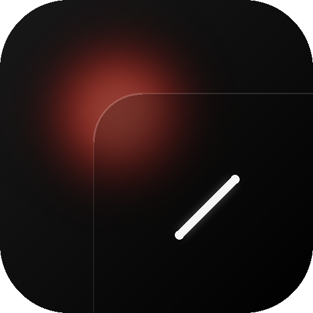

  
  <h1>PAC Barinas</h1>
  
<b>Cronogramas eléctricos y reportes comunitarios para Barinas</b>

Aplicación Android y plataforma web para consultar el Plan de Administración de Carga, relacionar sectores con bloques y colaborar mediante reportes del estado eléctrico.

**Estado documentado:** 21 de octubre de 2026. Android **1.4.0 / versionCode 8**, Android7.0/API24 o superior. La revisión de publicidad y preparación de APK release/AAB figura en la guía de publicación; no se publica automáticamente en Google Play.

## Documentación

- [Documentación actual del sistema](DOCUMENTACION_SISTEMA.md): arquitectura, capacidades reales, datos, distribución y pendientes.
- [Manual detallado del código](DOCUMENTACION_CODIGO.md): guía de aprendizaje y siete capítulos, con explicación por archivo/función, flujos, contratos y mantenimiento.
- [Release 1.4.0](docs/RELEASE_1.4.0.md): anuncios de navegación/apertura, firma, APK/AAB y comprobaciones de publicación.
- [Índice de funciones](docs/codigo/07-indice-funciones.md): nombres, archivos y líneas para encontrar cada declaración.
- [Análisis técnico previo](ANALISIS_SISTEMA_PAC_BARINAS_2026-10-15.md): hallazgos y prioridades que motivaron la actualización documental.
- [Mapa, anuncios y sincronización](docs/CAMBIOS_MAPA_ANUNCIOS_Y_SINCRONIZACION.md): correcciones actuales y límites de distribución.
- [Operación del gateway](docs/OPERACION_GATEWAY_SUPABASE.md): rutas compatibles, cuotas y servidor.
- [Cambios de seguridad y alertas](docs/CAMBIOS_SEGURIDAD_Y_ALERTAS.md): correcciones, pruebas y activación remota.
- [Activación de acceso seguro](docs/ACTIVACION_SEGURIDAD.md): cuenta administradora, RLS y configuración del servidor.

## Componentes

- Android nativo con Kotlin, Jetpack Compose, ViewModel/StateFlow, Room y WorkManager.
- Horarios semanales/mensuales, reglas predictivas heurísticas, perfiles Casa/Trabajo, mapas, alertas locales y widget.
- Supabase para datos y cambios Realtime.
- Portal público React/Vite, blog, modo TV, páginas informativas y dos implementaciones administrativas actualmente presentes.
- Gateway Supabase para consultas compatibles; Vercel conserva solo el envío administrativo FCM por decisión del titular.

## Límites actuales

La entrega incorpora mapa compartido, fallas irregulares, recompensa opcional de doce horas, apertura publicitaria coordinada, diálogos compactos y sincronización PAC validada. Supabase agrega reportes con fecha original e identidad estable. Persisten diferencias entre paneles, IDs antiguos sin equivalencia revisada y heurísticas predictivas. Los porcentajes no son probabilidades calibradas. Android aún no recibe FCM y el actualizador abre Google Play.

Consultar la documentación antes de utilizar seeds o scripts patch/update: pueden sobrescribir datos o código. Los cambios aplicados y su verificación figuran en el registro de cambios.

## Organización y desarrollo

La raíz es el repositorio Android `Ralag/luz-barinas-android`. La carpeta `admin-web` es otro repositorio, cuyo remoto configurado actualmente es `Ralag/pac-barinas`; está excluida del Git Android.

Abrir la raíz con Android Studio y preparar SDK36, JVM/wrapper compatibles y firma configurada. La web utiliza sus scripts npm dentro de admin-web. Configuración, dependencias, pruebas y procedimientos se explican en [el capítulo de operación](docs/codigo/06-base-de-datos-configuracion-y-operacion.md).

## Créditos

- **Ideación y concepción:** [ElMatrushka](https://www.facebook.com/elmatrushka.bv/).
- **Desarrollo y arquitectura:** Ing. Jorluis.
- **Colaboración ciudadana:** comunidad de Barinas.
