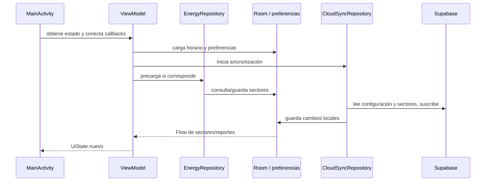

# 01. Cómo entender y seguir el código

**Objetivo:** que puedas recorrer una función, entender de dónde vienen sus datos, comprobar su resultado y modificarla sin depender de una explicación externa. Este manual describe el código local al 15 de octubre de 2026; las limitaciones identificadas siguen presentes.

## 1. Orden de aprendizaje

1. Lee la [documentación del sistema](../../DOCUMENTACION_SISTEMA.md) para conocer componentes, estado real y pendientes.
2. Aprende los conceptos de este capítulo y sigue un reporte completo.
3. Lee [datos y motor Android](02-android-datos-y-motor.md) antes de cambiar predicciones, persistencia o sincronización.
4. Lee [interfaz y segundo plano](03-android-interfaz-y-segundo-plano.md) antes de cambiar pantallas, ViewModel, alertas o widget.
5. Usa [web React y API](04-web-react-y-api.md) para las páginas públicas, blog, TV y panel React.
6. Usa [panel clásico](05-panel-clasico.md) para `admin.html` y `public/app.js`.
7. Revisa [base de datos, configuración y operación](06-base-de-datos-configuracion-y-operacion.md) antes de cambiar tablas, versiones o publicar.
8. Busca cualquier declaración en el [índice de funciones](07-indice-funciones.md).

No es necesario memorizar todo. Es necesario saber localizar quién inicia una operación, qué función la ejecuta y dónde se conserva el resultado.

## 2. Diccionario mínimo del proyecto

| Término | Explicación aplicada aquí |
|---|---|
| Función | Operación que recibe parámetros, calcula o produce un efecto y puede devolver un valor. Su nombre no garantiza que su cuerpo esté implementado. |
| Parámetro | Dato entregado al llamar una función. `sectorId` identifica una fila; no es lo mismo que el nombre visible del sector. |
| Retorno | Resultado de una función. `true` solo es confiable si el cuerpo lo devuelve después de verificar el efecto prometido. |
| Efecto | Algo que cambia fuera de un cálculo: escribir una tabla, cambiar una preferencia, enviar una petición o mostrar una notificación. |
| Estado | Datos que describen el momento actual de una pantalla o proceso. Puede vivir solo en memoria o persistirse. |
| Persistencia | Información que sobrevive al cierre: Room, preferencias, localStorage o Supabase. Cada una tiene distinto alcance. |
| Modelo/DTO | Estructura de campos. El modelo de pantalla, la fila local y el JSON remoto pueden usar nombres distintos; el mapeo los relaciona. |
| Repositorio | Puerta de acceso a datos. `EnergyRepository` combina almacenamiento local y operaciones; `CloudSyncRepository` trabaja con la nube. |
| DAO | Interfaz que declara consultas SQL de Room. Room genera el código que las ejecuta. |
| ViewModel | Mantiene el estado y coordina acciones Android sin convertir cada pantalla en responsable de la base de datos. |
| Composable | Función Kotlin que describe interfaz. Puede ejecutarse otra vez cuando cambia el estado; esa recomposición no equivale a que el usuario vuelva a pulsar un botón. |
| Callback/lambda | Función que se entrega a otra para ejecutar después. `onClick` responde a una interacción; no se ejecuta simplemente por nombrarla. |
| Coroutine / suspend | Trabajo Kotlin que puede suspenderse mientras espera. `suspend` no garantiza que algo se ejecute en hilo de fondo: hay que mirar el dispatcher/contexto. |
| Flow / StateFlow | Secuencia de cambios; StateFlow conserva el valor actual. La UI observa y vuelve a representarse. |
| Worker | Tarea que WorkManager agenda para ejecutarse cuando corresponda. Reintentar una tarea no debe duplicar el evento que transporta. |
| Receiver | Punto de entrada Android para eventos como alarma, reinicio o botón de notificación. Puede ejecutarse sin una Activity abierta. |
| React / componente | Función que devuelve una descripción de la página. Recibe props y combina estado, efectos y componentes hijos. |
| Hook | Función React como `useState` o `useEffect`. El primero conserva estado; el segundo conecta efectos con montaje/cambios y puede devolver limpieza. |
| SPA | Aplicación web que puede cambiar de página sin descargar otro HTML; el servidor también debe resolver bien una URL al recargar. |
| API / endpoint | Entrada HTTP a una función de servidor. Importan método, parámetros, autenticación, estado HTTP y cuerpo devuelto. |
| PostgREST | Capa que expone PostgreSQL mediante HTTP; el SDK Supabase construye esas peticiones. |
| Realtime | Eventos de cambios remotos mientras el cliente está conectado y suscrito. No equivale a FCM en una app cerrada. |
| RLS | Reglas de acceso por fila en PostgreSQL. Tenerlo activado no garantiza restricciones si las políticas autorizan a todos. |
| Upsert | Insertar una fila o actualizar la que coincide con la clave de conflicto. No fusiona automáticamente cada propiedad interna de un JSON. |
| Idempotencia | Repetir un envío produce un solo evento lógico, normalmente gracias a un ID único que el servidor reconoce. |
| UTC / epoch | Timestamps en milisegundos representan instantes. America/Caracas se aplica al interpretarlos como fecha/hora local. |
| Build / dist | Resultado generado de compilar. Normalmente se modifica la fuente y se regenera la salida. |
| Seed | Carga inicial de datos; puede introducir ejemplos y sobrescribir valores. No es una lectura ni una sincronización inocua. |

## 3. Cómo leer una ficha de función

Busca primero su nombre exacto en el índice y abre el archivo/línea. Lee parámetros y tipo retornado. Dentro del cuerpo identifica cuatro cosas: validaciones/retornos anticipados, transformación de datos, llamadas a otras funciones y efectos. Por último busca sus llamadores con la búsqueda del editor.

Ejemplo conceptual, sin ejecutarlo:

```kotlin
val reports = pendingDao.getUnsyncedReports()
for (report in reports) {
    val uploaded = cloudSync.uploadCitizenReport(/* campos del reporte */)
    if (uploaded) pendingDao.markAsSynced(report.id)
}
```

La consulta entrega pendientes; el bucle intenta transportarlos; la confirmación local debería corresponder al mismo ID. Después se estudia el caso difícil: ¿qué ocurre si el servidor recibe el evento pero se pierde la respuesta? Sin idempotencia, el siguiente intento puede duplicarlo. El código actual tiene varios caminos de envío y una confirmación por último pendiente que se documentan en el capítulo 02.

En JavaScript hay que distinguir:

```javascript
const { data, error } = await supabase.from('sectors').select('*');
if (error) throw error;
```

`await` espera la promesa, pero no convierte todo error devuelto como dato en excepción. Un `try/catch` sin revisar `error` puede omitir un fallo real. Los capítulos marcan los lugares donde sucede.

## 4. Las cinco capas de almacenamiento

| Lugar | Qué contiene | A quién afecta | Qué lo actualiza |
|---|---|---|---|
| Variables/estado de UI | Pestaña, filtros, diálogos, listas renderizadas | Instancia actual | Callbacks y recolectores/efectos. |
| Room | Sectores locales, historial, reportes pendientes | Ese teléfono | Repositorio, sincronización y worker. |
| SharedPreferences | Ubicación, perfiles, temas, horario y alarmas | Ese teléfono | ViewModel, ajustes y repositorio de horario. |
| localStorage | Bandera de panel, preferencias web y overrides | Ese navegador/origen | Panel o componentes web. |
| Supabase | Configuración común, sectores, propuestas, reportes | Clientes del proyecto | Escrituras de panel, app y scripts, según permisos. |

Una acción puede afectar solo una capa. Un sector añadido al estado React puede desaparecer al recargar; ocultarlo en localStorage no lo elimina para otros; guardarlo en Room no confirma que llegó a Supabase. Para diagnosticar, comprobar cada capa de la ruta en orden.

## 5. Flujo Android desde cero



`MainActivity` es la entrada visual; no todas las clases con nombre Screen están montadas allí. Actualmente las pestañas principales son Hoy, Horarios y Mapa. Ajustes/legales/diálogos se abren como estados adicionales. `AdminScreen` y `TelemetryScreen` existen en fuente, pero no son pestañas principales en esa navegación.

Al volver del fondo o arrancar un receiver, no se puede suponer que el ViewModel ya existe. Ese es el motivo del defecto de carga de horarios persistidos en tareas de fondo.

## 6. Seguir un reporte ciudadano

1. Desde **Dashboard**, el callback pasa al ViewModel y este delega en `EnergyRepository.submitReport`. Se inserta `PendingReportEntity`, se ajusta el estado local, se encola trabajo conectado y se intenta además el envío inmediato.
2. Desde una **notificación**, `NotificationActionReceiver` escribe Room, aplica su cambio optimista y encola WorkManager directamente. No pasa por ViewModel/repositorio ni realiza el mismo intento inmediato.
3. Desde el **widget**, `ReportPowerActionCallback` también escribe y encola directamente. Actualmente utiliza un sector fijo, con independencia de la ubicación elegida.
4. Los caminos convergen en pendientes locales y en el envío del worker. El usuario puede asimismo forzar la sincronización desde la app.
5. `CloudSyncRepository.uploadCitizenReport` construye DTO y hace INSERT remoto.
6. El código intenta marcar un pendiente como sincronizado.
7. La web consulta/recibe cambios y representa el reporte.

Los pasos describen lo implementado, con fallos: el ID original no se utiliza correctamente en una confirmación, la fecha remota se sustituye por la de envío y varias rutas pueden insertar el mismo evento. La llegada de un reporte tampoco implica que un trigger remoto recalculó todos los porcentajes: no se encontró ese trigger en los SQL entregados.

Para comprobar un cambio, seguir el mismo evento por su ID y fecha, no solo por el texto de la alerta. Si todavía no tiene un ID compartido, esa ausencia forma parte del problema a corregir.

## 7. Seguir un cambio de cronograma

1. Elegir cuál panel está en uso: clásico o React. Sus persistencias no son equivalentes.
2. La edición altera memoria local del navegador.
3. El panel publica un JSON en `app_config` con clave `pac_schedule`.
4. Android lo lee o recibe el evento Realtime y aplica slots/matriz/listas presentes.
5. Guarda preferencias y emite señal para actualizar el ViewModel.
6. La pantalla reconstruye el horario/predicción.

Hay tres resultados que deben comprobarse por separado: escritura en nube, actualización de pantalla y reprogramación de alarmas. Una alerta de «publicado» no es un acuse de cada teléfono. El React actual omite listas `sectorsA-D` al reemplazar el JSON; el Android tiene una función de publicación que devuelve true sin escribir; los cambios remotos no garantizan por sí mismos rearmado inmediato de alarmas.

## 8. Seguir una página web

`index.html` contiene el contenedor. `src/main.jsx` monta React. `App` interpreta pathname, conserva ruta en estado y selecciona la página, cargando varias con lazy/Suspense. `navigate` cambia history y estado. Atrás/adelante dispara popstate. Para una recarga, Vercel decide qué archivo entregar antes de que React se ejecute.

Esto explica el caso `/admin`: la navegación interna puede montar `AdminPortal`, mientras el rewrite entrega `admin.html` al abrir la URL. También explica el blog: un plugin de build genera HTML por slug para metadatos y buscadores, además de la navegación React.

Los componentes de telemetría consultan Supabase y hacen refrescos. Sus timers/effects necesitan limpieza al desmontar. Las API en `api/` se ejecutan en servidor; iniciar solo Vite no equivale a tener esas funciones disponibles localmente.

## 9. Regla del PAC que realmente implementa el código

Una fila identifica una franja y una columna un día. Los bloques son letras, `-` indica sin corte. El desplazamiento mensual es 0 para días1–7, 1 para8–14, 2 para15–21 y3 para22–fin. Se aplica al índice de fila y reinicia al cambiar mes. No debe describirse como una rotación continua independiente de la fecha.

Para una franja23–03, el final pertenece al día siguiente. Las alarmas Android ya revisan el inicio de ayer mediante findScheduledWindowForBlock: devuelve null sin programación, usa Caracas y excluye el instante final. PacBlock.normalize valida el bloque completo y PacAlertTargetResolver.resolve obtiene la asignación del perfil activo de Room. findNextWindowForBlock conserva un respaldo predictivo y no se usa para alarmas. Queda unificar web/API.

El ajuste ciudadano cuenta reportes sin luz por hora y puede mover el próximo inicio al pico detectado. Los porcentajes actuales provienen de reglas; para convertirlos en probabilidades hace falta medir aciertos sobre datos independientes.

## 10. Cómo abordar una modificación

| Lo que quieres cambiar | Archivos/capas que debes seguir |
|---|---|
| Texto o disposición de pantalla Android | Composable concreto, sus props/callbacks y recursos si el texto está allí. |
| Comportamiento de un botón | Callback → ViewModel → repositorio → DAO/nube; no basta editar el rótulo. |
| Campo de un reporte | Modelo dominio, entidad/migración Room, DAO si aplica, worker/input, DTO Supabase, SQL, feeds y pruebas. |
| Horario/rotación | PacSchedule, preferencias, paneles, funciones API, vistas mensuales, scheduler y pruebas temporales. |
| Página pública | App/ruta, página/componentes, Navbar/Footer, SEO y configuración de recarga. |
| Artículo | Módulo de artículo, registro de artículos, navegación y prerender de build. |
| Tema TV | TvKioskMode, props compartidas, tema específico, controles/persistencia. |
| Roles administrativos | Login real, API, grants/policies y pruebas de permitir/denegar; ocultar botones es insuficiente. |
| Versión Android | Gradle, artefacto firmado, canal de distribución y detector de actualización. |

Trabaja con un cambio verificable cada vez. Antes de tocar una regla, escribe el caso concreto y el resultado esperado. Tras modificar, revisa datos persistidos, estado visible y comportamiento al reiniciar/sin conexión. No vuelvas a ejecutar seeds o scripts de reemplazo para «probar» una lectura.

## 11. Cómo actualizar este manual

Después de cambiar una función, actualiza la ficha de su capítulo y regenera el índice con:

```powershell
node docs/codigo/herramientas/inventario.mjs
```

El inventario lee fuentes y analiza sintaxis; no ejecuta sus operaciones. Usa el parser Rolldown ya instalado en el proyecto web. Los cambios de firma, retorno, tabla o callback deben actualizarse también en los capítulos que describen al llamador. La comprobación automática detecta nombres ausentes; una revisión humana sigue siendo necesaria para validar el significado de la explicación.
