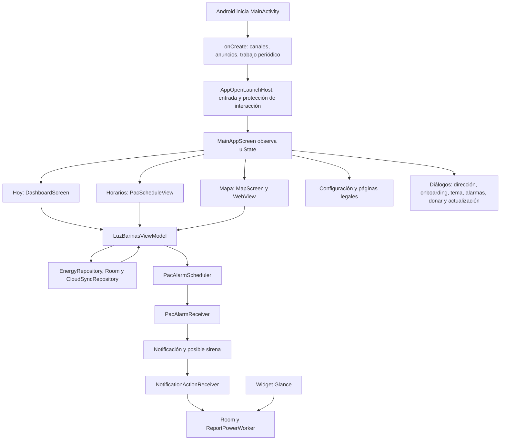

# 03. Android: interfaz, estado, notificaciones y segundo plano

Revisión del código local: 16 de octubre de 2026. Este capítulo explica cómo mantener la aplicación que está en el repositorio. Describe lo que hace el código, incluso cuando su comportamiento difiere del texto mostrado al usuario. No acredita la versión instalada en los teléfonos ni la configuración del servidor. Este capítulo incluye la corrección de enrutamiento/horarios de alertas y no reproduce credenciales.

## Cómo leer este capítulo

El directorio base de las referencias Kotlin es `E:\LUZ BARINAS\app\src\main\java\com\example`. Una referencia `L180` sirve como orientación en la revisión enlazada; las posiciones y firmas vigentes del código local se consultan en el [índice 07](07-indice-funciones.md). Las explicaciones de este capítulo describen la implementación actual, incluidos overrides y JavaScript propio del mapa. Los bloques anónimos se explican con su función contenedora: no tienen un nombre adicional que pueda buscarse en Kotlin.

Las funciones `@Composable` aquí descritas retornan `Unit`: su resultado es una descripción de interfaz que Compose dibuja. Los callbacks como `(Sector) -> Unit` representan una acción que el padre entrega al componente. No equivalen a una escritura en servidor: hay que seguir el callback hasta el ViewModel y después hasta el repositorio. El capítulo [02, datos y motor](02-android-datos-y-motor.md) explica la implementación interna de esos repositorios, modelos y utilidades.

## 1. Las piezas y el recorrido del usuario

La navegación principal sí monta tres pestañas: índice `0` Hoy, `1` Horarios y `2` Mapa. La pantalla de configuración aparece superpuesta mediante un booleano local y desde ella se abren los textos legales. No hay `NavHost`, rutas de navegación ni pila de destinos declarada: la navegación depende de `currentTab` y de estados `remember`.

`AdminScreen` y `TelemetryScreen` existen, pero no se invocan desde la navegación actual de `MainActivity`. Tampoco abrir `isAdminOpen` las monta automáticamente. Las acciones administrativas del ViewModel siguen presentes para esos componentes, posibles pruebas o una futura reconexión. No debe confundirse código existente con un recorrido accesible al usuario. El intersticial utiliza puertas de consentimiento, recompensa y frecuencia; su uso depende de una transición natural explícita de navegación, nunca de iniciar la app.

## 2. Aprender a leer Compose con este proyecto

Una pantalla es una función de sus datos actuales: `DashboardScreen(selectedSector = ...)` vuelve a evaluarse cuando cambian los estados que lee. Los eventos suben mediante callbacks; los nuevos datos bajan desde `uiState`. Este patrón permite cambiar una tarjeta sin que ella conozca Supabase. `remember` conserva un objeto mientras su posición permanece en la composición; por sí solo no conserva un formulario tras recrear la actividad. Los flujos se convierten en estado mediante `collectAsStateWithLifecycle()`. Véase la [guía oficial de estado de Compose](https://developer.android.com/develop/ui/compose/state).

En estos archivos, las herramientas recurrentes tienen las siguientes responsabilidades:

| Construcción | Cómo reconocerla y mantenerla aquí |
|---|---|
| `remember { mutableStateOf(...) }` y delegación `by` | Estado de formulario, pestaña interna o diálogo. Asignar la variable provoca la actualización de lectores; cambiar una lista común por dentro puede no hacerlo. |
| `remember(claves)` | Resultado calculado que se reutiliza mientras sus claves no cambien. Hay que incluir todas las dependencias, especialmente tiempo, versión del PAC y selección. |
| `StateFlow`, `_uiState.update { it.copy(...) }` | El ViewModel publica copias del estado; la UI no escribe directamente en el flujo público. |
| `LaunchedEffect(claves)` | Trabajo ligado a la composición, por ejemplo búsqueda con demora o actualización del reloj. Cambiar las claves cancela el trabajo anterior y crea otro. |
| `DisposableEffect` / `onDispose` | Limpieza de WebView, anuncios o sonido cuando el componente sale de composición. |
| `viewModelScope.launch` | Trabajo asíncrono asociado al ViewModel. Una función de acción retorna antes de que termine la petición. |
| `rememberCoroutineScope()` | Corutinas de un componente: demostración de sonido y botón de actualización. |
| `Scaffold` | Distribuye barra superior, navegación inferior, botón flotante, snackbar y contenido con `innerPadding`. |
| `LazyColumn` / `LazyRow` | Listas que componen los elementos necesarios. Las claves por ID ayudan a mantener identidad de filas. |
| `Column`, `Row`, `Box`, `Surface`, `Card` | Agrupan, alinean, superponen y dan superficie visual; no persisten datos. |
| `Modifier` | Tamaño, relleno, semántica, etiquetas de prueba, fondo y acciones táctiles. El orden de sus operaciones afecta el área que se dibuja o recibe toques. |
| `AnimatedVisibility`, `AnimatedContent`, `Crossfade` | Cambian presentación y transición. No añaden persistencia ni una pila de navegación. |
| `AndroidView` | Integra componentes Android clásicos: WebView y AdView. Sus callbacks `factory` y `update` tienen ciclos distintos. |

Los efectos deben mantenerse fuera del dibujo ordinario para evitar repetir escrituras al recomponer. La [guía oficial de efectos](https://developer.android.com/develop/ui/compose/side-effects) explica las claves y cancelaciones. En este proyecto hay estados temporales recordados que no se refrescan al cambiar preferencias externamente; al mantenerlos, revisar si el valor debe observarse o recargarse al volver.

## 3. Entrada y navegación: MainActivity.kt

Fuente: [MainActivity.kt](https://github.com/Ralag/luz-barinas-android/blob/d3889c9577a9ea779bdebd5b13a4b20d7c7dcbf7/app/src/main/java/com/example/MainActivity.kt).

### `MainActivity.onCreate(savedInstanceState: Bundle?): Unit` — L85

`onCreate` restaura la generación publicitaria guardada, crea canales de notificación, inicia UMP/AdMob y programa la comprobación predictiva periódica. `setContent` observa el ViewModel, resuelve tema y escala y monta `AppOpenLaunchHost`. El host espera la entrada inicial antes de componer `MainAppScreen`; una vez montada, conserva esa pantalla incluso durante las compuertas de regreso. Su estado guardable evita repetir la entrada por una simple recomposición o recreación.

`onStop` registra el instante monotónico de salida y precarga apertura si no se está mostrando otro anuncio y no es un cambio de configuración. `onStart` solicita una nueva generación solo al regresar después de al menos cinco minutos, con elegibilidad publicitaria y sin edición, diálogo o alarma protegida; el gestor exige además diez minutos desde la última apertura publicitaria. El host la superpone conservando los estados de la pantalla. `onSaveInstanceState` guarda la generación para que una rotación no produzca otra apertura. Cerrar un anuncio no se interpreta como volver a abrir la app. No existe ya un Handler de dos segundos que intente mostrar sobre la navegación.

El tema mantiene la escala elegida por el usuario. En una entrada normal, `MainAppScreen` solo empieza después de continuar desde el gate; una alarma activa omite esa espera. La app no solicita permisos ni abre automáticamente selección de dirección detrás de la pantalla de entrada. En retornos posteriores la pantalla sigue montada, de modo que el host conserva los formularios recordados.

### `MainAppScreen(viewModel: LuzBarinasViewModel): Unit` — L136

La invoca `onCreate`. Lee `uiState` y `PacAlarmPlayer.isPlayingFlow`; mantiene en `remember` snackbar, varios booleanos de diálogos/configuración y la versión de actualización descartada. Son estados de esa composición, no preferencias permanentes.

| Bloque/callback | Qué hace y qué cambia |
|---|---|
| Permiso de notificaciones | Ya no se solicita automáticamente al montar MainAppScreen. Se ofrece desde la bienvenida al activar alertas. |
| `LaunchedEffect(uiState.userMessage)`, L159 | Muestra el mensaje en snackbar y luego llama a `clearUserMessage()`. El mensaje no debe consumirse antes de que termine la presentación. |
| `currentBlock` | Usa `PacBlock.normalize` para obtener código válido de la selección. Sin sector/código válido queda vacío, sin elegir A por defecto. |
| `LaunchedEffect(uiState.selectedSector)`, L176 | Solicita reprogramar alarmas al cambiar el objeto de sector seleccionado. No tiene `scheduleVersion` como clave independiente. |
| `PacSettingsDialog`, L181 | Recibe el bloque calculado y `userAddress` como nombre; cierra cambiando `isSettingsOpen`. |
| `ThemeSettingsDialog`, L189 | Recibe modo/paleta/escala y conecta su callback con `viewModel.updateTheme(...)`. |
| `OnboardingFlowDialog`, L204 | Se abre si el onboarding está pendiente y la dirección no está abierta. Completarlo guarda onboarding_done y abre la dirección; omitir guarda la elección y permite continuar. |
| `BarinasAddressDialog`, L212 | Se abre por solicitud explícita o al completar la configuración de ubicación. Elegir llama a `setUserLocation`; registrar llama a `registerCommunityLocation`; cerrar llama a `setOnboardingOpen(false)`. |
| `DonationsDialog`, L230 | Lee `donationConfig` remoto del estado; cerrar solo oculta el diálogo. |
| Actualización, L237–256 | Usa `updateAvailable`, una versión descartada y una apertura manual. Si se fuerza sin actualización remota, construye información de la versión actual. El título del diálogo sigue diciendo que existe nueva actualización. |
| `BackHandler`, L260 | Si la pestaña no es Hoy, vuelve a `0`. `SettingsScreen` añade su propio manejador al estar montada. |
| Botón flotante, L305 | Solo aparece mientras la sirena está marcada como activa. Llama a `PacAlarmPlayer.stopAlarm(context)`. |

En pantallas de más de 600 dp se usa `NavigationRail`; en las demás se monta navegación inferior y un banner publicitario. Ambas navegaciones escriben únicamente `setTab(0/1/2)`. La barra superior ofrece Donar, paleta y Configuración. El `Crossfade` de L481 elige el contenido:

| Tab | Datos que recibe | Eventos conectados |
|---|---|---|
| Hoy / `DashboardScreen`, L487 | Sectores, selección, dirección, predicción, pendientes, aviso, perfil y existencia de trabajo. | Cambiar perfil→`switchProfile`; cerrar aviso→`dismissBroadcastNotice`; selección→`selectSector`; reporte→`reportPowerStatus`; dirección/alertas→abrir diálogo; horarios→tab 1. |
| Horarios / `PacScheduleView`, L506 | Selección, copia de matriz y franjas de `uiState`. | Pulsar nombre→`selectSectorByName` y volver a Hoy, aunque la búsqueda no encuentre coincidencia. |
| Mapa / `MapScreen`, L515 | Sectores, selección y filtro. | Selección→`selectSector`; filtro→`setFilter`; reporte rápido→`reportPowerStatus` sin observación. |

La configuración se dibuja encima de la estructura principal en `AnimatedVisibility` L531. Sus eventos conectan tema, dirección, reabrir bienvenida, alarmas, actualización y donaciones. No se monta `AdminScreen`, `TelemetryScreen` ni una pantalla especial por `isAdminOpen`. Cambiar `currentTab` a un valor distinto de 0/1/2 deja el `when` sin contenido; `setTab` no valida ese rango.

## 4. ViewModel: el intermediario entre pantallas y datos

Fuente: [LuzBarinasViewModel.kt](https://github.com/Ralag/luz-barinas-android/blob/d3889c9577a9ea779bdebd5b13a4b20d7c7dcbf7/app/src/main/java/com/example/ui/viewmodel/LuzBarinasViewModel.kt).

### Modelos de estado y creación

`LuzBarinasUiState` (L28) es una `data class`: agrupa catálogo/selección/dirección, onboarding, predicción, pendientes e historial, filtro/tab/carga/mensajes, modo de simulación, datos administrativos de matriz/franjas/listas A–D, aviso, actualización, donación, perfiles y personalización visual. `isBlackoutSimulationMode`, `isAdminOpen`, `donationUrl` y otras propiedades presentes no implican una UI activa que las consuma. Las listas del PAC son copias para provocar actualizaciones de estado; la lógica también lee el singleton `PacScheduleData`.

`AppUpdateInfo` (L62) contiene `versionCode: Int`, `versionName: String`, `releaseNotes: String`, `downloadUrl: String` y `isMandatory: Boolean`. Es un dato de presentación, no un instalador.

`LuzBarinasViewModel(application: Application)` (L70) crea `EnergyRepository`, abre las preferencias `luz_barinas_user_prefs` y publica `StateFlow` de solo lectura. El estado inicial lee dirección, perfil, existencia de trabajo, modo, paleta y escala, y marca carga. `isDarkMode` comienza con su default y no se deriva en esa construcción de `themeMode`/sistema; algunos componentes pueden usar una bandera distinta al esquema real del tema.

El bloque `init` no es una función invocable separada. Carga el PAC persistido antes de tomar sus copias; una corutina prepara/migra el catálogo local y después inicia sincronización remota. También crea los colectores:

| Colector | Actualización y efecto |
|---|---|
| Sectores Room | Reemplaza catálogo y resuelve solo ID del perfil activo; Casa admite ID general heredado. Ya no elige Alto Barinas I ni primer elemento como selección implícita. Sin coincidencia deja selección nula; quita carga. Si cambia ID escuchado recalcula/conecta sector. |
| Pendientes, L137 | Copia el contador a `unsyncedReportsCount`. |
| Reportes locales, L144 | Copia el listado a `recentReports`; es historial del dispositivo, no una descarga del feed global. |
| Actualización del PAC | Reconstruye matriz, franjas, asignaciones y versión desde un snapshot coherente y recalcula predicción. El rearmado remoto se solicita en `CloudSyncRepository` después de aplicar y guardar el horario; este colector no lo duplica. |
| Avisos, L159 | Publica `activeBroadcastNotice`. |
| Versión remota, L166 | Publica `updateAvailable`. |
| Donaciones, L173 | Publica `donationConfig`. |

### Acciones de selección y presentación

Todas las siguientes funciones retornan `Unit`, salvo la constructora privada de copias indicada. Cuando lanzan una corutina, ese retorno no confirma la finalización del trabajo.

| Función exacta / línea | Parámetros, pasos y estado | Llamador y efectos que debe tener presentes quien mantiene |
|---|---|---|
| `selectSector` | `sector: Sector` → Unit. Cancela alarmas/avisos/sirena anteriores; normaliza con `PacBlock.normalize`; guarda IDs/dirección/código en claves generales y del perfil, actualiza estado/predicción/suscripción y rearma. Un bloque inválido elimina sus preferencias de código y no genera alarma. | Buscador/mapa y llamadas de selección/perfil. |
| `switchProfile` | `profile: String` → Unit. Admite solo home/work y cambios efectivos. Conserva identidad/dirección/bloque del perfil anterior, cancela alertas previas, guarda el perfil nuevo y resuelve su ID/dirección. Limpia selección/predicción si no está configurado; si existe sector llama selectSector y restaura dirección específica. | Botones Casa/Trabajo. Trabajo sin configurar ya no conserva ni alerta Casa. |
| `selectSectorByName` L238 | `name: String`. Encuentra primera coincidencia por inclusión del nombre en cualquiera de los dos sentidos, sin distinguir mayúsculas; delega a `selectSector`. | Lista de circuitos en Horarios. No informa si falta coincidencia y puede emparejar un nombre parcial ambiguo. |
| `setFilter` L247 | `status: ServiceStatus?`. Copia `activeFilter`. `null` significa todos. | Chips de Mapa; no cambia la selección ni consulta servidor. |
| `setTab` L251 | `index: Int`. Copia `currentTab`. | Navegación y retorno desde horarios; no persiste ni valida el índice. |
| `toggleDarkMode` L255 | Sin parámetros. Alterna hacia `light` si el modo es `dark`, hacia `dark` en cualquier otro caso; llama a `updateTheme`. | Configuración. Desde `system` siempre pasa a oscuro, aunque el sistema ya estuviera oscuro. |
| `updateTheme` L261 | `themeMode: String? = null`, `colorSchemeName: String? = null`, `visualScale: Float? = null`. Solo actualiza y persiste los campos no nulos; modo también cambia `isDarkMode` a comparación con `dark`. Aplica editor y publica copia. | Diálogo de tema/toggle. No valida strings ni acota escala; `system` no sincroniza esa bandera con el tema del teléfono. |
| `setOnboardingOpen` L504 | `isOpen: Boolean`. Cambia el booleano del estado. | Cierre de dirección y reinicio desde Ajustes; no cambia por sí misma `onboarding_done`. |
| `dismissBroadcastNotice` L571 | Sin parámetros. Pone el aviso activo en `null`. | Cerrar banner. No elimina el aviso remoto ni persiste descarte; puede reaparecer con un evento posterior. |
| `clearUserMessage` L575 | Sin parámetros. Pone `userMessage = null`. | Efecto del snackbar en `MainAppScreen`. |

### Reportes, comunidad y predicción

**`reportPowerStatus` L281.** Recibe `hasPower: Boolean`, `reportType: String` derivado por defecto, `voltage: Float?` con 118/0 por defecto y `observation: String? = null`. Sale si no hay selección. Captura el sector y llama asíncronamente a `repository.submitReport` con ID/nombre y el evento. Si tiene éxito, construye un mensaje para NORMAL, FALLA_IRREGULAR u otro y recalcula predicción; si falla, muestra texto de cola offline. La función no distingue con precisión confirmación remota de guardado local: la semántica real depende del `Result` del repositorio. La llaman reportes de Hoy y Mapa. El texto NORMAL dice 118 V aunque el parámetro pudiera ser distinto.

**`syncPendingReportsNow` L319.** Sin parámetros; en una corutina marca carga, obtiene el número sincronizado del repositorio y quita carga con mensaje. Cero reúne “sin conexión” y “sin pendientes”, dos estados distintos. Está prevista para `TelemetryScreen`; esa pantalla no está montada por la actividad actual.

**`triggerPushAlertSimulation` L336.** Sin parámetros; requiere selección y crea una notificación interactiva local con `NotificationHelper.showInteractiveOutageAlert`, más un mensaje. No llama a un servicio FCM ni envía a otros teléfonos. No aparece conectada a la navegación actual.

**`registerCommunityLocation`** recibe nombre/municipio/parroquia/bloque/circuito; en coroutine guarda por repositorio y, ante éxito, crea dirección temporal de catálogo y llama setUserLocation. La petición remota actual es solo INSERT de propuesta pendiente; no publica un sector común desde Android. Persiste el límite de que el repositorio ignora el Boolean del envío: el mensaje de sincronización no es un comprobante remoto y sigue pendiente una outbox comunitaria.

**`setUserLocation`** recibe dirección, cancela alertas anteriores y resuelve sector por ID o nombre exacto sin distinguir mayúsculas. Ya no elige arbitrariamente el primer sector del bloque ni la selección anterior. Normaliza bloque del sector real si existe, o etiqueta de la dirección mientras llega su fila; guarda IDs/dirección/código general y del perfil, onboarding y estado. Una fila aún no presente deja selección/predicción nulas; el flujo Room podrá resolver el ID guardado después. Recalcula/escucha si encontró sector y solicita rearmado. El resolver de alarmas exige fila Room y código válido, por lo que no alerta sobre un fallback geográfico inventado. Sin GPS ni escritura remota propia.

**`refreshPrediction` L579.** Privada; `sectorId: String`; lanza consulta a `repository.getPredictionForSector` y publica `prediction`. La llaman selección, recolector de sectores y cambios PAC/reportes. No compara el ID al terminar: dos consultas concurrentes pueden devolver resultados en orden distinto a la selección vigente. No debe hacerse una petición bloqueante desde un composable para sustituirla.

**`onCleared` L586.** Override sin argumentos; llama a `super` y detiene sincronización remota. Lo llama el propietario del ViewModel cuando lo retira, no cada vez que una pestaña deja de verse.

### Edición del PAC y funciones administrativas presentes

`buildPacStateCopy(userMsg: String? = null, current: LuzBarinasUiState = _uiState.value): LuzBarinasUiState` es privada. Obtiene un snapshot coherente del singleton y retorna una copia de `current` con versión, matriz, franjas y listas A–D; mantiene el mensaje anterior si no se proporciona uno. El colector remoto le entrega el estado de la actualización atómica para conservar cambios concurrentes. No guarda ni publica. La usan ese colector y las acciones de edición.

El patrón común de edición es **mutar PAC → guardar preferencias → solicitar rearmado de alarmas → publicar snapshots UI → recalcular predicción → lanzar publicación remota**. La última función sigue siendo stub sin escritura; el rearmado sí utiliza el horario local persistido y cancela lo previo. Los callbacks están destinados a AdminScreen, aún sin montaje principal.

| Función / línea | Entrada y operación específica |
|---|---|
| `setAdminOpen` L365 | `isOpen: Boolean`; solo cambia `isAdminOpen`; no autentica ni abre una pantalla por sí misma. |
| `updateMatrixCell` L369 | `slotIdx: Int`, `dayIdx: Int`, `block: String`; llama `updateCell` y ejecuta el patrón común. |
| `updateSlot` L377 | Índice, `newLabel: String`, `startHour: Int`, `endHour: Int`; modifica la franja y ejecuta el patrón común. |
| `deleteSlot` L385 | `slotIdx: Int`; solo persiste/refresca/publica si `deleteSlot` del modelo devuelve verdadero; añade mensaje de eliminación. |
| `addSlot` L395 | `label: String`, inicio y fin enteros; añade franja y mensaje, después patrón común. |
| `addSectorToBlock` L403 | `sectorName: String`, `blockCode: String`; modifica listas por nombre y mensaje de asignación. No crea por sí misma una fila `SectorEntity`. |
| `removeSectorFromBlock` L411 | Nombre y código; retira nombre de una lista, guarda y anuncia. No borra una fila de Supabase. |
| `reassignSector` L419 | Nombre y `targetBlock: String`; delega traslado entre listas, guarda y anuncia. |
| `applyDoubleTurnPreset` L427 | Sin parámetros; aplica preset de doble turno y mensaje de 8 h; guarda/refresca/publica. |
| `applySingleTurnPreset` L437 | Sin parámetros; preset de un turno y mensaje de 4 h; mismo patrón. |
| `resetScheduleToDefault` L447 | Sin parámetros; delega directamente a `applyDoubleTurnPreset`, por lo que restaurar significa ese preset. |
| `deleteTurnAndRebalance` L451 | Índice de franja y día; guarda el resultado del rebalanceo en `lastRebalanceResult` y su explicación en mensaje, más patrón común. |
| `publishScheduleNotification` L550 | Sin parámetros; exige selección, lanza publicación, muestra **localmente** una notificación interactiva y anuncia sincronización sin esperar/comprobar el resultado. No implementa difusión masiva entre dispositivos. |

### Preferencias compartidas y perfiles

En `luz_barinas_user_prefs`, IDs generales y `profile_home_*`/`profile_work_*` se mantienen junto a `active_profile`. Selección guarda ID/dirección/bloque del perfil y variantes generales. `PacAlertTargetResolver` usa identidad de perfil y el bloque Room como fuente; repara variantes antiguas corruptas y migra identidad Casa heredada. Trabajo sin ID no hereda la selección global. Cambiar una preferencia aislada no equivale a seleccionar perfil/sector correctamente.

Las preferencias del PAC y alertas son otros almacenes manejados por `PacSchedulePrefs`/`PacAlertPrefs`. No asumir que cambiar un booleano UI las escribe: cada función anterior indica expresamente cuándo ocurre. Casa/Trabajo no son cuentas remotas, sino dos configuraciones locales. El widget actual no consulta ninguna de las dos.

## 5. Pantallas visibles y componentes de horarios

### DashboardScreen.kt

Fuente: [DashboardScreen.kt](https://github.com/Ralag/luz-barinas-android/blob/d3889c9577a9ea779bdebd5b13a4b20d7c7dcbf7/app/src/main/java/com/example/ui/screens/DashboardScreen.kt).

**`DashboardScreen`** recibe `sectors`, `selectedSector`, dirección opcional, `prediction`, `unsyncedCount`, aviso opcional, perfil/existencia de trabajo, callbacks de perfil, aviso, selección, reporte de cuatro argumentos, dirección, horarios, alarma y tutorial opcional, más `modifier` y `scheduleVersion`. Retorna `Unit`. La monta Hoy. No escribe Room: todas las acciones durables salen por callbacks. `unsyncedCount` está en la firma pero no se dibuja aquí como tarjeta de sincronización.

Mantiene feedback de reporte, texto de observación y su apertura; normaliza bloque con `PacBlock.normalize`, sin A por defecto. Un `LaunchedEffect(Unit)` espera diez segundos repetidamente y publica la clave del minuto; con ella crea `Calendar` en `America/Caracas`. `scheduleVersion` invalida el snapshot y las ventanas recordadas al publicar un cronograma. `findScheduledWindowForBlock` resuelve el turno activo y el siguiente con las franjas publicadas, incluidos los cruces de medianoche. La banda principal describe el estado comunitario guardado: normal, sin luz, falla irregular o desconocido; su texto secundario muestra por separado la franja PAC activa o siguiente. Un corte previsto no convierte por sí mismo un reporte normal en un corte observado, y un estado desconocido no se presenta como corte programado.

| Elemento visual | Dato y comportamiento |
|---|---|
| Aviso superior L174 | Si hay aviso, dibuja `BroadcastNoticeBanner`; cerrar llama al padre. |
| Búsqueda L185 | `GoogleSearchBar` recibe sectores y selecciona uno por callback. |
| Casa/Trabajo L194 | Si existe trabajo, dos botones llaman `onSwitchProfile`; si no, “Agregar” cambia a trabajo y abre dirección. |
| Tarjeta de hoy L250 | Nombre de selección o dirección, distintivo comunitario/PAC, circuito, bloque y “Cambiar”. El nombre dispone de todo el ancho y hasta dos líneas con elipsis; circuito hasta dos líneas y chips se ajustan con `FlowRow`. |
| Banda de estado | Texto y color se derivan del estado comunitario: verde para normal, rojo para sin luz, morado para falla irregular y neutro para desconocido. La descripción accesible usa ese mismo texto. Debajo muestra la referencia PAC activa o siguiente, sin afirmar que sea una medición eléctrica. |
| Cronograma diario | Recorre todas las franjas del snapshot y aplica la rotación correspondiente a la fecha Caracas. AHORA identifica solo una franja que haya comenzado hoy; el turno nocturno de ayer se explica en la referencia PAC superior. “Ver más” llama a navegación. |
| Acceso a alertas L559 | Lee `PacAlertPrefs` con `remember`; muestra modo/anticipación y abre diálogo. Ese recuerdo no observa automáticamente cambios de preferencias. |
| Reportes | Con Luz→`true,NORMAL,null,obs`; Sin Luz→`false,SIN_LUZ,0f,obs`; Falla→`false,FALLA_IRREGULAR,0f,obs` con descripción de respaldo. El reporte normal de un toque no inventa una tensión observada. Limpia texto/cierra observación y muestra agradecimiento inmediatamente. |
| Observación L728 | Toggle, cuatro sugerencias que sustituyen el texto y campo libre; no hay medición de voltaje ni validación de veracidad. |
| Atajo y pie L823/L839 | Abre horarios y muestra independencia del proyecto/fuentes; es texto local. |

Si `onWatchTutorial` tiene valor aparece un acceso adicional al tutorial. Sin destino configurado no se dibuja un botón inactivo. Los botones de perfil utilizan al menos 48 dp de alto.

**`BroadcastNoticeBanner` L876** recibe `notice: BroadcastNotice`, `onDismiss: () -> Unit` y `modifier`; la llama Dashboard. Retorna `Unit`, no persiste. Compara nivel ignorando mayúsculas y muestra etiqueta/fondo/borde rojo para EMERGENCY, ámbar para WARNING y azul para información; muestra título, mensaje si no está vacío y botón cerrar. Los datos vienen de la configuración recibida por el ViewModel; el aspecto de emergencia no demuestra la procedencia del aviso.

### PacScheduleView.kt

Fuente: [PacScheduleView.kt](https://github.com/Ralag/luz-barinas-android/blob/d3889c9577a9ea779bdebd5b13a4b20d7c7dcbf7/app/src/main/java/com/example/ui/components/PacScheduleView.kt).

**`PacScheduleView`.** Entradas: selección nullable, `modifier`, `onSectorClicked: (String) -> Unit` opcional, `pacMatrix: List<List<String>>` y `pacSlots: List<PacSlot>` con copias por defecto. Retorna `Unit`. La monta la pestaña Horarios. Mantiene minuto, día seleccionado, subpestaña y mes seleccionado; obtiene mes/año/día con `Calendar` en `America/Caracas` y actualiza la clave cada diez segundos. El día del mes determina la semana PAC. `weekMatrix` rota la matriz base por esa semana; las semanas mensuales de `getMonthlyWeeks` se recuerdan por mes, cantidad de días, matriz y franjas. Una franja nocturna que comenzó ayer no se resalta como si comenzara hoy.

Su subpestaña **Semanal** muestra `weekMatrix`, permite seleccionar cabecera o chip de día y dibuja todas las franjas del detalle diario con indicación del bloque propio/turno actual. Las celdas ausentes del detalle se muestran como `-`. La matriz semanal y las mensuales parten de la misma base y aplican su rotación de semana. Entre bloques de contenido incorpora un banner. La subpestaña **Mensual** permite elegir cualquiera de los doce meses del año actual y dibuja cuatro semanas calculadas; resalta la que corresponde al mes y semana actuales. **Circuitos** muestra las listas A–D con selección de nombre. Los selectores solo cambian estado de presentación; no publican un cronograma.

**`PacOfficialMatrixCard`.** Entradas: `title`, `modifier`, matriz, franjas, `highlightToday`, `todayIdx`, `currentSlotIdx`, `userBlock`, `selectedDayIdx` y callback de cabecera nullable. Retorna `Unit`. La usa semanal y cada semana mensual. Dibuja título, tabla con desplazamiento horizontal, días y leyenda A–D; día/turno actual y bloque del usuario cambian bordes y fondos. Recorre todas las franjas recibidas y representa una celda ausente mediante `-`, sin asignarle A. Pulsar cabecera invoca callback si existe; no cambia datos por sí misma. El padre no le pasa siempre `selectedDayIdx`, por lo que el resaltado de selección y el detalle no deben darse por sincronizados automáticamente.

**`PacBlockSectorsGrid` L839.** `modifier`, `onSectorClicked` opcional; retorna `Unit`. La llama la vista de circuitos. Lee directamente `PacScheduleData.SECTORS_BLOQUE_A/B/C/D` y crea cuatro `BlockSectorsCard`; D incluye una nota. No recibe las copias A–D del ViewModel ni consulta Room.

**`BlockSectorsCard` L884.** Entradas: `blockName`, `headerColor: Color`, `sectors: List<String>`, modifier, callback y `note: String?`. Retorna `Unit`. Separa nombres en dos columnas pares/impares con `remember(sectors)`, muestra ocho filas inicialmente y alterna expansión cuando hay más. Pulsar nombre llama `onSectorClicked(nombre)`; no conoce IDs. Una mutación en sitio de una misma lista puede invalidar la expectativa de memoria: conviene pasar nuevas listas observables.

**`getBlockColor(block: String): Color` L1010.** Función normal, llamada por tarjetas y detalles del archivo. Convierte a mayúsculas y trim, retorna colores A–D o índigo de respaldo. No elimina el prefijo “Bloque”; si se le entrega ese formato caerá al respaldo.

### MapScreen.kt

Fuente: [MapScreen.kt](https://github.com/Ralag/luz-barinas-android/blob/d3889c9577a9ea779bdebd5b13a4b20d7c7dcbf7/app/src/main/java/com/example/ui/screens/MapScreen.kt).

**`MapScreen`** recibe sectores, selección, filtro nullable, callbacks de selección/filtro/reporte rápido y modifier; retorna `Unit`. Memoriza los sectores que pasan el filtro y muestra Todos, Con luz, Sin luz y Falla irregular. Filtrar no elimina una selección guardada; la tarjeta advierte si el seleccionado queda fuera del filtro.

La tarjeta distingue una falla irregular de un corte, limita los nombres a dos líneas y permite desplazar su contenido en un máximo de 205 dp para conservar espacio al mapa. Se retiraron las afirmaciones de suministro “en tiempo real”, el consenso y el contador “Reportes hoy” que el modelo no acreditaba como mediciones actuales. Los tres botones llaman `onQuickReport(true,"NORMAL",null)`, `(false,"SIN_LUZ",null)` y `(false,"FALLA_IRREGULAR",null)`: no inventan una tensión medida para un reporte de un toque.

**`FilterChipItem`**, privada, recibe etiqueta, color, selección y callback. Mantiene un blanco táctil de al menos 40 dp y emite el cambio sin modificar el filtro internamente.

## 6. Diálogos, selección, temas y configuración

### AdaptiveActionDialog.kt y BarinasAddressDialog.kt

Fuentes: [AdaptiveActionDialog.kt](https://github.com/Ralag/luz-barinas-android/blob/main/app/src/main/java/com/example/ui/components/AdaptiveActionDialog.kt), [BarinasAddressDialog.kt](https://github.com/Ralag/luz-barinas-android/blob/main/app/src/main/java/com/example/ui/components/BarinasAddressDialog.kt).

**`AdaptiveActionDialog`** es un contenedor interno compartido por ubicación, bienvenida y actualización. Recibe cierre, `modifier`, `dismissible`, acciones como `ColumnScope` y contenido que acepta un `Modifier`. Usa una ventana `Dialog` sin el ancho predeterminado, obtiene el área disponible con `BoxWithConstraints`, descuenta barras/recortes mediante `safeDrawingPadding` y el teclado mediante `imePadding`. Limita la superficie a 560 dp de ancho y a la altura disponible. El cuerpo recibe `weight(1f, fill=false)`; el pie se mide fuera de su desplazamiento. Cada llamador aporta un único contenedor vertical desplazable. Así un formulario largo reduce el área del cuerpo y conserva espacio para Guardar/Cerrar. El sistema, no una altura fija del teléfono, determina ese espacio.

**`BarinasAddressDialog`** conserva su contrato: `isOpen`, dirección actual nullable, `onLocationSelected(BarinasLocation)`, `onDismiss`, callback nullable `(name,municipio,parroquia,block,circuit)`, sectores disponibles y `modifier`; retorna `Unit`. Si está cerrado no compone contenido. Pestaña, campos del alta y consulta usan `rememberSaveable`, por lo que sobreviven a recreaciones compatibles de la actividad. La preselección y los resultados siguen siendo estado transitorio.

Convierte sectores en ubicaciones dinámicas, preservando ID/nombre/circuito/comunitario y normalizando el bloque con `PacBlock.normalize`. La conversión todavía asigna municipio/parroquia Barinas cuando el modelo `Sector` no transporta el territorio. El formulario empieza con el primer municipio y parroquia del catálogo y bloque C. Cambiar municipio restablece la parroquia a la primera disponible.

La búsqueda espera 200 ms con dos caracteres o más; combina ubicaciones dinámicas y catálogo, prioriza las dinámicas y deduplica por nombre recortado/minúsculas. Con menos caracteres muestra comunidades dinámicas o instrucciones de búsqueda. Cambiar consulta borra preselección; la acción Search preselecciona el primer resultado y libera el foco. Una fila solo preselecciona; el botón fijo «Elegir este sector» emite `onLocationSelected`. Los nombres y detalles muestran hasta dos líneas con elipsis; el texto completo permanece en las semánticas de Compose.

Sin resultados se ofrece copiar la consulta al formulario de «Mi sector». Una sola `LazyColumn` contiene cabecera, pestañas, campos y resultados; las listas horizontales de municipio/parroquia no compiten con un segundo scroll vertical. «Guardar mi sector» permanece en el pie y solo se habilita con nombre no vacío y callback disponible. Al tocarlo libera el teclado, emite los cinco textos recortados (bloque con prefijo `Bloque`) y cierra; la persistencia y sincronización siguen a cargo del padre. El componente no confirma que Supabase haya recibido la propuesta.

### GoogleSearchBar.kt

Fuente: [GoogleSearchBar.kt](https://github.com/Ralag/luz-barinas-android/blob/d3889c9577a9ea779bdebd5b13a4b20d7c7dcbf7/app/src/main/java/com/example/ui/components/GoogleSearchBar.kt).

**`GoogleSearchBar` L72** recibe `query: String = ""`, `onQueryChange`, sectores, `onSectorSelected` y modifier; retorna `Unit`, llamada por Dashboard. No usa el buscador de Google ni manda la consulta a Internet: es búsqueda local con aspecto de barra de búsqueda. Tiene foco y consulta interna recordados; usa query externa cuando no está vacía, en otro caso interna. Ese modelo mezcla control externo e interno: el padre debe conocerlo para que limpiar funcione como espera.

El efecto de búsqueda espera 250 ms, exige dos caracteres recortados, filtra nombre/circuito/bloque y toma seis. Introducir texto escribe consulta interna y avisa al padre. Search del teclado elige primer resultado, limpia ambas consultas y quita foco. El botón limpiar hace lo mismo sin selección. Pulsar una sugerencia llama selección, `onQueryChange("")` y quita foco, pero no limpia `internalQuery`; con el uso actual de Dashboard, que no entrega estado externo, las sugerencias pueden permanecer. El desplegable muestra ubicación, circuito, bloque y punto de estado, y usa ID como clave.

### OnboardingFlowDialog.kt

Fuente: [OnboardingFlowDialog.kt](https://github.com/Ralag/luz-barinas-android/blob/main/app/src/main/java/com/example/ui/components/OnboardingFlowDialog.kt).

| Función | Entradas, presentación y efectos |
|---|---|
| `OnboardingFlowDialog` | `isOpen`, `onComplete`, `onSkip=onComplete` y `onWatchTutorial: (() -> Unit)?`. Mantiene el paso con `rememberSaveable`. Abre una bienvenida que se puede cerrar/omitir; elegir sector emite `onComplete` y explorar emite `onSkip`. El padre persiste la decisión y determina la siguiente pantalla. No solicita permisos automáticamente. |
| `WelcomeStep` | Recibe callback nullable de tutorial. Explica horario, mapa y reportes mediante tres filas. Incluye independencia/fuentes y, solo si existe callback, un botón de tutorial. No contiene una URL ficticia ni abre un destino por su cuenta. |
| `WelcomeFeature` | Recibe icono vectorial, título y detalle. El icono decorativo carece de descripción redundante y el texto ocupa el ancho restante con `weight`. |
| `PermissionsStep` | Ayuda opcional. Desde Android 13 solicita `POST_NOTIFICATIONS` mediante Activity Result y actualiza el estado del botón con la respuesta; en versiones anteriores abre ajustes de notificaciones. Desde Android 12 ofrece abrir el permiso de alarmas exactas para el paquete. Consultar horarios/mapa no depende de concederlos. |
| `BatteryStep` | Explica posibles retrasos en segundo plano y abre la información de la aplicación para revisar batería. No solicita exclusión de optimización directamente ni promete ejecución ininterrumpida. |

El cuerpo se desplaza y las acciones conservan su espacio con `AdaptiveActionDialog`. Una entrada de opacidad de 220 ms presenta el contenido, con botones disponibles inmediatamente. `AnimatedContent` usa transiciones cortas de opacidad (160/100 ms) al abrir ayuda o volver; ambas animaciones respetan la escala de animación de Android. No hay temporizador de espera, avance automático ni animación repetida en el inicio. La bienvenida puede reabrirse desde configuración usando el callback existente del padre.

### PacSettingsDialog.kt

Fuente: [PacSettingsDialog.kt](https://github.com/Ralag/luz-barinas-android/blob/d3889c9577a9ea779bdebd5b13a4b20d7c7dcbf7/app/src/main/java/com/example/ui/components/PacSettingsDialog.kt).

**`PacSettingsDialog`** recibe abierto, bloque/nombre y cierre → Unit. Mantiene borrador local de anticipación/notificación/sirena/retorno/vibración y guarda solo al aceptar. Preview llama `findScheduledWindowForBlock` recordado por bloque y versión PAC; sin ventana muestra “Sin cortes programados para tu bloque”. No usa el respaldo artificial del motor. La preview puede envejecer por paso de tiempo si no recomponen sus claves.

Muestra próximo corte, anticipación rápida 5/10/15/30/60 o entrada numérica de hasta tres dígitos; solo actualiza anticipación si está entre 1 y 180. Alternar a notificación estándar activa notificación y desactiva sirena y retorno; la descripción de retorno automático no equivale a que ese interruptor quede activo. Alternar sirena activa sirena y retorno. Después hay switches independientes para los mismos ajustes. La demostración llama a `startAlarm`, programa parada a cinco segundos y permite detener manualmente. `DisposableEffect` y todos los cierres detienen sonido. Guardar construye `PacAlertSettings`, iguala `useLegacyAlarmSiren` a sirena, guarda, rearma scheduler y cierra. No hay control de volumen implementado en este diálogo.

### ThemeSettingsDialog.kt y tema

Fuente: [ThemeSettingsDialog.kt](https://github.com/Ralag/luz-barinas-android/blob/d3889c9577a9ea779bdebd5b13a4b20d7c7dcbf7/app/src/main/java/com/example/ui/components/ThemeSettingsDialog.kt).

**`ThemeSettingsDialog` L18** recibe abierto, modo/paleta/escala actuales, cierre y callback `(String?,String?,Float?) -> Unit`; retorna `Unit`. No crea borrador: cada toque llama inmediatamente al ViewModel con un valor y los otros dos `null`. El bottom sheet ofrece Claro/Oscuro/Sistema, Predeterminado/Dinámico y Compacto 0,85/Normal 1/Grande 1,15. El comentario de `UiState` menciona `nature`, pero no existe un botón ni una paleta implementada para ella. Cerrar oculta y no revierte cambios.

**`ThemeOptionButton` L151**, privada, recibe texto, seleccionado, clic y modifier, retorna `Unit`. La usa el diálogo para todas sus opciones; superficie de 48 dp, colores/borde de selección y texto. No persiste ni decide el modo; ejecuta el callback.

Fuente: [Theme.kt](https://github.com/Ralag/luz-barinas-android/blob/d3889c9577a9ea779bdebd5b13a4b20d7c7dcbf7/app/src/main/java/com/example/ui/theme/Theme.kt).

**`MyApplicationTheme` L66** recibe `darkTheme: Boolean = isSystemInDarkTheme()`, `dynamicColor: Boolean = false` y `content: @Composable () -> Unit`; retorna `Unit`, llamada por MainActivity. En Android S o posterior, si dinámico, toma esquema dinámico del contexto; en otro caso usa `DarkColorScheme` o `LightColorScheme`, y entrega esquema/tipografía/formas a `MaterialTheme`. El resto de componentes puede tener colores fijos, por lo que no todo cambia con la paleta.

Archivos sin funciones que forman parte del contrato visual:

| Archivo | Contenido y uso |
|---|---|
| [Color.kt](https://github.com/Ralag/luz-barinas-android/blob/d3889c9577a9ea779bdebd5b13a4b20d7c7dcbf7/app/src/main/java/com/example/ui/theme/Color.kt) | Constantes de marca, bloques y estado, fondos/bordes/textos para claro/oscuro y aliases de compatibilidad. A naranja, B azul, C amarillo y D verde en Compose. El mapa HTML tiene otra asociación de colores; no hay una fuente única. |
| [Type.kt](https://github.com/Ralag/luz-barinas-android/blob/d3889c9577a9ea779bdebd5b13a4b20d7c7dcbf7/app/src/main/java/com/example/ui/theme/Type.kt) | `AppFontFamily = FontFamily.Default`; `Typography` define display 57/45/36 sp, titulares 32/28/24, títulos 22/16/14, cuerpo 16/14/12 y etiquetas 14/12/11, además de altura/peso/espaciado. No hay una fuente Inter instalada por esa declaración. |
| [Shape.kt](https://github.com/Ralag/luz-barinas-android/blob/d3889c9577a9ea779bdebd5b13a4b20d7c7dcbf7/app/src/main/java/com/example/ui/theme/Shape.kt) | `AppShapes`: esquinas 4/8/14/20/28 dp. Se aplica mediante MaterialTheme, aunque muchos componentes declaran esquinas propias. |

### SettingsScreen.kt

Fuente: [SettingsScreen.kt](https://github.com/Ralag/luz-barinas-android/blob/d3889c9577a9ea779bdebd5b13a4b20d7c7dcbf7/app/src/main/java/com/example/ui/screens/SettingsScreen.kt).

`LegalPage` L25 es un enum con PRIVACY, TERMS, DEVELOPER, REFUND, SYSTEM_DOC, TRANSPARENCIA y GOV_DISCLAIMER. No son rutas externas: son valores del estado local.

**`SettingsScreen` L31** recibe callbacks de volver, toggle oscuro, cambio de ubicación, reinicio onboarding, alarmas, actualización y donación; recibe `isDarkMode` y modifier; retorna `Unit`. La monta MainAppScreen como capa. Mantiene `currentLegalPage`; Back vuelve primero de legal a configuración y después llama `onBack`. `Crossfade` elige entre `LegalScreen` con el contenido adecuado y lista de ajustes.

La lista agrupa General (oscuro, ubicación, bienvenida), Notificaciones/Alarmas (sirena continua, retorno y avanzado), Actualizaciones (botón y BuildConfig), Apoyar y dos grupos legales/técnicos. Sirena/retorno usan su propio estado de `PacAlertPrefs`; tanto fila como switch guardan y rearman inmediatamente. Esto duplica una vía de edición del diálogo avanzado y puede dejar la copia local desactualizada si el diálogo cambia preferencias. El botón “Buscar actualizaciones OTA” solamente ejecuta el callback que abre diálogo; no fuerza una nueva consulta en la función.

**`SettingsCategory` L314** recibe título y `content: @Composable ColumnScope.() -> Unit`; retorna `Unit`. La llama SettingsScreen; dibuja etiqueta y tarjeta que ejecuta contenido. `ColumnScope` permite pesos/alineaciones propios del contenedor a los hijos.

**`SettingsItem` L342** recibe icono, título, subtítulo, callback, color de icono por defecto y `trailingContent` composable nullable; retorna `Unit`. Dibuja fila táctil y contenido opcional derecho, normalmente Switch. Omite subtítulo vacío. No conoce preferencias; los callbacks del llamador son quienes las cambian.

### DonationsDialog.kt

Fuente: [DonationsDialog.kt](https://github.com/Ralag/luz-barinas-android/blob/d3889c9577a9ea779bdebd5b13a4b20d7c7dcbf7/app/src/main/java/com/example/ui/components/DonationsDialog.kt).

**`DonationsDialog` L30** recibe `config: DonationConfig?` y cierre → `Unit`. La llama MainAppScreen con configuración del flujo remoto. Muestra explicación del apoyo y botón PayPal con URL configurada o respaldo integrado; abre `ACTION_VIEW`. Si Binance no está vacío muestra ID y botón de copiar; si banco/teléfono/documento de pago móvil están todos presentes, muestra tarjeta y copia los tres al portapapeles. Sin configuración remota aún existe el botón de respaldo PayPal. No procesa pago, no verifica recepción y no maneja un resultado de navegador. Cambiar destino de donación es una operación administrativa sensible en la configuración remota.

### UpdatePromptDialog.kt

Fuente: [UpdatePromptDialog.kt](https://github.com/Ralag/luz-barinas-android/blob/main/app/src/main/java/com/example/ui/components/UpdatePromptDialog.kt).

**`UpdatePromptDialog`** recibe `AppUpdateInfo?` y cierre; si la información es null no dibuja nada. Obtiene contexto y scope y pasa las acciones a `UpdatePromptContent`. Actualizar lanza `AppUpdater.openPlayStoreForUpdate(context)`, que intenta Google Play y su respaldo web. El diálogo conserva su estado al regresar de la tienda, de modo que un intento fallido no elimina el aviso. No descarga ni instala un APK y el texto «Actualizar en Google Play» describe el comportamiento real.

**`UpdatePromptContent`** recibe información no nula, cierre y callback de actualización. Separar presentación/acción permite probar botones sin abrir tiendas ni descargar archivos. Usa `AdaptiveActionDialog`: icono, versión y notas pertenecen a un cuerpo con `verticalScroll`; actualizar y posponer permanecen en el pie. Unas notas extensas no desplazan los botones fuera de la pantalla. Si la versión es obligatoria, desactiva cierre externo/atrás y oculta posponer. La obligatoriedad de UI no sustituye un control de versiones del servidor.

### StatusBadge.kt

Fuente: [StatusBadge.kt](https://github.com/Ralag/luz-barinas-android/blob/main/app/src/main/java/com/example/ui/components/StatusBadge.kt).

**`StatusBadge`** recibe `ServiceStatus`, `modifier` e `isLarge`; retorna `Unit`. Elige color, icono y texto para normal, corte PAC y avería. El texto dispone del ancho restante, admite hasta dos líneas y elipsis y permanece disponible completo para accesibilidad. El icono decorativo no repite la descripción. Se retiró el parpadeo infinito de estados de corte para mantener lectura estable y evitar movimiento innecesario. El componente representa datos recibidos; no comprueba el suministro ni modifica métricas.

### Pruebas de pantallas compactas

`CompactDialogUiTest` usa Robolectric/Compose con un teléfono de 320×480 dp, orientación horizontal de 480×320 dp y escala de fuente 1,6. `LargeText` proporciona la configuración y densidad de prueba; `registerSectorSaveRemainsReachableWithLargeText` escribe un nombre extenso, pulsa Guardar y comprueba los argumentos reales del callback y cierre. `updateActionsRemainReachableWithLongReleaseNotesInLandscape` verifica que actualizar/posponer sigan visibles y funcionen con notas largas. `welcomeCanBeSkippedWithoutOpeningPermissionSetup` verifica el callback de omisión y ausencia del tutorial cuando no hay destino. `longSectorNameKeepsChangeActionAndIrregularReportUsable` comprueba el texto completo accesible, Cambiar y el tipo exacto de reporte irregular. `weeklyMatrixShowsSeventhSlotAndMissingCellsAsUnassigned` monta siete franjas con una fila ausente y exige la séptima etiqueta y sus siete celdas `-`. Las llamadas `captureRoboImage` producen capturas en `app/build/reports/compact-ui/` al activar el modo de grabación Roborazzi; no son imágenes basales dentro de Git. Estos tests no simulan el teclado físico ni sustituyen la comprobación en un dispositivo con IME y barras del fabricante.

## 7. Páginas legales: contenido, navegación y sus límites

Fuente: [LegalScreen.kt](https://github.com/Ralag/luz-barinas-android/blob/d3889c9577a9ea779bdebd5b13a4b20d7c7dcbf7/app/src/main/java/com/example/ui/screens/LegalScreen.kt). Todas las funciones de esta sección son composables que retornan `Unit`.

| Función / línea | Parámetros, qué presenta y efecto |
|---|---|
| `LegalScreen` L31 | `title: String`, `onBack`, `content: @Composable () -> Unit`. SettingsScreen la usa como contenedor con barra, volver y columna desplazable; ejecuta el contenido. No descarga documento ni maneja almacenamiento. |
| `PrivacyPolicyContent` L65 | Sin parámetros. Texto local sobre responsable, ausencia de cuentas, reportes, almacenamiento, terceros, eliminación local y contacto; fecha/versiones escritas a mano. Declara campos menos amplios que los DTO reales: observación, voltaje y origen también deben considerarse al actualizar política. No implementa borrado remoto. |
| `TermsAndConditionsContent` L100 | Sin parámetros. Independencia, variabilidad, veracidad de reportes, responsabilidad, donaciones, licencia y contacto. Son textos declarados por la app; no convierten la configuración de seguridad en una restricción técnica. |
| `TransparenciaContent` L135 | Sin parámetros. Lista Supabase, GitHub, Vercel y AdMob, preferencias y telemetría. Nombres de estados allí escritos difieren de valores utilizados en el modelo. No hay lectura dinámica de qué integraciones están activas. |
| `DeveloperInfoContent` L169 | Sin parámetros. Créditos, imagen `elmatrushka`, proyecto/desarrollo, sitios y contacto. Botón abre perfil de Facebook con `ACTION_VIEW`, captura excepción e imprime. No requiere credenciales de Facebook. |
| `RefundPolicyContent` L301 | Sin parámetros. Presenta gratuidad, donación voluntaria, afirmación de no reembolso y contacto. No consulta transacciones ni ejecuta devoluciones; no se evalúa aquí su validez jurídica. |
| `SystemDocumentationContent` L322 | Sin parámetros. Resumen técnico local/versionado a mano. Menciona tópicos push y OTA que no deben confundirse con capacidades actualmente completas del cliente; al cambiar arquitectura hay que actualizar este texto además del README. |
| `GovernmentDisclaimerContent` L349 | Sin parámetros. Deslinde gubernamental, fuentes y advertencia de colaboración. Dos botones abren portales públicos con `ACTION_VIEW` y capturan excepción. Las URL locales usan HTTP; no se comprobó su disponibilidad ni exactitud externa durante la lectura. |

Las páginas las selecciona `SettingsScreen`, no las llama directamente la actividad. El contenido está escrito en Kotlin, no en `strings.xml`; traducir/cambiar una política exige editar y publicar una nueva versión. No hay un registro automático de aceptación ni una prueba de exactitud del cronograma por mostrar un enlace oficial.

## 8. Pantallas presentes que la navegación actual no monta

### TelemetryScreen.kt

Fuente: [TelemetryScreen.kt](https://github.com/Ralag/luz-barinas-android/blob/d3889c9577a9ea779bdebd5b13a4b20d7c7dcbf7/app/src/main/java/com/example/ui/screens/TelemetryScreen.kt).

**`TelemetryScreen` L56** recibe `sectors`, `recentReports: List<CitizenReport>`, `unsyncedCount`, `onSyncNow` y modifier → `Unit`. No se encontró invocación desde el código principal. Si se conecta, muestra salud de red calculada por número de sectores NORMAL/total, tarjetas de conteo normal/PAC/avería, pendientes y botón sincronizar. Historial muestra reportes del dispositivo recibidos, voltaje/hora/sector e indicador `isSynced`; lista vacía presenta instrucciones. No descarga reportes de servidor y no mide cobertura geográfica real: porcentaje es proporción de registros NORMAL.

El formateador `dd/MM hh:mm a` usa locale/zona del dispositivo. Colores y texto de los reportes distinguen solo hasPower, por lo que una avería no tiene categoría visual independiente aquí. La fila denomina pendientes “cola WorkManager”, pero el contador procede de Room: no es una consulta de trabajos activos. La pantalla propaga `onSyncNow`; el futuro montaje debería conectarlo a la acción homónima del ViewModel.

**`SummaryStatBox` L328**, privada: `label`, `count: Int`, `color: Color`, modifier → `Unit`. TelemetryScreen la usa para sus tres cifras; dibuja columna de número y etiqueta sin efectos.

### AdminScreen.kt

Fuente: [AdminScreen.kt](https://github.com/Ralag/luz-barinas-android/blob/d3889c9577a9ea779bdebd5b13a4b20d7c7dcbf7/app/src/main/java/com/example/ui/screens/AdminScreen.kt).

**`AdminScreen` L79** es la única función nombrada del archivo, aunque agrupa muchos callbacks. Retorna `Unit`. Recibe sectores, versión, matriz, franjas, listas A–D; callbacks de celda, editar/quitar/añadir franja, presets simple/doble, rebalanceo, alta/baja/traslado de nombre de sector, restaurar, publicar y cerrar, más modifier. `sectors`, `scheduleVersion` y ciertos estados están presentes sin un uso equivalente a una consulta remota; la UI se basa sobre todo en las listas/matriz entregadas.

La actividad actual no llama a esta pantalla. Tampoco incluye dentro de esta función una autenticación administrativa verificable: modificar una clave local aquí no autoriza operaciones en servidor. Si se reconecta, cada callback debe conectarse deliberadamente a las acciones del ViewModel y revisarse la publicación remota incompleta.

Mantiene estado de franja que se edita, campos de edición/alta, celda seleccionada, nuevo nombre/bloque, bloque de gestión activo y mensaje de clave. Abre `admin_security_prefs` para escribir `master_key`; no reproducimos su valor. El recorrido de callbacks es:

| Sección / líneas | Datos, acciones y consecuencias |
|---|---|
| Cabecera L140 | Explica el panel y llama `onCloseAdmin`. |
| Presets L238 | Cuenta repeticiones por bloque/día en hasta seis filas para inferir si simple; botones llaman a los callbacks simple/doble, no mutan modelo directamente. |
| Franjas L302 | Lista `pacSlots`; editar copia datos a borrador; eliminar llama callback y se deshabilita cuando solo hay una. Añadir crea etiqueta por número y abre formulario. |
| Matriz L389 | Tabla horizontal de siete días y máximo seis franjas. Celda abre acciones con pareja índice/día; ausencias se representan A. Restaurar emite `onResetToDefault`. |
| Alta de nombre L570 | Campo y bloque A–D; nombre no vacío→`onAddSectorToBlock(nombre.trim(),bloque)` y limpia campo. Esto gestiona nombres del PAC, no acredita alta territorial en DB. |
| Gestión por bloque L630 | Alterna A–D, cuenta y lista sectores; si lista recibida está vacía cae a lista singleton, por lo que un vacío intencional puede reaparecer. Flechas llaman `onReassignSector`; papelera llama `onRemoveSectorFromBlock`. |
| Difusión L768 | Botón llama `onPublishNotification`; la versión actual del ViewModel no envía un push masivo. |
| Clave L818 | Guarda el texto recortado no vacío en preferencia `master_key`, limpia campo y muestra mensaje. No cambia RLS ni autentica una cuenta. |
| Editar franja L899 | Cambia etiqueta e inicio 0–23/fin 0–24 con `toIntOrNull` y `coerceIn`; guardar emite índice/etiqueta/horas y cierra. No valida aquí solapamiento o duración. |
| Añadir franja L965 | Campos similares; exige etiqueta para emitir `onAddSlot` y cerrar. Las vistas que siguen limitadas a seis filas deben revisarse al permitir más. |
| Celda L1027 | Permite A/B/C/D/Libre; rotar sigue A→B→C→D→-→A; quitar corte guarda `-`; rebalanceo llama `onDeleteTurnAndRebalance`. Todas cierran el diálogo después del callback. |

## 9. El mapa compartido: Kotlin, JavaScript y recursos locales

Fuentes: [InteractiveBarinasMap.kt](https://github.com/Ralag/luz-barinas-android/blob/main/app/src/main/java/com/example/ui/components/InteractiveBarinasMap.kt), [map.html](https://github.com/Ralag/luz-barinas-android/blob/main/app/src/main/assets/map/map.html), [pac-map-app.js](https://github.com/Ralag/luz-barinas-android/blob/main/app/src/main/assets/map/pac-map-app.js) y [pac-map-core.js](https://github.com/Ralag/luz-barinas-android/blob/main/app/src/main/assets/map/pac-map-core.js). Leaflet y su complemento de calor siguen incluidos en el APK. Solo las imágenes del fondo se solicitan a Esri por HTTPS; ni el documento, ni sus scripts, ni la selección pasan por Vercel.

### InteractiveBarinasMap.kt: origen local y ciclo de vida

`InteractiveBarinasMap(sectors, selectedSector, onSectorSelected, modifier)` crea un único WebView durante su composición. `rememberUpdatedState` mantiene los sectores, la selección y el callback actuales: el puente ya no conserva la lista del primer arranque. El efecto de datos envía el contrato al quedar listo el JavaScript y al cambiar sectores o selección. No reconstruye el WebView ni vuelve a cargar HTML en cada actualización.

`mapAssetName(uri)` reconoce únicamente HTTPS, host `appassets.androidplatform.net`, puerto implícito y nombres locales de una lista cerrada. `shouldInterceptRequest` abre ese recurso con `context.assets.open`, establece el MIME correcto y responde 403 mediante `blockedResponse` para otras rutas. Las únicas solicitudes externas permitidas son subrecursos HTTPS de proveedores de imágenes del mapa. Ambos overrides `shouldOverrideUrlLoading` bloquean navegación: pulsar una atribución externa no carga otra página dentro del WebView que dispone del puente. JavaScript está activo, pero DOM storage, archivos, contenido, ventanas adicionales y contenido mixto están deshabilitados. El HTML añade CSP: scripts locales, imágenes de proveedores autorizados y sin frames, formularios u objetos.

`mapDataScript(sectors, selected)` devuelve la llamada JavaScript codificada con `JSONObject.quote` tanto para el JSON de sectores como para el ID seleccionado. No concatena IDs como código. Transporta ID, nombre, circuito, bloque, estado enum, voltaje finito o ausente, indicador comunitario, actualización y primera coordenada válida. Rechaza NaN, infinito, rangos imposibles y la pareja 0,0. No inventa 118 V cuando el voltaje es cero. Los campos territoriales no están presentes en el modelo Android: una ubicación sin coordenadas usa una referencia por nombre o Barinas marcada como aproximada; no se debe confundir con geolocalización.

`AndroidMapBridge` expone únicamente `onSectorClicked(id)` y `onMapReady()`. Ambos trasladan la ejecución al hilo principal mediante Handler; IDs excesivamente largos se descartan y el componente busca el ID en la lista actual antes de notificar al padre. `dispose()` desactiva el puente y cancela tareas pendientes. El observador de Lifecycle pausa/reanuda WebView y pide `resumePacMap` al recuperar pantalla. Al salir, se retira el observador, se libera el puente, se pide `disposePacMap`, se detiene la carga y se destruye WebView. Esta limpieza evita callbacks después de abandonar el mapa.

### PacMapCore: reglas idénticas en Android y web

`pac-map-core.js` y `pac-map.css` se mantienen idénticos a `admin-web/public/`. La prueba de sincronía compara sus bytes cuando ambos repositorios están presentes. Los colores de bloque son A azul, B ámbar, C verde y D rosa; una insignia adicional representa el estado con color **y símbolo**. Un bloque inválido se muestra como `-` gris. Una ubicación aproximada lleva borde punteado y texto explicativo.

| Función | Entrada, resultado y propósito |
|---|---|
| `installPacMapCore(root,factory)` / `createPacMapCore()` | Instalan la API congelada en `globalThis.PacMapCore`; en Node también exportan CommonJS para pruebas. No hacen solicitudes de red. |
| `textKey(value)` | Convierte a texto, elimina diacríticos, pone en minúsculas y recorta. Permite comparar municipios/nombres sin depender de tildes. |
| `escapeHtml(value)` | Escapa `&`, `<`, `>`, comillas dobles y simples. Nombres y circuitos remotos se presentan como texto; no se consideran HTML confiable. |
| `normalizeBlock(value)` | Recorta, convierte a mayúsculas y elimina el prefijo BLOQUE. Solo acepta A/B/C/D; devuelve `-` para lo demás. |
| `normalizeStatus(value)` | Devuelve NORMAL, SCHEDULED_OUTAGE, IRREGULAR_OUTAGE o UNKNOWN. FALLA_IRREGULAR, IRREGULAR, AVERIA y BAJON equivalen a IRREGULAR_OUTAGE; SIN_LUZ y OUTAGE a SCHEDULED_OUTAGE. Un valor nuevo no se pinta falsamente normal. |
| `statusInfo(value)` | Devuelve `{status,label,color,symbol}` para representar el estado con el mismo contrato en ambas plataformas. Una falla es morada y lleva `⚠`. |
| `validCoordinatePair(lat,lon)` | Comprueba presencia, números finitos, latitud ±90 y longitud ±180. Acepta un eje cero válido; rechaza ambos cero. |
| `coordinates(sector)` | Devuelve `{point,approximate,label}`. Usa coordenadas registradas; si no existen busca un nombre conocido exacto y después centro municipal o Barinas. No añade desplazamientos aleatorios ni interpreta una coincidencia parcial como dirección real. |
| `locationGroups(sectors)` | Agrupa referencias coincidentes con precisión de seis decimales. Cada grupo conserva todos sus sectores, sin ocultarlos bajo marcadores superpuestos. |
| `representativeSector(sectors,selectedId)` | Elige el seleccionado, luego una falla, luego un corte y finalmente el primero. Decide la insignia del grupo; el popup conserva la lista completa. |
| `markerHtml(sector,selected,count)` | Construye únicamente el icono con enums, colores validados y contador numérico; no inserta nombres ni IDs remotos. Añade estilo de selección/aproximación. |
| `heatPoints(sectors)` | Devuelve `[lat,lon,1]` solo para cortes/fallas con coordenadas registradas. Es densidad de sectores afectados; no cantidad de personas ni de reportes. Las referencias aproximadas y los sectores normales no generan calor artificial. |
| `voltageLabel(value)` | Mantiene cero como cero y muestra un número finito no negativo como tensión reportada. Para ausente/inválido devuelve “Sin tensión reportada”. |

Las tablas de municipios y nombres conocidos son referencias locales; no delimitan circuitos ni acreditan precisión catastral. Los sectores con la misma referencia se agrupan y el popup permite escoger cada uno. Sin conexión pueden faltar imágenes del fondo, aunque el código y los sectores ya almacenados sigan disponibles. No es un mapa offline completo.

### pac-map-app.js: representación estable de Android

`installAndroidMap()` encapsula las capas, el Map de marcadores por grupo, los sectores actuales y los modos. `initMap()` crea Leaflet una sola vez, con zoom y atribución visibles, registra los controles, observa el tamaño y avisa a `AndroidBridge.onMapReady`. La atribución reconoce al proveedor de imágenes en lugar de ocultarla.

| Función / callbacks con nombre | Operación |
|---|---|
| `updateStatus()` | Cuenta ubicados/aproximados y explica el alcance del modo calor. `onTileError()` muestra un mensaje de conexión sin borrar los sectores. |
| `setBasemap(satellite)` / `onBasemapClick()` | Retiran solo base/etiquetas y solicitan Esri oscuro o satélite. No llaman a `bringToFront` sobre LayerGroup, método que no existe en ese tipo de Leaflet. Los marcadores conservan su pane. |
| `selectSector(id)` / `onSelectSector()` / `onSelectGroupSector()` | Verifican existencia y notifican selección al puente. El usuario elige mediante el botón del popup; explorar un marcador no cambia accidentalmente el perfil. |
| `createPopup(sector)` | Crea DOM con nombre/circuito escapados, bloque, estado, tensión reportada y precisión de ubicación. El botón usa closure con el ID original, nunca un `onclick` interpolado. |
| `createGroupPopup(group)` / `appendGroupSector(sector)` | Para una referencia compartida crean lista desplazable de botones con todos los nombres y estados. No se pierde acceso a sectores que comparten centro municipal. |
| `renderLayers(selectionChanged)` | Actualiza grupos por identidad y firma de contenido; conserva los marcadores sin cambios. Reconstruye calor cuando corresponde, conserva seleccionado interactivo y solo centra/abre popup cuando cambió de verdad la selección. Las actualizaciones en tiempo real no arrebatan el paneo del usuario. |
| `removeMissing(marker,id)` / `updateMarker(group)` | Eliminan grupos desaparecidos y actualizan posición/icono/popup de los nuevos o modificados. |
| `updateHeatVisibility(marker)` / `restoreMarker(marker)` | Ocultan pines generales en calor, conservan el seleccionado y restauran todos al volver a pines. |
| `updateMapData(payload,nextSelectedId)` | API de Kotlin. Acepta JSON/lista, descarta elementos sin ID o IDs duplicados, actualiza datos y decide si cambió selección. Un JSON inválido muestra error. |
| `onHeatmapClick()` | Alterna calor/pines y `aria-pressed`. `onCenterClick()` encuadra coordenadas registradas o vuelve a Barinas si no hay ubicaciones precisas. |
| `resumePacMap()` | Invalida dimensiones sin pan automático al cambiar tamaño o recuperar la pantalla. |
| `disposePacMap()` | Desconecta ResizeObserver, elimina Leaflet, limpia marcadores y rechaza nuevas actualizaciones. |

### Pruebas del mapa

[MapBridgeSecurityTest.kt](https://github.com/Ralag/luz-barinas-android/blob/main/app/src/test/java/com/example/MapBridgeSecurityTest.kt) incluye `selectedIdAndPayloadAreEncodedAsJsonInsteadOfExecutableJavascript`, `localAssetOriginOnlyServesAnExplicitAllowlist` y `coordinatesAndZeroVoltageArePreservedWhenValid`. La ayuda privada `sector(id)` crea un fixture con nombre hostil y datos no finitos. Las pruebas verifican el contrato de entrada, no afirman haber auditado todo el motor WebView.

[pac-map.test.cjs](https://github.com/Ralag/pac-barinas/blob/main/tests/pac-map.test.cjs) prueba aliases de falla, bloque, coordenadas/precisión, agrupación, escape, calor y cero voltaje. Con ambos repositorios presentes también ejecuta el adaptador Android en un entorno controlado: conserva el pan al llegar datos, reutiliza marcadores, permite escoger sectores recién llegados y no falla al cambiar base. Estas comprobaciones complementan una prueba física de gestos, WebView y conectividad.

## 10. Publicidad: consentimiento, formatos y recompensa

Fuentes: [AdComponents.kt](https://github.com/Ralag/luz-barinas-android/blob/main/app/src/main/java/com/example/ui/components/AdComponents.kt), [AdsRuntime.kt](https://github.com/Ralag/luz-barinas-android/blob/main/app/src/main/java/com/example/ads/AdsRuntime.kt), [AdsConfiguration.kt](https://github.com/Ralag/luz-barinas-android/blob/main/app/src/main/java/com/example/ads/AdsConfiguration.kt), [RewardedAdManager.kt](https://github.com/Ralag/luz-barinas-android/blob/main/app/src/main/java/com/example/ads/RewardedAdManager.kt) y [AdFreeRewardCard.kt](https://github.com/Ralag/luz-barinas-android/blob/main/app/src/main/java/com/example/ads/AdFreeRewardCard.kt). La configuración de duración y sus pruebas se explican también en el capítulo 02.

### Consentimiento e inicialización

`initializeAdMob(activity)` delega en `AdsRuntime.initialize`. Antes de solicitar anuncios, obtiene la información de UMP y llama `requestConsentInfoUpdate` en cada creación de actividad; en caso de éxito presenta solamente el formulario que UMP considere necesario. `reconcile` publica `AdsRuntimeState` con permiso para solicitar anuncios, necesidad de opciones de privacidad y mensaje de error. Inicializa Mobile Ads una sola vez cuando UMP permite solicitudes; su callback publica `initialized` en el hilo principal. Una solicitud UMP fallida conserva únicamente el permiso que el propio SDK considere válido de una elección anterior. La app sigue funcionando sin anuncios si no existe ese permiso.

`AdsRuntime.canRequestAds(context)` es la puerta común: SDK listo, UMP permite solicitar y recompensa inactiva. Se consulta tanto al cargar como inmediatamente antes de mostrar. Una carga pendiente que termina después de retirar permiso se descarta. Los singletons no guardan una actividad entre cargas: utilizan `applicationContext`.

`AdPrivacyOptionsButton` aparece cuando UMP exige un punto de entrada y la pantalla dispone de actividad. Llama `showPrivacyOptions`, bloquea solicitudes y vacía anuncios almacenados mientras presenta el formulario; al cerrarlo vuelve a consultar UMP. `canShowOn` rechaza actividades destruidas, finalizando o sin estado RESUMED. `FullScreenAdCoordinator.acquire` permite una sola pantalla publicitaria y `release` libera ese turno al cerrar o fallar.

Esto requiere configurar y publicar los mensajes correspondientes al App ID en **AdMob → Privacy & messaging**; integrar el SDK no configura la consola ni acredita cumplimiento por sí mismo. Si la actualización falla sin un formulario de opciones disponible, el mismo componente ofrece reintentar la conexión sin reiniciar la app. El botón de recompensa autoriza ver un anuncio concreto y no reemplaza las opciones de privacidad. Guía oficial: [UMP Android](https://developers.google.com/admob/android/privacy).

### Unidades y separación entre desarrollo y producción

`AdsConfiguration.unitId` selecciona la variable BuildConfig según `AdFormat` y delega la validación en `resolveAdUnitId`. DEBUG siempre usa las unidades oficiales de prueba para banner, intersticial, apertura y recompensa, aunque el entorno tenga unidades reales. Release exige un ID con estructura de unidad AdMob y rechaza unidades oficiales de prueba. Un valor vacío, `DISABLED` o inválido deshabilita ese formato. No se utiliza reflexión para leer BuildConfig, evitando que la optimización R8 elimine campos que solo se accedían por nombre.

Las variables son `ADMOB_BANNER_UNIT_ID`, `ADMOB_INTERSTITIAL_UNIT_ID`, `ADMOB_APP_OPEN_UNIT_ID` y `ADMOB_REWARDED_UNIT_ID`. La unidad con bonificación suministrada por el titular ya figura en la configuración de ejemplo y `ADMOB_REWARD_HOURS=12` define la pausa solicitada. El ID de aplicación es una configuración distinta del ID de una unidad. La ausencia de inventario, las restricciones de la cuenta y la aprobación en AdMob siguen dependiendo del proveedor; una compilación correcta no demuestra anuncios disponibles en producción.

### Banner e intersticial

`getBannerAdUnitId` obtiene el ID validado. `AdaptiveBannerAd` observa consentimiento y recompensa; no monta una vista cuando los anuncios están suspendidos. Usa `BoxWithConstraints` para calcular el ancho disponible y `getCurrentOrientationAnchoredAdaptiveBannerAdSize` para un banner realmente adaptable. Una rotación/cambio de ancho recrea la vista. Un `LifecycleEventObserver` llama `pause`/`resume`; `onDispose` retira el observador y destruye `AdView`. La separación vertical respecto al contenido ayuda a no confundir controles con el anuncio.

`InterstitialAdManager.preload` evita cargas duplicadas, descarta el caché al cumplir una hora y limita reintentos fallidos a uno cada 30 segundos, sin bucle automático. Guarda un número `generation`: `clear` lo incrementa para invalidar también resultados que todavía estaban en vuelo. `onAdLoaded` publica solo si coincide la generación y sigue permitido solicitar; `onAdFailedToLoad` elimina el caché y registra la hora del fallo.

`showAd(activity, onComplete)` acepta anuncios solo con la app en primer plano, sin otra publicidad completa, después del primer minuto de sesión y con al menos cinco minutos entre impresiones. El intervalo usa `SystemClock.elapsedRealtime`, por lo que cambiar la hora no lo evita. Devuelve `false` si no pudo iniciar el anuncio: la navegación debe continuar de inmediato. Si devuelve `true`, `onComplete` continúa tras cierre o error de presentación; su guardia `completed` impide ejecutar dos veces la acción. `onAdShowedFullScreenContent` registra la impresión; `onAdDismissedFullScreenContent` y `onAdFailedToShowFullScreenContent` llaman la función local `finish`, liberan el coordinador y preparan la siguiente carga. Las tareas de reportar, configurar alertas, consultar un corte o instalar una actualización no deben depender de completar un anuncio.

### Apertura: solo durante una carga real

`AppOpenAdManager.loadAd` espera consentimiento y SDK, evita cargas duplicadas y caduca caché a las cuatro horas. `hasAvailableAd` verifica esa edad e `isLaunchEligible` exige unidad configurada y diez minutos desde la última impresión. `showAdIfAvailable` requiere explícitamente `isLoadingScreen=true`, adquiere la exclusión de pantalla completa y continúa una sola vez al cerrar o fallar. Un callback de carga solo cambia estado/caché: no muestra anuncios por sí mismo. `clear` invalida cargas antiguas mediante generación. El fallo de carga registra código y dominio en `PacAds`, sin contenido personal ni claves.

### Recompensa optativa y beneficio local

`AdFreeRewardCard` presenta la duración y el alcance antes de cualquier solicitud. El usuario prepara el anuncio y, una vez READY, pulsa explícitamente **Ver anuncio**. La app no lo presenta desde el callback de carga. `findAdsActivity` resuelve una actividad desde los wrappers de contexto sin mantenerla en un singleton. Todos los estados tienen texto: carga, disponibilidad, anuncio en curso, error, unidad sin configurar y recompensa activa con fecha de vencimiento. El texto y los botones se ajustan al ancho; el contenedor padre debe ser desplazable.

`RewardedAdManager.load` comprueba permiso, ausencia de recompensa y unidad real o test según compilación. Mantiene estados IDLE, LOADING, READY, SHOWING y ERROR, una sola carga y caducidad de una hora. `onAdLoaded` vuelve a validar puertas/generación; `onAdFailedToLoad` permite un nuevo intento después de 30 segundos. `clear` invalida una carga previa y evita reutilizar el anuncio.

`RewardedAdManager.show` consume la referencia antes de mostrar, comprueba edad y adquiere el coordinador. **Solo el listener `onUserEarnedReward` llama `AdFreeRewardStore.grantEarnedReward`**. Cargar, ver una impresión, hacer clic o cerrar antes de recibir ese evento no conceden tiempo. La variable `earned` evita procesar dos veces un callback repetido. Al ganar, invalida intersticiales y anuncios de apertura almacenados; el banner desaparece por el estado observable. Los callbacks de cierre/error llaman `finish` y liberan el coordinador; muestran información, sin conceder el beneficio por sí mismos. No hay anuncios de prueba ni solicitudes reales durante las pruebas unitarias.

`rememberAdFreeActive` observa la ventana persistida, actualiza al reanudar y como máximo cada minuto mientras está compuesto, con un despertar en el vencimiento. Así una recompensa que termina con la pantalla abierta vuelve a habilitar banners sin reiniciar. `AdFreeRewardWindow.isActive` decide el intervalo local (comienzo incluido, vencimiento excluido); `grant` conserva una ventana activa en vez de extenderla. `AdFreeRewardStore.initialize` carga las fechas guardadas y `AdFreeRewardStore.isActive` ofrece la misma decisión a todos los managers. El beneficio dura por defecto **12 horas**, no se acumula, se limita a esta instalación y cubre todos los formatos. `resolveRewardHours` obtiene esa duración de la configuración y limita valores personalizados a 1–24 horas. Las reglas de backup excluyen estas preferencias tanto de la nube como de la transferencia entre dispositivos. No se comparte por cuenta ni requiere Vercel/Supabase. La política de Google permite recompensas no monetarias internas y exige elección clara; no permite incentivar clics. Referencias: [recompensa Android](https://developers.google.com/admob/android/rewarded) y [política de recompensas](https://support.google.com/admob/answer/7313578?hl=en).

La duración de 12 horas es una decisión de producto inicial, no una predicción de rentabilidad. Antes de reducirla o aumentar la presión publicitaria conviene medir solicitudes, anuncios servidos, recompensas completadas e ingresos por usuario activo con datos reales. No se añadió seguimiento analítico adicional en este cambio.

## 11. Notificaciones y alarmas: programar, recibir y responder

Hay tres caminos distintos: avisos locales con `NotificationHelper`, alarmas exactas de `AlarmManager` recibidas por `PacAlarmReceiver` y comprobaciones periódicas de `PredictiveNotificationWorker`. Los avisos remotos de Supabase generan notificación cuando CloudSync recibe el cambio. En este cliente no aparece un servicio Firebase Messaging que convierta la función web FCM en recepción completa del APK.

### NotificationHelper.kt

Fuente: [NotificationHelper.kt](https://github.com/Ralag/luz-barinas-android/blob/d3889c9577a9ea779bdebd5b13a4b20d7c7dcbf7/app/src/main/java/com/example/notification/NotificationHelper.kt).

`NotificationHelper` es un singleton con canales general `alertas_cortes_barinas`, corte `pac_corte_luz`, retorno `pac_restablecimiento_luz`; IDs 1001 alerta, 1002 confirmación, 1003 predictiva, 1004 aviso y 1005 retorno. Reutilizar ID reemplaza la notificación de ese tipo, no crea un historial por sector. Los métodos de mostrar capturan `SecurityException` si falta permiso; no retornan confirmación de presentación.

| Función / línea | Parámetros y retorno | Pasos, llamadas y estado externo |
|---|---|---|
| `createNotificationChannel` L30 | Contexto → `Unit` | Desde API O crea tres canales de importancia alta con sonido de notificación por defecto. Los patrones de vibración de corte/retorno difieren, pero el URI de sonido es el mismo. La llaman actividad y métodos de notificación/receptor. No tiene UI ni consulta Supabase. |
| `showInteractiveOutageAlert` L84 | Contexto, `sectorId`, `sectorName`, `circuitCode` con defaults → `Unit` | Crea canales, PendingIntent de abrir actividad y dos broadcasts explícitos a NotificationActionReceiver con sector/estado. Muestra pregunta con botones Sí/Se fue. ViewModel la usa en simulación y publicación local. |
| `showConfirmationNotification` L160 | Contexto, nombre, `hasPower: Boolean` → `Unit` | Construye confirmación de baja prioridad con texto “sincronizando”, ID1002. La llama NotificationActionReceiver antes de guardar en Room. No es prueba de sincronización; no crea canales aquí. |
| `showPredictiveAlert` L185 | Contexto, nombre, ID con default, `minutesUntil: Int`, `slotLabel: String` → `Unit` | Crea canales y aviso de corte con apertura de actividad, texto largo/vibración, ID1003. Ya no la utiliza el worker; se conserva como helper heredado. El parámetro sectorId no añade aquí una acción de reporte o selección al intent. |
| `showBroadcastNoticeNotification` L223 | Contexto, título, mensaje, `level: String = "INFO"` → `Unit` | Crea canales, prefijo de urgencia según nivel y notificación general ID1004. CloudSync la llama al detectar aviso nuevo activo. No es un envío a otros teléfonos. |

Los intents de apertura usan NEW_TASK/CLEAR_TASK y requestCode 0. Pulsar no selecciona explícitamente el sector del aviso: se abre la actividad con las preferencias normales.

### PacAlarmScheduler.kt

Fuente: [PacAlarmScheduler.kt](https://github.com/Ralag/luz-barinas-android/blob/d3889c9577a9ea779bdebd5b13a4b20d7c7dcbf7/app/src/main/java/com/example/notification/PacAlarmScheduler.kt).

`PacScheduledAlert(action: String, triggerAtMillis: Long, window: PacScheduleWindow)` describe una alarma real: tipo, instante y ventana original. No escribe nada por construirlo. El singleton tiene scope IO con SupervisorJob, bloqueo para serializar programación, generación creciente y mapa PRE→5001, RESTORE→5002, VALIDATION→5003.

| Función exacta | Parámetros/retorno, pasos, efectos y consumidores |
|---|---|
| `scheduleNextAlarm` | Context → Unit. UI/ajustes/recepción PAC la llaman. Usa contexto aplicación, invalida/cancela programación previa y lanza cálculo IO; retornar no acredita que terminó |
| `scheduleNextAlarmAndWait` | Context y `nowMillis` opcional → Unit suspendida. Worker/receiver/pruebas esperan cancelación y cálculo; permite tiempo fijo en regresiones |
| `beginReschedule` | Context → ticket Long, privada. Bajo lock incrementa generación, cancela PendingIntent anteriores y devuelve ticket; la usan las dos entradas |
| `schedule` | Context, ticket, instante → Unit suspendida privada en IO. Carga PAC persistido antes de calcular, resuelve destinatario desde Room y lee ajustes. Si no hay destinatario termina sin alarmas nuevas. Construye plan; bajo lock descarta tickets viejos, apaga sirena si se desactivó, cancela avisos que ya no corresponden a switches y arma cada elemento. Excepciones se registran; no contacta servidor |
| `buildPlan` | Bloque, PacAlertSettings e instante → List de PacScheduledAlert, interna. Busca ventana real futura excluyendo activa y ventana actual/o siguiente. Previa solo si notificación o sirena y hora futura; validación solo si notificaciones; retorno solo si su switch, al final de la ventana activa o siguiente. Todo apagado/D sin horario da lista vacía. Usada por scheduler/tests; no disco/red |
| `arm` | Context, destinatario, ajustes, elemento → Unit privada. Crea broadcast explícito con perfil/ID/bloque y principio/final de ventana, etiqueta/anticipación; UPDATE_CURRENT e IMMUTABLE. Usa RTC_WAKEUP y setExactAndAllowWhileIdle cuando exactas están autorizadas; desde AndroidS consulta canScheduleExactAlarms y, sin acceso, usa setAndAllowWhileIdle como mejor esfuerzo. Captura cambio de permiso |
| `cancelAlarms` | Context → Unit. Selección/perfil/tests la llaman. Invalida generación, cancela programación, detiene sirena y elimina avisos PAC previa/validación/predictivo/retorno. No elimina comunicados generales de Supabase |
| `cancelPendingAlarms` | Context → Unit privada. Reconstruye tres PendingIntent con NO_CREATE/IMMUTABLE; si existen cancela alarma y token. La usan beginReschedule y cancelAlarms |

La búsqueda nullable no inventa turnos. Al dispararse validación se programa ya la siguiente ventana futura, aunque el turno actual siga activo; retorno puede quedar para el final actual. No se depende de que retorno esté habilitado para continuar la cadena. El fallback inexacto está sometido a restricciones Android: no garantiza minuto exacto, ni el worker de30min corrige esa garantía.

### PacAlarmReceiver.kt

Fuente: [PacAlarmReceiver.kt](https://github.com/Ralag/luz-barinas-android/blob/d3889c9577a9ea779bdebd5b13a4b20d7c7dcbf7/app/src/main/java/com/example/notification/PacAlarmReceiver.kt).

**`onReceive(context, intent): Unit`.** Android entrega broadcast. Sin action termina. STOP detiene player y cancela previa/retorno. Las otras acciones usan goAsync y coroutine IO; antes de terminar siempre finaliza PendingResult en finally. BOOT solicita directamente el scheduler suspendido, que carga PAC; para alertas primero verifica/entrega con handleScheduledAlert y después rearma. Errores se registran. Manifest añade reinicio, hora/zona modificada, reemplazo de APK y concesión de exactas como puntos de rearmado.

**`handleScheduledAlert(context, intent, nowMillis = System.currentTimeMillis()): Boolean`**, interna suspendida. Carga horario persistido, resuelve destinatario Room y rechaza extras de otro perfil/sector/bloque. Requiere timestamp de inicio y vuelve a consultar ventana real para ese inicio; inicio/final deben coincidir con extras para descartar horario sustituido. PRE delega al notifier; VALIDATION solo se permite entre inicio incluido/final excluido; RESTORE solo al final y durante30min siguientes. Retorna si entregó, sin convertir fin de turno en medición eléctrica. Usada por onReceive y regresión de intent de perfil viejo. No sube reportes: los botones siguen usando NotificationActionReceiver.

El companion conserva actions y nombres extras previos y agrega `EXTRA_PROFILE`, `EXTRA_WINDOW_START`, `EXTRA_WINDOW_END`. Intents antiguos sin identidad/ventana se descartan; la nueva programación los reemplaza. ID de aviso previo/sirena es2001.

### PacAlertNotifier.kt

Fuente: [PacAlertNotifier.kt](https://github.com/Ralag/luz-barinas-android/blob/d3889c9577a9ea779bdebd5b13a4b20d7c7dcbf7/app/src/main/java/com/example/notification/PacAlertNotifier.kt).

Es el camino común de entrega exacta y periódica. Todas sus funciones de presentación retornan Boolean de publicación local, no confirmación de lectura del usuario. Ninguna usa Supabase o comprueba suministro físico.

| Función exacta | Contrato, pasos y límites |
|---|---|
| `claim` | Context, PacAlertTarget, inicio y kind String → Boolean interna sincronizada. Clave kind/perfil/sector/bloque en `pac_alert_deliveries`; si el mismo inicio ya está guardado devuelve false; si no, commit durable y devuelve resultado. Exactas y worker usan misma clave pre; retorno/validación son eventos distintos. Tests verifican duplicación. La reserva ocurre antes de notify: un fallo posterior puede impedir reintentar esa ventana |
| `showPreAlert` | Context, target, ventana, ahora → Boolean. Relee ajustes, valida perfil actual, exige notificación o sirena, instante antes del inicio y dentro de anticipación. Exige notificaciones autorizadas, reserva pre y calcula minutos restantes redondeados hacia arriba. Crea aviso y agrega sirena/acción de detener si habilitada. La llaman worker y receiver |
| `showRestoreAlert` | Context, target y ventana → Boolean. Verifica destino, switch retorno, permiso y reserva restore; título informa fin de turno y pide verificar suministro. Sirena solo si habilitada. La llama receiver tras validar fecha |
| `showValidationAlert` | Context, target y ventana → Boolean. Exige destino actual, switch notificación, permiso y reserva validation. Crea pregunta y acciones201/202 con ID/nombre/hasPower a NotificationActionReceiver. La llama receiver durante ventana |
| `isCurrentTarget` | Context/target → Boolean privada. Comprueba perfil e ID actual; solo home admite claves globales heredadas. Evita publicar si la selección cambió tras resolver. No consulta Room otra vez |
| `base` | Context, restore Boolean, vibrate Boolean → NotificationCompat.Builder privada. Crea canales, icono, prioridad, apertura de actividad y patrón. Sin vibración utiliza canal separado `_sin_vibracion` con tono y enableVibration(false), respetando canal Android ya creado |
| `addSiren` | Context, builder, vibrate → Unit privada. Marca categoría alarma/ongoing y acción STOP101; inicia player con vibración configurada |
| `post` | Context, ID, builder → Boolean privada. Publica mediante NotificationManagerCompat; SecurityException detiene sirena y devuelve false |

Notificación previa, sirena y retorno son switches independientes. Sirena puede estar activa aunque previa estándar esté apagada; mantiene aviso de detener. Validación sigue switch de notificaciones. Desactivar retorno impide su aviso aunque haya un intent viejo. Android debe permitir notificaciones para ofrecer aviso/acción de detener; la aplicación no fuerza permisos del sistema.

### PacAlarmPlayer.kt

Fuente: [PacAlarmPlayer.kt](https://github.com/Ralag/luz-barinas-android/blob/d3889c9577a9ea779bdebd5b13a4b20d7c7dcbf7/app/src/main/java/com/example/notification/PacAlarmPlayer.kt).

| Función / línea | Entrada/retorno y efectos |
|---|---|
| `startAlarm` L24 | Contexto y `vibrate: Boolean = true` → `Unit`. La llaman receptor y demo. Si flujo activo, termina. Busca URI alarma→tono→notificación; crea Ringtone con USAGE_ALARM, activa looping desde P y reproduce. Si vibrar, obtiene VibratorManager desde S o Vibrator clásico y patrón repetido. Al final publica true; errores se registran. No usa un foreground service ni adquiere wakelock propio. |
| `stopAlarm` L67 | Contexto → `Unit`. La llaman botón flotante, receiver y diálogo. Detiene tono, borra referencia, cancela vibración y publica false; captura error. El parámetro contexto está disponible pero no se usa para esas operaciones. |
| `isAlarmActive` L80 | Sin parámetros → `Boolean`. Retorna valor actual del flujo. No se encontró llamada en producción; MainAppScreen observa `isPlayingFlow` directamente. |

El sonido no sobrevive necesariamente a muerte de proceso por ser un objeto en memoria. El flag true indica que terminó el bloque de inicio, no garantiza que hubiera un Ringtone audible ni volumen suficiente. Apagar el sonido por botón flotante no cancela automáticamente la notificación persistente; esa limpieza está separada en receiver.

### NotificationActionReceiver.kt: botón de notificación a cola

Fuente: [NotificationActionReceiver.kt](https://github.com/Ralag/luz-barinas-android/blob/d3889c9577a9ea779bdebd5b13a4b20d7c7dcbf7/app/src/main/java/com/example/notification/NotificationActionReceiver.kt).

**`onReceive(context: Context,intent: Intent): Unit` L22.** Android lo llama desde PendingIntents de pregunta/validación. Lee ID/nombre y extra booleano, con defaults de Alto Barinas; determina tipo NORMAL/SIN_LUZ y tensión 118/0. No usa `intent.action` para comprobar que coincide con el booleano. Cancela ID1001 y muestra confirmación antes de persistir.

Luego `goAsync()` obtiene un resultado pendiente y una corutina IO crea `PendingReportEntity`, inserta y actualiza el sector local: estado normal/programado, +1 contador, porcentaje -12 o +18 acotado y hora actual. Construye Data con sector/estado/tipo/voltaje y encola `ReportPowerWorker` con red CONNECTED y trabajo único APPEND_OR_REPLACE. `finally` termina el resultado incluso si falla. No hay un catch que traduzca fallo de Room en una notificación corregida. Tampoco pasa ID local al worker: este luego recorre pendientes.

El trabajo de receiver es breve en su punto de entrada, pero `goAsync` no autoriza ejecución ilimitada. Si se modifica, mantener persistencia rápida y delegación a WorkManager. Los identificadores/actions/extras del companion son contrato local; no son credenciales ni un endpoint público.

## 12. WorkManager: transporte y avisos periódicos

### ReportPowerWorker.kt

Fuente: [ReportPowerWorker.kt](https://github.com/Ralag/luz-barinas-android/blob/d3889c9577a9ea779bdebd5b13a4b20d7c7dcbf7/app/src/main/java/com/example/worker/ReportPowerWorker.kt).

`ReportPowerWorker(appContext: Context,workerParams: WorkerParameters)` extiende CoroutineWorker; Android/WorkManager construye la instancia. **`doWork(): ListenableWorker.Result` L17** es suspendida y ejecuta en IO. Obtiene DAOs, lee Data de sector, hasPower, tipo y voltaje. Cuando hay ID, actualiza otra vez el sector optimistamente: +1 contador, -10/+15 porcentaje, fuerza estado por hasPower y 118/0 V. Ese bloque no crea el pendiente ni usa tipo/voltaje leído para preservar avería; el evento ya fue guardado por repositorio/receiver/widget. Repetirlo en cada reintento altera métricas nuevamente.

Después lee **todos** los pendientes, crea CloudSyncRepository y llama `uploadCitizenReport` para cada uno con ID/nombre/estado/tipo/voltaje/observación. Éxito→marca el ID local; false o excepción→incrementa `retryCount` y activa fallo global. Devuelve `Result.success()` si todos fueron exitosos, incluso lista vacía, o `Result.retry()` si alguno falla. No decide un máximo de reintentos. El método remoto vuelve a asignar timestamp de envío y no recibe UUID estable original, relevante para duplicados/cronología.

Sus llamadores son las peticiones de EnergyRepository, NotificationActionReceiver y widget; todos comparten `WORK_NAME = sync_power_telemetry_work` y claves Data del companion. APPEND_OR_REPLACE ordena esa cadena de trabajos, pero no evita otro camino manual/inmediato compitiendo con el mismo conjunto de pendientes. La corrección futura debería separar “transportar evento” de “aplicar evento”, y confirmar por identidad estable.

### PredictiveNotificationWorker.kt

Fuente: [PredictiveNotificationWorker.kt](https://github.com/Ralag/luz-barinas-android/blob/d3889c9577a9ea779bdebd5b13a4b20d7c7dcbf7/app/src/main/java/com/example/worker/PredictiveNotificationWorker.kt).

**`doWork(): Result`**, suspendida sin parámetros en IO. Carga PAC, espera rearmado del scheduler y lee ajustes. Si previa/sirena están apagadas termina success, conservando la programación independiente de retorno realizada por scheduler. Resuelve perfil/sector desde Room; sin destino o próxima ventana real termina success. Obtiene siguiente ventana futura con fecha absoluta Caracas y, si falta entre1ms y la anticipación configurada, llama `PacAlertNotifier.showPreAlert`. Comparte deduplicación con exactas. CancellationException se propaga; otro error devuelve retry. No usa la zona del dispositivo ni calcula “mañana” con columna de hoy; tampoco usa motor heurístico.

**`enqueue(context): Unit`**, companion. MainActivity la llama. Crea periodo30min/flex15 y trabajo único `predictive_notification_work` con KEEP. Un trabajo existente conserva su petición. La entrega periódica es respaldo de mejor esfuerzo: para anticipación breve puede no ejecutarse dentro del intervalo. Se retiró el helper `calculateMinutesUntil`; las diferencias provienen del inicio real en milisegundos.

## 13. Widget Glance

Fuente: [LuzBarinasWidget.kt](https://github.com/Ralag/luz-barinas-android/blob/d3889c9577a9ea779bdebd5b13a4b20d7c7dcbf7/app/src/main/java/com/example/glance/LuzBarinasWidget.kt).

**`LuzBarinasWidget.provideGlance(context: Context,id: GlanceId): Unit` L47** es suspendida. Glance la llama para proporcionar la representación del widget. Obtiene Room y lee en IO el ID fijo `sec_a_alto_barinas_1`; si no existe usa nombre y mensajes de respaldo. No observa el perfil actual. En `provideContent` dibuja fondo oscuro, nombre, tensión de referencia/0 V, estado y dos botones. Cada botón usa `actionRunCallback<ReportPowerActionCallback>` con `has_power` y `sector_id`. El estado se toma antes de componer; no se colecta un Flow continuo de Room aquí.

**`ReportPowerActionCallback.onAction(context: Context,glanceId: GlanceId,parameters: ActionParameters): Unit` L153** es suspendida, llamada por Glance al pulsar. Lee booleano e ID con fallback fijo; el nombre también se fija a Alto Barinas 1. En IO inserta pendiente con timestamp, tipo y 118/0; actualiza sector +1 contador, -10/+15 porcentaje y normal/programado; encola trabajo con Data, red CONNECTED y APPEND_OR_REPLACE. Al terminar llama `LuzBarinasWidget().updateAll(context)`. No confirma subida antes de refrescar. El worker vuelve a aplicar métricas, por lo que un toque puede contarse más de una vez.

`LuzBarinasWidgetReceiver` L228 extiende GlanceAppWidgetReceiver y expone `override val glanceAppWidget = LuzBarinasWidget()`. No declara funciones adicionales propias: Glance proporciona el manejo estándar. El manifest lo exporta y enlaza metadatos del widget.

Para hacer el widget coherente con la app, deben compartirse resolución del perfil, nombre/ID y representación del estado, además de un único servicio de registrar evento. `glanceId` sirve para identificar la instancia, pero la implementación actual actualiza todas y no guarda selección distinta por widget.

## 14. Manifest y recursos que sostienen la interfaz

Fuente: [AndroidManifest.xml](https://github.com/Ralag/luz-barinas-android/blob/d3889c9577a9ea779bdebd5b13a4b20d7c7dcbf7/app/src/main/AndroidManifest.xml).

| Declaración | Uso real y punto de mantenimiento |
|---|---|
| INTERNET / ACCESS_NETWORK_STATE | Supabase, versiones, anuncios, cartografía y trabajos con condición de red. No significan que todas las operaciones se recuperen automáticamente tras desconexión. |
| POST_NOTIFICATIONS | Solicitud runtime en MainAppScreen desde Android 13; los helpers capturan falta de permiso. |
| VIBRATE | Patrón de sirena y notificaciones. El permiso no obliga al dispositivo a vibrar en todas las configuraciones. |
| SCHEDULE_EXACT_ALARM | Scheduler y pantalla de permisos especiales. La declaración no equivale a concesión efectiva. |
| RECEIVE_BOOT_COMPLETED | Permite BOOT→receiver→scheduler, que carga horario persistido antes de calcular, sin exigir Activity previa. |
| WAKE_LOCK | Declarado; el reproductor propio no adquiere aquí un wakelock explícito. No tomarlo como garantía de sirena continua. |
| AD_ID | Integración de anuncios e identificador publicitario. |
| application L16 | `allowBackup=true`, reglas de backup/extracción, iconos, app_name, RTL y tema base. Meta-data AdMob recibe placeholder Gradle; no está escrita una credencial en este capítulo. |
| MainActivity L31 | Exportada y MAIN/LAUNCHER: punto de entrada desde Android. |
| NotificationActionReceiver L44 | No exportado; actions de reporte. Recibe PendingIntents explícitos creados por la app. |
| PacAlarmReceiver L54 | No exportado; alertas explícitas y rearmado al reiniciar, cambiar hora/zona, reemplazar APK o conceder acceso a exactas. VALIDATION se dirige por clase. |
| LuzBarinasWidgetReceiver L66 | Exportado, APPWIDGET_UPDATE y proveedor XML Glance. |
| FileProvider L77 | No exportado, autoridad `${applicationId}.provider`, concede permisos por URI y usa `file_paths.xml`. La existencia del provider no demuestra que el flujo actual instale APK. |

No hay permisos de GPS en este manifest ni servicio de Firebase Messaging propio. No hay permiso de solicitud de instalar paquetes ni un servicio de primer plano de alarma propio en este archivo. Son hechos de esta configuración local, no una revisión de manifiestos fusionados de todas las dependencias.

| Recurso | Contenido y relación con código |
|---|---|
| [strings.xml](https://github.com/Ralag/luz-barinas-android/blob/d3889c9577a9ea779bdebd5b13a4b20d7c7dcbf7/app/src/main/res/values/strings.xml) | Solo `app_name = PAC Barinas`. La mayoría del texto UI está hardcodeado en Kotlin: cambios de nombre/legal/traducción no se resuelven modificando esta única cadena. |
| [themes.xml](https://github.com/Ralag/luz-barinas-android/blob/d3889c9577a9ea779bdebd5b13a4b20d7c7dcbf7/app/src/main/res/values/themes.xml) | Tema Android `Theme.DeviceDefault.NoActionBar` como base de actividad. Los colores/tipos Compose vienen de `MyApplicationTheme`, son otra capa. |
| [colors.xml](https://github.com/Ralag/luz-barinas-android/blob/d3889c9577a9ea779bdebd5b13a4b20d7c7dcbf7/app/src/main/res/values/colors.xml) | Paleta XML de plantilla púrpura/teal/blanco/negro; no es la fuente principal de la paleta Compose. |
| [luz_barinas_widget_info.xml](https://github.com/Ralag/luz-barinas-android/blob/d3889c9577a9ea779bdebd5b13a4b20d7c7dcbf7/app/src/main/res/xml/luz_barinas_widget_info.xml) | Mínimo 180×110dp, objetivo 3×2 celdas, periodo solicitado 1.800.000ms, resize horizontal/vertical, preview icono y categoría home. El refresco por acción se solicita adicionalmente en onAction. |
| [file_paths.xml](https://github.com/Ralag/luz-barinas-android/blob/d3889c9577a9ea779bdebd5b13a4b20d7c7dcbf7/app/src/main/res/xml/file_paths.xml) | Expone rutas posibles Download, raíz externa y archivos externos al usar FileProvider. El alcance es amplio; solo se comparten URIs a las que el código conceda acceso, no todas por declararlas. |
| [backup_rules.xml](https://github.com/Ralag/luz-barinas-android/blob/d3889c9577a9ea779bdebd5b13a4b20d7c7dcbf7/app/src/main/res/xml/backup_rules.xml) | Plantilla sin includes/excludes activos. No existe aquí una exclusión deliberada de pendientes/perfiles. |
| [data_extraction_rules.xml](https://github.com/Ralag/luz-barinas-android/blob/d3889c9577a9ea779bdebd5b13a4b20d7c7dcbf7/app/src/main/res/xml/data_extraction_rules.xml) | Sección cloud-backup sin reglas activas; device-transfer solo comentada. Ajustar copia/restauración con conocimiento de Room y cola. |
| [ic_notification_bolt.xml](https://github.com/Ralag/luz-barinas-android/blob/d3889c9577a9ea779bdebd5b13a4b20d7c7dcbf7/app/src/main/res/drawable/ic_notification_bolt.xml) | Vector de rayo usado como icono pequeño de avisos. `ic_power_on.xml` y `ic_power_off.xml` suministran iconos de estado/acciones. |
| [ic_launcher.xml](https://github.com/Ralag/luz-barinas-android/blob/d3889c9577a9ea779bdebd5b13a4b20d7c7dcbf7/app/src/main/res/mipmap-anydpi-v26/ic_launcher.xml) y variante round | Iconos adaptativos combinan fondo y primer plano; existen mipmaps para densidades mdpi a xxxhdpi. Mantener legibilidad en formatos redondos/monocromos. |
| `drawable/ic_pac_barinas_logo.png`, `ic_launcher_foreground.png`, `elmatrushka.png` | Bitmaps de identidad/launcher/créditos. `elmatrushka` se dibuja en DeveloperInfoContent. No son funciones ejecutables. |
| [assets/map/map.html](https://github.com/Ralag/luz-barinas-android/blob/d3889c9577a9ea779bdebd5b13a4b20d7c7dcbf7/app/src/main/assets/map/map.html) y dependencias | Documento y bibliotecas locales del mapa, con imágenes de capas y marcadores. Los recursos de teselas se solicitan externamente; no están incluidos como mapa offline completo. |

## 15. Cómo seguir y modificar un comportamiento sin perderse

### Caso: cambiar un botón de reporte

Comenzar por DashboardScreen L659/L681/L703 o MapScreen L274/L285: comprobar valores exactos de callback. Seguir a `MainAppScreen` y `reportPowerStatus`, después a `EnergyRepository.submitReport` (capítulo 02). Comparar también NotificationActionReceiver y widget: ambos crean eventos por su cuenta. Modificar solo la UI deja otros accesos con la lógica anterior. El worker debería transportar el pendiente; hoy también aplica métricas, así que hay que revisar efectos de reintento al tocar ese camino.

### Caso: añadir un ajuste de alarmas

Identificar su campo en `PacAlertSettings`/`PacAlertPrefs`; decidir si edición es inmediata (SettingsScreen) o borrador hasta Guardar (PacSettingsDialog). Después revisar scheduler, receiver y worker: no basta con un Switch. Si afecta programación, cancelar/rearmar explícitamente ventanas anteriores. Para comprobar un cambio separar permisos, hora/cronograma y presentación; no usar recepción de notificación como prueba de retorno real de energía.

### Caso: modificar colores o texto

Buscar fuente Compose en Color/Theme/Type/Shape y colores fijos de la pantalla. Para mapa revisar CSS/JS porque no consume MaterialTheme. Para texto global, `strings.xml` contiene muy poco; hay textos repetidos en Kotlin, onboarding, legales, notificaciones y widget. Un nombre de estado técnico no debe cambiarse en JSON solo para cambiar una etiqueta visible.

### Caso: recuperar una pantalla existente

Antes de conectar AdminScreen o TelemetryScreen, definir navegación y callbacks, preservar datos observables y revisar autorización. `isAdminOpen = true` no es una comprobación de rol. Para añadir pestaña hay que tocar barras de navegación y el `when`; para una capa hay que definir cómo se cierra con atrás. Una pantalla presente puede contener supuestos antiguos, como seis franjas, publicaciones stub o claves locales, que deben resolverse al activarla.

### Caso: modificar el mapa

Cambiar primero el contrato `sendDataToMap` y la lectura `updateMapData`; mantener IDs codificados como datos y separar datos de HTML. Elegir qué coordenada se usa y marcar precisión. No trasladar sin comprobación la afirmación de “volumen” a un calor que solo utiliza estado. Revisar limpieza del WebView, callbacks que capturan listas iniciales y restricciones de navegación antes de incorporar enlaces o contenido remoto.

### Verificación que corresponde a cada cambio

Para UI reversible, comprobar recorrido/tamaño/atrás/accesibilidad y datos vacíos. Para horarios y cola, usar pruebas de eventos con tiempo fijo y repositorios simulados, junto con las del capítulo 02. Para alarmas/widgets, verificar también proceso nuevo sin abrir la actividad, permisos denegados, perfil trabajo, reinicio, madrugada y red perdida. Los métodos que retornan `Unit` tras lanzar trabajo no sirven como aserción de sincronización: observar resultado durable. No ejecutar servicios reales de anuncios, donaciones, notificaciones masivas o producción para comprobar un manual.

## 16. Índice y firmas actuales de este capítulo

El índice incluye funciones fuente nombradas, privadas/overrides/helpers y callbacks publicitarios. Se regenera desde el código después de la corrección de alertas; métodos antiguos del receiver y calculateMinutesUntil fueron retirados. Las anotaciones/defaults no ejecutan una función por mencionarla. Getters/inicializadores y modelos también se explican en el cuerpo. Las fuentes de datos/motor/pruebas están en capítulo02 y el índice global07 reúne ambas áreas.

### glance/LuzBarinasWidget.kt

Fuente: [LuzBarinasWidget.kt](https://github.com/Ralag/luz-barinas-android/blob/d3889c9577a9ea779bdebd5b13a4b20d7c7dcbf7/app/src/main/java/com/example/glance/LuzBarinasWidget.kt).

| Línea | Firma fuente |
|---|---|
| 47 | `override suspend fun provideGlance(context: Context, id: GlanceId)` |
| 153 | `override suspend fun onAction( context: Context, glanceId: GlanceId, parameters: ActionParameters )` |

### MainActivity.kt

Fuente: [MainActivity.kt](https://github.com/Ralag/luz-barinas-android/blob/d3889c9577a9ea779bdebd5b13a4b20d7c7dcbf7/app/src/main/java/com/example/MainActivity.kt).

| Línea | Firma fuente |
|---|---|
| 85 | `override fun onCreate(savedInstanceState: Bundle?)` |
| 136 | `fun MainAppScreen(viewModel: LuzBarinasViewModel)` |

### notification/NotificationActionReceiver.kt

Fuente: [NotificationActionReceiver.kt](https://github.com/Ralag/luz-barinas-android/blob/d3889c9577a9ea779bdebd5b13a4b20d7c7dcbf7/app/src/main/java/com/example/notification/NotificationActionReceiver.kt).

| Línea | Firma fuente |
|---|---|
| 22 | `override fun onReceive(context: Context, intent: Intent)` |

### notification/NotificationHelper.kt

Fuente: [NotificationHelper.kt](https://github.com/Ralag/luz-barinas-android/blob/d3889c9577a9ea779bdebd5b13a4b20d7c7dcbf7/app/src/main/java/com/example/notification/NotificationHelper.kt).

| Línea | Firma fuente |
|---|---|
| 30 | `fun createNotificationChannel(context: Context)` |
| 84 | `fun showInteractiveOutageAlert( context: Context, sectorId: String = "sec_a_alto_barinas_1", sectorName: String = "Alto Barinas 1", circuitCode: String = "Don Samuel" )` |
| 160 | `fun showConfirmationNotification( context: Context, sectorName: String, hasPower: Boolean )` |
| 185 | `fun showPredictiveAlert( context: Context, sectorName: String, sectorId: String = "sec_a_alto_barinas_1", minutesUntil: Int, slotLabel: String )` |
| 223 | `fun showBroadcastNoticeNotification( context: Context, title: String, message: String, level: String = "INFO" )` |

### notification/PacAlarmPlayer.kt

Fuente: [PacAlarmPlayer.kt](https://github.com/Ralag/luz-barinas-android/blob/d3889c9577a9ea779bdebd5b13a4b20d7c7dcbf7/app/src/main/java/com/example/notification/PacAlarmPlayer.kt).

| Línea | Firma fuente |
|---|---|
| 24 | `fun startAlarm(context: Context, vibrate: Boolean = true)` |
| 67 | `fun stopAlarm(context: Context)` |
| 80 | `fun isAlarmActive(): Boolean` |

### notification/PacAlarmReceiver.kt

Fuente: [PacAlarmReceiver.kt](https://github.com/Ralag/luz-barinas-android/blob/d3889c9577a9ea779bdebd5b13a4b20d7c7dcbf7/app/src/main/java/com/example/notification/PacAlarmReceiver.kt).

| Línea | Firma fuente |
|---|---|
| 17 | `override fun onReceive(context: Context, intent: Intent)` |
| 38 | `internal suspend fun handleScheduledAlert(context: Context, intent: Intent, nowMillis: Long = System.currentTimeMillis()): Boolean` |

### notification/PacAlarmScheduler.kt

Fuente: [PacAlarmScheduler.kt](https://github.com/Ralag/luz-barinas-android/blob/d3889c9577a9ea779bdebd5b13a4b20d7c7dcbf7/app/src/main/java/com/example/notification/PacAlarmScheduler.kt).

| Línea | Firma fuente |
|---|---|
| 36 | `fun scheduleNextAlarm(context: Context)` |
| 42 | `suspend fun scheduleNextAlarmAndWait(context: Context, nowMillis: Long = System.currentTimeMillis())` |
| 48 | `private fun beginReschedule(context: Context): Long` |
| 54 | `private suspend fun schedule(context: Context, ticket: Long, nowMillis: Long): Unit` |
| 76 | `internal fun buildPlan(block: String, settings: PacAlertSettings, nowMillis: Long): List<PacScheduledAlert>` |
| 95 | `private fun arm(context: Context, target: PacAlertTarget, settings: PacAlertSettings, alert: PacScheduledAlert)` |
| 124 | `fun cancelAlarms(context: Context)` |
| 136 | `private fun cancelPendingAlarms(context: Context)` |

### notification/PacAlertNotifier.kt

Fuente: [PacAlertNotifier.kt](https://github.com/Ralag/luz-barinas-android/blob/d3889c9577a9ea779bdebd5b13a4b20d7c7dcbf7/app/src/main/java/com/example/notification/PacAlertNotifier.kt).

| Línea | Firma fuente |
|---|---|
| 21 | `internal fun claim(context: Context, target: PacAlertTarget, startMillis: Long, kind: String): Boolean` |
| 28 | `fun showPreAlert(context: Context, target: PacAlertTarget, window: PacScheduleWindow, nowMillis: Long): Boolean` |
| 42 | `fun showRestoreAlert(context: Context, target: PacAlertTarget, window: PacScheduleWindow): Boolean` |
| 53 | `fun showValidationAlert(context: Context, target: PacAlertTarget, window: PacScheduleWindow): Boolean` |
| 76 | `private fun isCurrentTarget(context: Context, target: PacAlertTarget): Boolean` |
| 85 | `private fun base(context: Context, restore: Boolean, vibrate: Boolean): NotificationCompat.Builder` |
| 108 | `private fun addSiren(context: Context, builder: NotificationCompat.Builder, vibrate: Boolean)` |
| 116 | `private fun post(context: Context, id: Int, builder: NotificationCompat.Builder): Boolean` |

### ui/components/AdComponents.kt

Fuente: [AdComponents.kt](https://github.com/Ralag/luz-barinas-android/blob/d3889c9577a9ea779bdebd5b13a4b20d7c7dcbf7/app/src/main/java/com/example/ui/components/AdComponents.kt).

| Línea | Firma fuente |
|---|---|
| 21 | `fun initializeAdMob(context: Context)` |
| 28 | `fun getBannerAdUnitId(): String` |
| 44 | `fun AdaptiveBannerAd( adUnitId: String = getBannerAdUnitId(), modifier: Modifier = Modifier )` |
| 84 | `fun preload(context: Context)` |
| 91 | `override fun onAdLoaded(ad: com.google.android.gms.ads.interstitial.InterstitialAd)` |
| 94 | `override fun onAdFailedToLoad(error: com.google.android.gms.ads.LoadAdError)` |
| 101 | `fun showAd(activity: android.app.Activity): Boolean` |
| 107 | `override fun onAdDismissedFullScreenContent()` |
| 111 | `override fun onAdFailedToShowFullScreenContent(error: com.google.android.gms.ads.AdError)` |
| 134 | `fun loadAd(context: Context)` |
| 143 | `override fun onAdLoaded(ad: com.google.android.gms.ads.appopen.AppOpenAd)` |
| 146 | `override fun onAdFailedToLoad(error: com.google.android.gms.ads.LoadAdError)` |
| 153 | `fun showAdIfAvailable(activity: android.app.Activity)` |
| 158 | `override fun onAdDismissedFullScreenContent()` |
| 163 | `override fun onAdFailedToShowFullScreenContent(error: com.google.android.gms.ads.AdError)` |
| 168 | `override fun onAdShowedFullScreenContent()` |

### ui/components/BarinasAddressDialog.kt

Fuente: [BarinasAddressDialog.kt](https://github.com/Ralag/luz-barinas-android/blob/d3889c9577a9ea779bdebd5b13a4b20d7c7dcbf7/app/src/main/java/com/example/ui/components/BarinasAddressDialog.kt).

| Línea | Firma fuente |
|---|---|
| 73 | `fun BarinasAddressDialog( isOpen: Boolean, currentAddress: String?, onLocationSelected: (BarinasLocation) -> Unit, onDismiss: () -> Unit, onRegisterNewCommunity: ((name: String, municipio: String, parroquia: String, block: String, circuit: String) -> Unit)? = null, availableSectors: List<com.example.data.model.Sector> = emptyList(), modifier: Modifier = Modifier )` |

### ui/components/DonationsDialog.kt

Fuente: [DonationsDialog.kt](https://github.com/Ralag/luz-barinas-android/blob/d3889c9577a9ea779bdebd5b13a4b20d7c7dcbf7/app/src/main/java/com/example/ui/components/DonationsDialog.kt).

| Línea | Firma fuente |
|---|---|
| 30 | `fun DonationsDialog( config: DonationConfig?, onDismiss: () -> Unit )` |

### ui/components/GoogleSearchBar.kt

Fuente: [GoogleSearchBar.kt](https://github.com/Ralag/luz-barinas-android/blob/d3889c9577a9ea779bdebd5b13a4b20d7c7dcbf7/app/src/main/java/com/example/ui/components/GoogleSearchBar.kt).

| Línea | Firma fuente |
|---|---|
| 72 | `fun GoogleSearchBar( query: String = "", onQueryChange: (String) -> Unit = {}, sectors: List<Sector>, onSectorSelected: (Sector) -> Unit, modifier: Modifier = Modifier )` |

### ui/components/InteractiveBarinasMap.kt

Fuente: [InteractiveBarinasMap.kt](https://github.com/Ralag/luz-barinas-android/blob/d3889c9577a9ea779bdebd5b13a4b20d7c7dcbf7/app/src/main/java/com/example/ui/components/InteractiveBarinasMap.kt).

| Línea | Firma fuente |
|---|---|
| 39 | `fun onSectorClicked(sectorId: String)` |
| 46 | `fun onMapReady()` |
| 55 | `fun InteractiveBarinasMap( sectors: List<Sector>, selectedSector: Sector?, onSectorSelected: (Sector) -> Unit, modifier: Modifier = Modifier )` |
| 64 | `fun sendDataToMap(wv: WebView, sectorList: List<Sector>, selected: Sector?)` |
| 138 | `override fun onPageFinished(view: WebView?, url: String?)` |

### ui/components/OnboardingFlowDialog.kt

Fuente: [OnboardingFlowDialog.kt](https://github.com/Ralag/luz-barinas-android/blob/d3889c9577a9ea779bdebd5b13a4b20d7c7dcbf7/app/src/main/java/com/example/ui/components/OnboardingFlowDialog.kt).

| Línea | Firma fuente |
|---|---|
| 38 | `fun OnboardingFlowDialog( isOpen: Boolean, onComplete: () -> Unit )` |
| 79 | `private fun WelcomeStep(onNext: () -> Unit)` |
| 165 | `private fun PermissionsStep(onNext: () -> Unit)` |
| 226 | `private fun BatteryStep(onNext: () -> Unit)` |

### ui/components/PacScheduleView.kt

Fuente: [PacScheduleView.kt](https://github.com/Ralag/luz-barinas-android/blob/d3889c9577a9ea779bdebd5b13a4b20d7c7dcbf7/app/src/main/java/com/example/ui/components/PacScheduleView.kt).

| Línea | Firma fuente |
|---|---|
| 81 | `fun PacScheduleView( selectedSector: Sector?, modifier: Modifier = Modifier, onSectorClicked: (String) -> Unit = {}, pacMatrix: List<List<String>> = PacScheduleData.getMatrixSnapshot(), pacSlots: List<PacSlot> = PacScheduleData.getSlotsSnapshot() )` |
| 618 | `fun PacOfficialMatrixCard( title: String, modifier: Modifier = Modifier, matrix: List<List<String>> = PacScheduleData.getMatrixSnapshot(), slots: List<PacSlot> = PacScheduleData.getSlotsSnapshot(), highlightToday: Boolean = false, todayIdx: Int = -1, currentSlotIdx: Int = -1, userBlock: String? = null, selectedDayIdx: Int = -1, onDayHeaderClicked: ((Int) -> Unit)? = null )` |
| 839 | `fun PacBlockSectorsGrid( modifier: Modifier = Modifier, onSectorClicked: (String) -> Unit = {} )` |
| 884 | `fun BlockSectorsCard( blockName: String, headerColor: Color, sectors: List<String>, modifier: Modifier = Modifier, onSectorClicked: (String) -> Unit = {}, note: String? = null )` |
| 1010 | `fun getBlockColor(block: String): Color` |

### ui/components/PacSettingsDialog.kt

Fuente: [PacSettingsDialog.kt](https://github.com/Ralag/luz-barinas-android/blob/d3889c9577a9ea779bdebd5b13a4b20d7c7dcbf7/app/src/main/java/com/example/ui/components/PacSettingsDialog.kt).

| Línea | Firma fuente |
|---|---|
| 45 | `fun PacSettingsDialog( isOpen: Boolean, userBlock: String, userSectorName: String, onDismiss: () -> Unit )` |

### ui/components/StatusBadge.kt

Fuente: [StatusBadge.kt](https://github.com/Ralag/luz-barinas-android/blob/d3889c9577a9ea779bdebd5b13a4b20d7c7dcbf7/app/src/main/java/com/example/ui/components/StatusBadge.kt).

| Línea | Firma fuente |
|---|---|
| 39 | `fun StatusBadge( status: ServiceStatus, modifier: Modifier = Modifier, isLarge: Boolean = false )` |

### ui/components/ThemeSettingsDialog.kt

Fuente: [ThemeSettingsDialog.kt](https://github.com/Ralag/luz-barinas-android/blob/d3889c9577a9ea779bdebd5b13a4b20d7c7dcbf7/app/src/main/java/com/example/ui/components/ThemeSettingsDialog.kt).

| Línea | Firma fuente |
|---|---|
| 18 | `fun ThemeSettingsDialog( isOpen: Boolean, currentThemeMode: String, currentColorScheme: String, currentVisualScale: Float, onDismiss: () -> Unit, onUpdateTheme: (themeMode: String?, colorScheme: String?, scale: Float?) -> Unit )` |
| 151 | `private fun ThemeOptionButton( text: String, isSelected: Boolean, onClick: () -> Unit, modifier: Modifier = Modifier )` |

### ui/components/UpdatePromptDialog.kt

Fuente: [UpdatePromptDialog.kt](https://github.com/Ralag/luz-barinas-android/blob/d3889c9577a9ea779bdebd5b13a4b20d7c7dcbf7/app/src/main/java/com/example/ui/components/UpdatePromptDialog.kt).

| Línea | Firma fuente |
|---|---|
| 26 | `fun UpdatePromptDialog( updateInfo: AppUpdateInfo?, onDismiss: () -> Unit )` |

### ui/screens/AdminScreen.kt

Fuente: [AdminScreen.kt](https://github.com/Ralag/luz-barinas-android/blob/d3889c9577a9ea779bdebd5b13a4b20d7c7dcbf7/app/src/main/java/com/example/ui/screens/AdminScreen.kt).

| Línea | Firma fuente |
|---|---|
| 79 | `fun AdminScreen( sectors: List<Sector>, scheduleVersion: Long, pacMatrix: List<List<String>> = PacScheduleData.getMatrixSnapshot(), pacSlots: List<PacSlot> = PacScheduleData.getSlotsSnapshot(), sectorsA: List<String> = emptyList(), sectorsB: List<String> = emptyList(), sectorsC: List<String> = emptyList(), sectorsD: List<String> = emptyList(), onUpdateMatrixCell: (slotIdx: Int, dayIdx: Int, block: String) -> Unit, onUpdateSlot: (slotIdx: Int, newLabel: String, startHour: Int, endHour: Int) -> Unit = { _, _, _, _ -> }, onDeleteSlot: (slotIdx: Int) -> Unit = {}, onAddSlot: (newLabel: String, startHour: Int, endHour: Int) -> Unit = { _, _, _ -> }, onApplyDoubleTurnPreset: () -> Unit = {}, onApplySingleTurnPreset: () -> Unit = {}, onDeleteTurnAndRebalance: (slotIdx: Int, dayIdx: Int) -> Unit = { _, _ -> }, onAddSectorToBlock: (sectorName: String, blockCode: String) -> Unit = { _, _ -> }, onRemoveSectorFromBlock: (sectorName: String, blockCode: String) -> Unit = { _, _ -> }, onReassignSector: (sectorName: String, targetBlock: String) -> Unit, onResetToDefault: () -> Unit, onPublishNotification: () -> Unit, onCloseAdmin: () -> Unit, modifier: Modifier = Modifier )` |

### ui/screens/DashboardScreen.kt

Fuente: [DashboardScreen.kt](https://github.com/Ralag/luz-barinas-android/blob/d3889c9577a9ea779bdebd5b13a4b20d7c7dcbf7/app/src/main/java/com/example/ui/screens/DashboardScreen.kt).

| Línea | Firma fuente |
|---|---|
| 85 | `fun DashboardScreen( sectors: List<Sector>, selectedSector: Sector?, userAddress: String? = null, prediction: OutagePrediction?, unsyncedCount: Int, activeNotice: BroadcastNotice? = null, activeProfile: String = "home", hasWorkProfile: Boolean = false, onSwitchProfile: (String) -> Unit = {}, onDismissNotice: () -> Unit = {}, onSectorSelected: (Sector) -> Unit, onReportStatus: (Boolean, String, Float?, String?) -> Unit, onChangeAddressClicked: () -> Unit = {}, onNavigateToSchedule: () -> Unit = {}, onOpenAlarmSettings: () -> Unit = {}, modifier: Modifier = Modifier )` |
| 876 | `fun BroadcastNoticeBanner( notice: BroadcastNotice, onDismiss: () -> Unit, modifier: Modifier = Modifier )` |

### ui/screens/LegalScreen.kt

Fuente: [LegalScreen.kt](https://github.com/Ralag/luz-barinas-android/blob/d3889c9577a9ea779bdebd5b13a4b20d7c7dcbf7/app/src/main/java/com/example/ui/screens/LegalScreen.kt).

| Línea | Firma fuente |
|---|---|
| 31 | `fun LegalScreen( title: String, onBack: () -> Unit, content: @Composable () -> Unit )` |
| 65 | `fun PrivacyPolicyContent()` |
| 100 | `fun TermsAndConditionsContent()` |
| 135 | `fun TransparenciaContent()` |
| 169 | `fun DeveloperInfoContent()` |
| 301 | `fun RefundPolicyContent()` |
| 322 | `fun SystemDocumentationContent()` |
| 349 | `fun GovernmentDisclaimerContent()` |

### ui/screens/MapScreen.kt

Fuente: [MapScreen.kt](https://github.com/Ralag/luz-barinas-android/blob/d3889c9577a9ea779bdebd5b13a4b20d7c7dcbf7/app/src/main/java/com/example/ui/screens/MapScreen.kt).

| Línea | Firma fuente |
|---|---|
| 49 | `fun MapScreen( sectors: List<Sector>, selectedSector: Sector?, activeFilter: ServiceStatus?, onSectorSelected: (Sector) -> Unit, onFilterChanged: (ServiceStatus?) -> Unit, onQuickReport: (Boolean, String, Float?) -> Unit, modifier: Modifier = Modifier )` |
| 304 | `private fun FilterChipItem( label: String, color: Color, isSelected: Boolean, onClick: () -> Unit )` |

### ui/screens/SettingsScreen.kt

Fuente: [SettingsScreen.kt](https://github.com/Ralag/luz-barinas-android/blob/d3889c9577a9ea779bdebd5b13a4b20d7c7dcbf7/app/src/main/java/com/example/ui/screens/SettingsScreen.kt).

| Línea | Firma fuente |
|---|---|
| 31 | `fun SettingsScreen( onBack: () -> Unit, onToggleDarkMode: () -> Unit, isDarkMode: Boolean, onChangeLocation: () -> Unit, onRestartOnboarding: () -> Unit, onOpenAlarmSettings: () -> Unit, onCheckUpdate: () -> Unit, onOpenDonations: () -> Unit, modifier: Modifier = Modifier )` |
| 314 | `fun SettingsCategory( title: String, content: @Composable ColumnScope.() -> Unit )` |
| 342 | `fun SettingsItem( icon: ImageVector, title: String, subtitle: String, onClick: () -> Unit, iconTint: androidx.compose.ui.graphics.Color = MaterialTheme.colorScheme.onSurfaceVariant, trailingContent: (@Composable () -> Unit)? = null )` |

### ui/screens/TelemetryScreen.kt

Fuente: [TelemetryScreen.kt](https://github.com/Ralag/luz-barinas-android/blob/d3889c9577a9ea779bdebd5b13a4b20d7c7dcbf7/app/src/main/java/com/example/ui/screens/TelemetryScreen.kt).

| Línea | Firma fuente |
|---|---|
| 56 | `fun TelemetryScreen( sectors: List<Sector>, recentReports: List<CitizenReport>, unsyncedCount: Int, onSyncNow: () -> Unit, modifier: Modifier = Modifier )` |
| 328 | `private fun SummaryStatBox( label: String, count: Int, color: Color, modifier: Modifier = Modifier )` |

### ui/theme/Theme.kt

Fuente: [Theme.kt](https://github.com/Ralag/luz-barinas-android/blob/d3889c9577a9ea779bdebd5b13a4b20d7c7dcbf7/app/src/main/java/com/example/ui/theme/Theme.kt).

| Línea | Firma fuente |
|---|---|
| 66 | `fun MyApplicationTheme( darkTheme: Boolean = isSystemInDarkTheme(), // Default to clean, modern daylight theme dynamicColor: Boolean = false, content: @Composable () -> Unit )` |

### ui/viewmodel/LuzBarinasViewModel.kt

Fuente: [LuzBarinasViewModel.kt](https://github.com/Ralag/luz-barinas-android/blob/d3889c9577a9ea779bdebd5b13a4b20d7c7dcbf7/app/src/main/java/com/example/ui/viewmodel/LuzBarinasViewModel.kt).

| Línea | Firma fuente |
|---|---|
| 179 | `fun selectSector(sector: Sector)` |
| 210 | `fun switchProfile(profile: String)` |
| 254 | `fun selectSectorByName(name: String)` |
| 263 | `fun setFilter(status: ServiceStatus?)` |
| 267 | `fun setTab(index: Int)` |
| 271 | `fun toggleDarkMode()` |
| 277 | `fun updateTheme(themeMode: String? = null, colorSchemeName: String? = null, visualScale: Float? = null)` |
| 297 | `fun reportPowerStatus( hasPower: Boolean, reportType: String = if (hasPower) "NORMAL" else "SIN_LUZ", voltage: Float? = if (hasPower) 118f else 0f, observation: String? = null )` |
| 335 | `fun syncPendingReportsNow()` |
| 352 | `fun triggerPushAlertSimulation()` |
| 367 | `private fun buildPacStateCopy(userMsg: String? = null): LuzBarinasUiState` |
| 381 | `fun setAdminOpen(isOpen: Boolean)` |
| 385 | `fun updateMatrixCell(slotIdx: Int, dayIdx: Int, block: String)` |
| 394 | `fun updateSlot(slotIdx: Int, newLabel: String, startHour: Int, endHour: Int)` |
| 403 | `fun deleteSlot(slotIdx: Int)` |
| 414 | `fun addSlot(label: String, startHour: Int, endHour: Int)` |
| 423 | `fun addSectorToBlock(sectorName: String, blockCode: String)` |
| 432 | `fun removeSectorFromBlock(sectorName: String, blockCode: String)` |
| 441 | `fun reassignSector(sectorName: String, targetBlock: String)` |
| 450 | `fun applyDoubleTurnPreset()` |
| 461 | `fun applySingleTurnPreset()` |
| 472 | `fun resetScheduleToDefault()` |
| 476 | `fun deleteTurnAndRebalance(slotIdx: Int, dayIdx: Int)` |
| 487 | `fun registerCommunityLocation( name: String, municipio: String = "Barinas", parroquia: String, block: String, circuit: String )` |
| 530 | `fun setOnboardingOpen(isOpen: Boolean)` |
| 534 | `fun setUserLocation(location: BarinasLocation)` |
| 574 | `fun publishScheduleNotification()` |
| 595 | `fun dismissBroadcastNotice()` |
| 599 | `fun clearUserMessage()` |
| 603 | `private fun refreshPrediction(sectorId: String)` |
| 610 | `override fun onCleared()` |

### worker/PredictiveNotificationWorker.kt

Fuente: [PredictiveNotificationWorker.kt](https://github.com/Ralag/luz-barinas-android/blob/d3889c9577a9ea779bdebd5b13a4b20d7c7dcbf7/app/src/main/java/com/example/worker/PredictiveNotificationWorker.kt).

| Línea | Firma fuente |
|---|---|
| 22 | `override suspend fun doWork(): Result` |
| 46 | `fun enqueue(context: Context)` |

### worker/ReportPowerWorker.kt

Fuente: [ReportPowerWorker.kt](https://github.com/Ralag/luz-barinas-android/blob/d3889c9577a9ea779bdebd5b13a4b20d7c7dcbf7/app/src/main/java/com/example/worker/ReportPowerWorker.kt).

| Línea | Firma fuente |
|---|---|
| 17 | `override suspend fun doWork(): Result` |

### Funciones JavaScript propias del mapa

Las funciones del contrato compartido `pac-map-core.js` y del adaptador `pac-map-app.js` se explican en el apartado 9. El HTML ya no contiene un script propio inline. El inventario global regenerado localiza todas las declaraciones con las nuevas posiciones; Leaflet y leaflet-heat siguen siendo dependencias de terceros.
## Coordinación de apertura, recompensa y bienvenida

`AppOpenLaunchGate(onReady, modifier)` muestra marca, progreso y «Entrar ahora». Observa consentimiento, inicialización SDK, estado del anuncio y ciclo de vida RESUMED. Usa reloj monotónico y un plazo de 3,5 segundos. Solo este gate puede solicitar mostrar apertura. Si no hay anuncio, hay error, falta permiso publicitario, existe recompensa o vence el plazo, continúa. Una carga que termina después no puede abrir publicidad sobre el mapa o los formularios.

`AppOpenLaunchHost(launchGeneration, alarmPlaying, gate, content)` conserva dos estados guardables: si terminó la primera entrada y qué generación de apertura terminó. Durante la primera carga aún no monta el contenido. Después lo mantiene en la misma posición de composición y, al solicitar una nueva generación por retorno desde segundo plano, superpone el gate sin desmontar la pantalla. El contenido cubierto no recibe toques ni se expone como controles accesibles detrás del gate. El parámetro `gate` permite probar esta integración con un botón falso sin solicitar publicidad. Si hay interacción protegida o alarma, termina esa generación sin mostrar ni posponer un anuncio hasta el cierre del formulario.

`AppOpenInteractionGuard.acquire()` registra un token por superficie en uso; `release(owner)` elimina exclusivamente ese token. Su flujo `blocked` permanece activo mientras quede al menos un propietario. `canOpenAfterReturn(launchEligible, alarmPlaying)` exige que el gestor publicitario permita la apertura y que no haya alarma ni tokens. `AppOpenInteractionProtection(busy)` adquiere y libera automáticamente el token mediante `DisposableEffect`, también al salir de la composición. Configuración, tema, dirección, donaciones, bienvenida, ajustes PAC, actualización y alarma se protegen desde `MainAppScreen`; el campo de observación de Hoy añade su propio token mientras está abierto o contiene un borrador.

`MainActivity.onStart()` solo aumenta `launchGeneration` tras cinco minutos fuera, con intervalo publicitario válido y sin interacción protegida. `onStop()` recuerda el inicio del segundo plano y prepara caché únicamente cuando no hay anuncio de pantalla completa ni recreación por configuración. `onSaveInstanceState(outState)` guarda la generación y `onCreate(savedInstanceState)` la restaura: girar el teléfono después de un retorno no solicita otra apertura por un contador reiniciado.

`AppOpenLaunchPolicy.evaluate` es la máquina de estados pura: WAITING puede producir LOAD una vez, SHOW si el anuncio llega antes del límite y la Activity está reanudada, o CONTINUE si debe salir. SHOWING ignora tiempo agotado; espera el callback de cierre/error. `skip()` termina únicamente WAITING. `onAdFinished()` termina únicamente SHOWING. `continueOnce()` fija FINISHED y evita una segunda continuación por carreras de callbacks.

`AppOpenLaunchPolicyTest.step` prepara entradas de la máquina sin cargar anuncios. `loadCallbackShowsOnlyWithinLoadingDeadline` prueba carga/cierre y continuación única; `timeoutAndLateCallbackCannotShowOverContent` prueba el límite exacto; `skipAndRewardEndLoadingExactlyOnce` prueba omisión y recompensa; `consentOrLoadFailureNeverBlocksEntry` verifica salidas sin consentimiento/error. Estas pruebas no certifican inventario AdMob ni funcionamiento en un dispositivo físico.

`AppOpenLaunchHostTest.FakeGate(onReady)` sustituye el anuncio por un botón local. `returnOverlayPreservesMountedFormAndDraft` completa la entrada, escribe un formulario recordado, simula otra generación y comprueba que su composición no se desmonta y conserva el borrador. `protectedReturnIsSkippedAndNotDeferredUntilFormCloses` comprueba que una edición protegida impide el gate y que cerrar el formulario no dispara un anuncio tardío. `activeAlarmBypassesInitialGateAndAlwaysBlocksReturn` verifica el acceso inmediato al control de alarma; `closingOneProtectedSurfaceCannotReleaseAnother` verifica el aislamiento de tokens y la condición de elegibilidad.

`DashboardStatusUiTest.publishActivePacForTheWholeDay()` prepara dos franjas válidas que cubren el día para que el resultado no dependa de la hora de ejecución; `restoreSchedule()` recupera el snapshot anterior. `showStatus(status)` monta Hoy con el estado indicado, desplaza la banda y exige una referencia PAC activa separada. `unknownServiceIsNotReportedAsAnObservedOutageDuringPac`, `normalCommunityReportRemainsDistinctFromTheActivePac` e `irregularFaultKeepsItsLabelDuringAnActiveScheduledCut` verifican respectivamente estado desconocido, reporte normal y falla irregular, sin reemplazarlos por una afirmación de corte observado.

La unidad con bonificación suministrada por el titular está configurada para **12 horas**. `SettingsScreen` monta `AdFreeRewardCard` y `AdPrivacyOptionsButton`; se ofrecen carga y reproducción voluntarias. La recompensa se concede solo en el callback ganado del SDK, persiste localmente y elimina banner, apertura e intersticial. No se acumula ni se transfiere por backup. Una desinstalación o cambio manual de reloj no proporciona una garantía antifraude de servidor. Debug usa exclusivamente IDs oficiales de prueba.

`MainAppScreen` conecta el intersticial al cierre natural de Configuración. El gestor exige sesión mínima de un minuto y cinco minutos entre impresiones; no se invoca al reportar, guardar ubicación, descargar una actualización o abrir una alarma.

`completeOnboarding()` guarda `onboarding_done` en las mismas preferencias de usuario que se leen al iniciar y cierra la bienvenida. Omitir ya no abre automáticamente el selector de sector. `showUserMessage(message)` entrega un aviso al Snackbar del estado. La notificación Android se solicita desde la guía cuando el usuario activa alertas, sin pedirla automáticamente durante la entrada.

Dashboard recibe `scheduleVersion` explícita; por ello Compose invalida el cálculo aun si el sector seleccionado no cambia. «Hoy» y «Horarios» usan Caracas y la matriz de semana actual; un corte nocturno conserva su fecha de inicio y no marca erróneamente como actual la fila que comenzará esta noche. El estado reportado y la programación se explican como fuentes distintas. UNKNOWN se muestra neutro y una falla irregular conserva su etiqueta.
