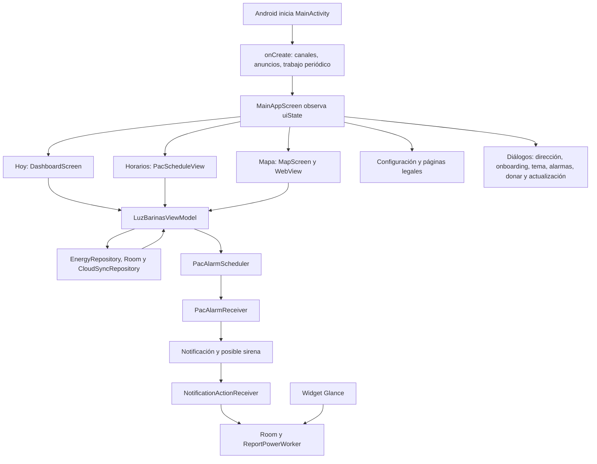

# 03. Android: interfaz, estado, notificaciones y segundo plano

Revisión del código local: 15 de octubre de 2026. Este capítulo explica cómo mantener la aplicación que está en el repositorio. Describe lo que hace el código, incluso cuando su comportamiento difiere del texto mostrado al usuario. No acredita la versión instalada en los teléfonos ni la configuración del servidor. No se han reproducido credenciales ni modificado funciones del producto.

## Cómo leer este capítulo

El directorio base de las referencias Kotlin es `E:\LUZ BARINAS\app\src\main\java\com\example`. Una referencia `L180` significa la línea 180 del archivo enlazado al comienzo del apartado. Las líneas corresponden a esta revisión; al editar el código pueden desplazarse. El índice final conserva los nombres exactos de las 124 declaraciones de este alcance, incluidos overrides y JavaScript propio del mapa. Los bloques anónimos se explican con su función contenedora: no tienen un nombre adicional que pueda buscarse en Kotlin.

Las funciones `@Composable` aquí descritas retornan `Unit`: su resultado es una descripción de interfaz que Compose dibuja. Los callbacks como `(Sector) -> Unit` representan una acción que el padre entrega al componente. No equivalen a una escritura en servidor: hay que seguir el callback hasta el ViewModel y después hasta el repositorio. El capítulo [02, datos y motor](<E:/LUZ BARINAS/docs/codigo/02-android-datos-y-motor.md>) explica la implementación interna de esos repositorios, modelos y utilidades.

## 1. Las piezas y el recorrido del usuario

La navegación principal sí monta tres pestañas: índice `0` Hoy, `1` Horarios y `2` Mapa. La pantalla de configuración aparece superpuesta mediante un booleano local y desde ella se abren los textos legales. No hay `NavHost`, rutas de navegación ni pila de destinos declarada: la navegación depende de `currentTab` y de estados `remember`.

`AdminScreen` y `TelemetryScreen` existen, pero no se invocan desde la navegación actual de `MainActivity`. Tampoco abrir `isAdminOpen` las monta automáticamente. Las acciones administrativas del ViewModel siguen presentes para esos componentes, posibles pruebas o una futura reconexión. No debe confundirse código existente con un recorrido accesible al usuario. El intersticial se precarga, pero no se encontró una llamada de producción a `InterstitialAdManager.showAd()`.

## 2. Aprender a leer Compose con este proyecto

Una pantalla es una función de sus datos actuales: `DashboardScreen(selectedSector = ...)` vuelve a evaluarse cuando cambian los estados que lee. Los eventos suben mediante callbacks; los nuevos datos bajan desde `uiState`. Este patrón permite cambiar una tarjeta sin que ella conozca Supabase. `remember` conserva un objeto mientras su posición permanece en la composición; por sí solo no conserva un formulario tras recrear la actividad. Los flujos se convierten en estado mediante `collectAsStateWithLifecycle()`. Véase la [guía oficial de estado de Compose](https://developer.android.com/develop/ui/compose/state).

En estos archivos, las herramientas recurrentes tienen las siguientes responsabilidades:

| Construcción | Cómo reconocerla y mantenerla aquí |
|---|---|
| `remember { mutableStateOf(...) }` y delegación `by` | Estado de formulario, pestaña interna o diálogo. Asignar la variable provoca la actualización de lectores; cambiar una lista común por dentro puede no hacerlo. |
| `remember(claves)` | Resultado calculado que se reutiliza mientras sus claves no cambien. Hay que incluir todas las dependencias, especialmente tiempo, versión del PAC y selección. |
| `StateFlow`, `_uiState.update { it.copy(...) }` | El ViewModel publica copias del estado; la UI no escribe directamente en el flujo público. |
| `LaunchedEffect(claves)` | Trabajo ligado a la composición, por ejemplo búsqueda con demora o actualización del reloj. Cambiar las claves cancela el trabajo anterior y crea otro. |
| `DisposableEffect` / `onDispose` | Limpieza de WebView, anuncios o sonido cuando el componente sale de composición. |
| `viewModelScope.launch` | Trabajo asíncrono asociado al ViewModel. Una función de acción retorna antes de que termine la petición. |
| `rememberCoroutineScope()` | Corutinas de un componente: demostración de sonido y botón de actualización. |
| `Scaffold` | Distribuye barra superior, navegación inferior, botón flotante, snackbar y contenido con `innerPadding`. |
| `LazyColumn` / `LazyRow` | Listas que componen los elementos necesarios. Las claves por ID ayudan a mantener identidad de filas. |
| `Column`, `Row`, `Box`, `Surface`, `Card` | Agrupan, alinean, superponen y dan superficie visual; no persisten datos. |
| `Modifier` | Tamaño, relleno, semántica, etiquetas de prueba, fondo y acciones táctiles. El orden de sus operaciones afecta el área que se dibuja o recibe toques. |
| `AnimatedVisibility`, `AnimatedContent`, `Crossfade` | Cambian presentación y transición. No añaden persistencia ni una pila de navegación. |
| `AndroidView` | Integra componentes Android clásicos: WebView y AdView. Sus callbacks `factory` y `update` tienen ciclos distintos. |

Los efectos deben mantenerse fuera del dibujo ordinario para evitar repetir escrituras al recomponer. La [guía oficial de efectos](https://developer.android.com/develop/ui/compose/side-effects) explica las claves y cancelaciones. En este proyecto hay estados temporales recordados que no se refrescan al cambiar preferencias externamente; al mantenerlos, revisar si el valor debe observarse o recargarse al volver.

## 3. Entrada y navegación: MainActivity.kt

Fuente: [MainActivity.kt](<E:/LUZ BARINAS/app/src/main/java/com/example/MainActivity.kt:81>).

### `MainActivity.onCreate(savedInstanceState: Bundle?): Unit` — L85

Android la llama al crear la actividad. `savedInstanceState` se entrega a `super`; este archivo no extrae una navegación anterior de él. La propiedad `viewModel` se obtiene con `by viewModels()` y pertenece al ciclo del propietario de ViewModels.

El orden es: activar dibujo hasta bordes con `enableEdgeToEdge()`, crear canales de notificación, iniciar AdMob, precargar intersticial y anuncio de apertura, publicar mediante un `Handler` principal una tentativa de mostrar el anuncio de apertura después de dos segundos y encolar el worker predictivo. Después instala Compose con `setContent`.

Dentro de `setContent` observa `uiState`, resuelve claro/oscuro con `themeMode` y, para `system`, con el tema del sistema. Activa colores dinámicos solo si `colorSchemeName == "dynamic"`. El `CompositionLocalProvider` multiplica tanto la densidad como `fontScale` por `visualScale`; por ello la escala afecta medidas y texto, no solamente el tamaño de letra. No hay callback que cancele expresamente la tarea del `Handler` al destruir la actividad. El retraso de dos segundos es una tentativa: si el anuncio todavía no está cargado, el gestor retorna sin mostrarlo.

### `MainAppScreen(viewModel: LuzBarinasViewModel): Unit` — L136

La invoca `onCreate`. Lee `uiState` y `PacAlarmPlayer.isPlayingFlow`; mantiene en `remember` snackbar, varios booleanos de diálogos/configuración y la versión de actualización descartada. Son estados de esa composición, no preferencias permanentes.

| Bloque/callback | Qué hace y qué cambia |
|---|---|
| `notificationPermissionLauncher`, L142; `LaunchedEffect(Unit)`, L146 | En Android 13 o posterior comprueba `POST_NOTIFICATIONS` y lo solicita si falta. Su callback ignora el resultado (`_`); no modifica una bandera visible ni ofrece aquí una explicación adicional. |
| `LaunchedEffect(uiState.userMessage)`, L159 | Muestra el mensaje en snackbar y luego llama a `clearUserMessage()`. El mensaje no debe consumirse antes de que termine la presentación. |
| `currentBlock`, L171 | Quita `BLOQUE` y espacios del bloque de selección; usa A si no hay sector. Aquí la normalización es distinta de la regex problemática del ViewModel. |
| `LaunchedEffect(uiState.selectedSector)`, L176 | Solicita reprogramar alarmas al cambiar el objeto de sector seleccionado. No tiene `scheduleVersion` como clave independiente. |
| `PacSettingsDialog`, L181 | Recibe el bloque calculado y `userAddress` como nombre; cierra cambiando `isSettingsOpen`. |
| `ThemeSettingsDialog`, L189 | Recibe modo/paleta/escala y conecta su callback con `viewModel.updateTheme(...)`. |
| `OnboardingFlowDialog`, L204 | Se abre si el onboarding está pendiente y la dirección no está abierta. Completarlo abre la dirección; ese callback aún no guarda `onboarding_done`. |
| `BarinasAddressDialog`, L212 | Se abre por solicitud local o cuando no hay dirección y el onboarding ya está cerrado. Elegir llama a `setUserLocation`; registrar llama a `registerCommunityLocation`; cerrar llama a `setOnboardingOpen(false)`. |
| `DonationsDialog`, L230 | Lee `donationConfig` remoto del estado; cerrar solo oculta el diálogo. |
| Actualización, L237–256 | Usa `updateAvailable`, una versión descartada y una apertura manual. Si se fuerza sin actualización remota, construye información de la versión actual. El título del diálogo sigue diciendo que existe nueva actualización. |
| `BackHandler`, L260 | Si la pestaña no es Hoy, vuelve a `0`. `SettingsScreen` añade su propio manejador al estar montada. |
| Botón flotante, L305 | Solo aparece mientras la sirena está marcada como activa. Llama a `PacAlarmPlayer.stopAlarm(context)`. |

En pantallas de más de 600 dp se usa `NavigationRail`; en las demás se monta navegación inferior y un banner publicitario. Ambas navegaciones escriben únicamente `setTab(0/1/2)`. La barra superior ofrece Donar, paleta y Configuración. El `Crossfade` de L481 elige el contenido:

| Tab | Datos que recibe | Eventos conectados |
|---|---|---|
| Hoy / `DashboardScreen`, L487 | Sectores, selección, dirección, predicción, pendientes, aviso, perfil y existencia de trabajo. | Cambiar perfil→`switchProfile`; cerrar aviso→`dismissBroadcastNotice`; selección→`selectSector`; reporte→`reportPowerStatus`; dirección/alertas→abrir diálogo; horarios→tab 1. |
| Horarios / `PacScheduleView`, L506 | Selección, copia de matriz y franjas de `uiState`. | Pulsar nombre→`selectSectorByName` y volver a Hoy, aunque la búsqueda no encuentre coincidencia. |
| Mapa / `MapScreen`, L515 | Sectores, selección y filtro. | Selección→`selectSector`; filtro→`setFilter`; reporte rápido→`reportPowerStatus` sin observación. |

La configuración se dibuja encima de la estructura principal en `AnimatedVisibility` L531. Sus eventos conectan tema, dirección, reabrir bienvenida, alarmas, actualización y donaciones. No se monta `AdminScreen`, `TelemetryScreen` ni una pantalla especial por `isAdminOpen`. Cambiar `currentTab` a un valor distinto de 0/1/2 deja el `when` sin contenido; `setTab` no valida ese rango.

## 4. ViewModel: el intermediario entre pantallas y datos

Fuente: [LuzBarinasViewModel.kt](<E:/LUZ BARINAS/app/src/main/java/com/example/ui/viewmodel/LuzBarinasViewModel.kt:28>).

### Modelos de estado y creación

`LuzBarinasUiState` (L28) es una `data class`: agrupa catálogo/selección/dirección, onboarding, predicción, pendientes e historial, filtro/tab/carga/mensajes, modo de simulación, datos administrativos de matriz/franjas/listas A–D, aviso, actualización, donación, perfiles y personalización visual. `isBlackoutSimulationMode`, `isAdminOpen`, `donationUrl` y otras propiedades presentes no implican una UI activa que las consuma. Las listas del PAC son copias para provocar actualizaciones de estado; la lógica también lee el singleton `PacScheduleData`.

`AppUpdateInfo` (L62) contiene `versionCode: Int`, `versionName: String`, `releaseNotes: String`, `downloadUrl: String` y `isMandatory: Boolean`. Es un dato de presentación, no un instalador.

`LuzBarinasViewModel(application: Application)` (L70) crea `EnergyRepository`, abre las preferencias `luz_barinas_user_prefs` y publica `StateFlow` de solo lectura. El estado inicial lee dirección, perfil, existencia de trabajo, modo, paleta y escala, y marca carga. `isDarkMode` comienza con su default y no se deriva en esa construcción de `themeMode`/sistema; algunos componentes pueden usar una bandera distinta al esquema real del tema.

El bloque `init` L90 no es una función invocable separada. Carga el PAC persistido antes de tomar sus copias, inicia sincronización remota, lanza precarga local y crea colectores:

| Colector | Actualización y efecto |
|---|---|
| Sectores Room, L108 | Reemplaza `sectors`, mantiene selección por ID, busca la preferencia guardada, Alto Barinas I o primer elemento; quita carga. Si cambia el ID escuchado, recalcula predicción y conecta `listenToSector`. |
| Pendientes, L137 | Copia el contador a `unsyncedReportsCount`. |
| Reportes locales, L144 | Copia el listado a `recentReports`; es historial del dispositivo, no una descarga del feed global. |
| Actualización del PAC, L151 | Reconstruye copias y predicción. Este bloque no llama explícitamente a rearmar alarmas. |
| Avisos, L159 | Publica `activeBroadcastNotice`. |
| Versión remota, L166 | Publica `updateAvailable`. |
| Donaciones, L173 | Publica `donationConfig`. |

### Acciones de selección y presentación

Todas las siguientes funciones retornan `Unit`, salvo la constructora privada de copias indicada. Cuando lanzan una corutina, ese retorno no confirma la finalización del trabajo.

| Función exacta / línea | Parámetros, pasos y estado | Llamador y efectos que debe tener presentes quien mantiene |
|---|---|---|
| `selectSector` L180 | `sector: Sector`. Busca primer carácter A/B/C/D en bloque; escribe IDs/dirección/bloque general y datos del perfil activo; cambia selección/dirección y existencia de trabajo. Actualiza ID escuchado, predicción y suscripción; rearma alarma. | Buscador, mapa y `selectSectorByName`/`switchProfile`. La regex `[ABCD]` toma B de `BLOQUE` para algunos bloques: no copiarla a funciones nuevas. |
| `switchProfile` L210 | `profile: String`. Si ya es activo, termina. Guarda `active_profile`, busca ID/dirección `profile_<perfil>_*`, actualiza estado y, si existe sector, llama a `selectSector`; si no, conserva selección previa y pide configurar trabajo. | Botones Casa/Trabajo. No valida que el string sea `home`/`work`. Cambiar a trabajo sin datos puede dejar temporalmente sector de casa. |
| `selectSectorByName` L238 | `name: String`. Encuentra primera coincidencia por inclusión del nombre en cualquiera de los dos sentidos, sin distinguir mayúsculas; delega a `selectSector`. | Lista de circuitos en Horarios. No informa si falta coincidencia y puede emparejar un nombre parcial ambiguo. |
| `setFilter` L247 | `status: ServiceStatus?`. Copia `activeFilter`. `null` significa todos. | Chips de Mapa; no cambia la selección ni consulta servidor. |
| `setTab` L251 | `index: Int`. Copia `currentTab`. | Navegación y retorno desde horarios; no persiste ni valida el índice. |
| `toggleDarkMode` L255 | Sin parámetros. Alterna hacia `light` si el modo es `dark`, hacia `dark` en cualquier otro caso; llama a `updateTheme`. | Configuración. Desde `system` siempre pasa a oscuro, aunque el sistema ya estuviera oscuro. |
| `updateTheme` L261 | `themeMode: String? = null`, `colorSchemeName: String? = null`, `visualScale: Float? = null`. Solo actualiza y persiste los campos no nulos; modo también cambia `isDarkMode` a comparación con `dark`. Aplica editor y publica copia. | Diálogo de tema/toggle. No valida strings ni acota escala; `system` no sincroniza esa bandera con el tema del teléfono. |
| `setOnboardingOpen` L504 | `isOpen: Boolean`. Cambia el booleano del estado. | Cierre de dirección y reinicio desde Ajustes; no cambia por sí misma `onboarding_done`. |
| `dismissBroadcastNotice` L571 | Sin parámetros. Pone el aviso activo en `null`. | Cerrar banner. No elimina el aviso remoto ni persiste descarte; puede reaparecer con un evento posterior. |
| `clearUserMessage` L575 | Sin parámetros. Pone `userMessage = null`. | Efecto del snackbar en `MainAppScreen`. |

### Reportes, comunidad y predicción

**`reportPowerStatus` L281.** Recibe `hasPower: Boolean`, `reportType: String` derivado por defecto, `voltage: Float?` con 118/0 por defecto y `observation: String? = null`. Sale si no hay selección. Captura el sector y llama asíncronamente a `repository.submitReport` con ID/nombre y el evento. Si tiene éxito, construye un mensaje para NORMAL, FALLA_IRREGULAR u otro y recalcula predicción; si falla, muestra texto de cola offline. La función no distingue con precisión confirmación remota de guardado local: la semántica real depende del `Result` del repositorio. La llaman reportes de Hoy y Mapa. El texto NORMAL dice 118 V aunque el parámetro pudiera ser distinto.

**`syncPendingReportsNow` L319.** Sin parámetros; en una corutina marca carga, obtiene el número sincronizado del repositorio y quita carga con mensaje. Cero reúne “sin conexión” y “sin pendientes”, dos estados distintos. Está prevista para `TelemetryScreen`; esa pantalla no está montada por la actividad actual.

**`triggerPushAlertSimulation` L336.** Sin parámetros; requiere selección y crea una notificación interactiva local con `NotificationHelper.showInteractiveOutageAlert`, más un mensaje. No llama a un servicio FCM ni envía a otros teléfonos. No aparece conectada a la navegación actual.

**`registerCommunityLocation` L461.** Entradas: nombre, municipio por defecto Barinas, parroquia, bloque y circuito, todos `String`. En corutina marca carga y pide al repositorio registrar; si hay éxito, crea un `BarinasLocation` con ID normalizado `loc_com_…`, tipo Comunidad, palabras clave, circuito de respaldo y referencia de sector, lo agrega al catálogo mutable y llama a `setUserLocation`. Después anuncia registro y sincronización y quita carga. Con error anuncia que no pudo registrar. La invoca el formulario de dirección. El resultado del repositorio puede ser local aunque falle la subida; no usar el mensaje como comprobante remoto. El repositorio actual escribe además sectores activos sin aprobación.

**`setUserLocation` L508.** Recibe `location: BarinasLocation`; calcula bloque con la misma regex, busca sector por ID, nombre parcial, primer bloque coincidente o selección anterior. Guarda dirección, IDs, bloques generales y del perfil, más `onboarding_done = true`. Cambia selección, dirección, onboarding, existencia de trabajo y mensaje; si encontró sector, recalcula y escucha; después rearma alarmas. La llama la selección confirmada de dirección y el registro comunitario. La ubicación elegida y el sector enlazado pueden no coincidir si se recurrió a un fallback. Guardar una dirección no implica GPS: este formulario selecciona un catálogo.

**`refreshPrediction` L579.** Privada; `sectorId: String`; lanza consulta a `repository.getPredictionForSector` y publica `prediction`. La llaman selección, recolector de sectores y cambios PAC/reportes. No compara el ID al terminar: dos consultas concurrentes pueden devolver resultados en orden distinto a la selección vigente. No debe hacerse una petición bloqueante desde un composable para sustituirla.

**`onCleared` L586.** Override sin argumentos; llama a `super` y detiene sincronización remota. Lo llama el propietario del ViewModel cuando lo retira, no cada vez que una pestaña deja de verse.

### Edición del PAC y funciones administrativas presentes

`buildPacStateCopy(userMsg: String? = null): LuzBarinasUiState` L351 es privada. Lee estado actual y singleton y retorna copia con versión, matriz, franjas y listas A–D; mantiene el mensaje anterior si no se proporciona uno. No guarda ni publica. La usan recolector remoto y acciones de edición.

El patrón común de edición es **mutar `PacScheduleData` → guardar con `PacSchedulePrefs` → publicar copia UI → recalcular predicción → lanzar `publishPacScheduleToCloud`**. En el código remoto actual esa última función es un stub que retorna éxito sin escribir. Las funciones de la tabla siguen retornando `Unit`; no convierten la publicación en una operación confirmada. Están destinadas a los callbacks de `AdminScreen`, actualmente sin montaje en la actividad.

| Función / línea | Entrada y operación específica |
|---|---|
| `setAdminOpen` L365 | `isOpen: Boolean`; solo cambia `isAdminOpen`; no autentica ni abre una pantalla por sí misma. |
| `updateMatrixCell` L369 | `slotIdx: Int`, `dayIdx: Int`, `block: String`; llama `updateCell` y ejecuta el patrón común. |
| `updateSlot` L377 | Índice, `newLabel: String`, `startHour: Int`, `endHour: Int`; modifica la franja y ejecuta el patrón común. |
| `deleteSlot` L385 | `slotIdx: Int`; solo persiste/refresca/publica si `deleteSlot` del modelo devuelve verdadero; añade mensaje de eliminación. |
| `addSlot` L395 | `label: String`, inicio y fin enteros; añade franja y mensaje, después patrón común. |
| `addSectorToBlock` L403 | `sectorName: String`, `blockCode: String`; modifica listas por nombre y mensaje de asignación. No crea por sí misma una fila `SectorEntity`. |
| `removeSectorFromBlock` L411 | Nombre y código; retira nombre de una lista, guarda y anuncia. No borra una fila de Supabase. |
| `reassignSector` L419 | Nombre y `targetBlock: String`; delega traslado entre listas, guarda y anuncia. |
| `applyDoubleTurnPreset` L427 | Sin parámetros; aplica preset de doble turno y mensaje de 8 h; guarda/refresca/publica. |
| `applySingleTurnPreset` L437 | Sin parámetros; preset de un turno y mensaje de 4 h; mismo patrón. |
| `resetScheduleToDefault` L447 | Sin parámetros; delega directamente a `applyDoubleTurnPreset`, por lo que restaurar significa ese preset. |
| `deleteTurnAndRebalance` L451 | Índice de franja y día; guarda el resultado del rebalanceo en `lastRebalanceResult` y su explicación en mensaje, más patrón común. |
| `publishScheduleNotification` L550 | Sin parámetros; exige selección, lanza publicación, muestra **localmente** una notificación interactiva y anuncia sincronización sin esperar/comprobar el resultado. No implementa difusión masiva entre dispositivos. |

### Preferencias compartidas y perfiles

En `luz_barinas_user_prefs`, las claves `saved_sector_id`/`selected_sector_id`, `saved_address`/`selected_sector_name`, `saved_block`/`saved_sector_block`/`selected_sector_block` son variantes que consumen scheduler y worker con prioridades distintas. Los perfiles añaden `profile_home_*` o `profile_work_*` y `active_profile`. `selectSector` guarda ID/dirección del perfil, mientras `setUserLocation` también guarda su bloque. Un cambio futuro debe mantener coherentes estos lectores o migrar las claves.

Las preferencias del PAC y alertas son otros almacenes manejados por `PacSchedulePrefs`/`PacAlertPrefs`. No asumir que cambiar un booleano UI las escribe: cada función anterior indica expresamente cuándo ocurre. Casa/Trabajo no son cuentas remotas, sino dos configuraciones locales. El widget actual no consulta ninguna de las dos.

## 5. Pantallas visibles y componentes de horarios

### DashboardScreen.kt

Fuente: [DashboardScreen.kt](<E:/LUZ BARINAS/app/src/main/java/com/example/ui/screens/DashboardScreen.kt:85>).

**`DashboardScreen` L85** recibe `sectors`, `selectedSector`, dirección opcional, `prediction`, `unsyncedCount`, aviso opcional, perfil/existencia de trabajo, callbacks de perfil, aviso, selección, reporte de cuatro argumentos, dirección, horarios y alarma, más `modifier`. Retorna `Unit`. La monta Hoy. No escribe Room: todas las acciones durables salen por callbacks. `unsyncedCount` está en la firma pero no se dibuja aquí como tarjeta de sincronización.

Mantiene feedback de reporte, texto de observación y su apertura; calcula bloque quitando prefijo, color y horario. Un `LaunchedEffect(Unit)` espera diez segundos repetidamente y publica la clave del minuto; con ella crea `Calendar`, día/franja y día del mes. Calcula corte actual mediante `getBlockForDate`, y “con servicio” combina estado `NORMAL` con ausencia de corte PAC en la franja. Busca próximo turno recorriendo seis posiciones fijas: mantenerlo exige revisar esa suposición si se añaden/eliminan franjas. Estos cálculos usan reloj del dispositivo, no una observación eléctrica.

| Elemento visual | Dato y comportamiento |
|---|---|
| Aviso superior L174 | Si hay aviso, dibuja `BroadcastNoticeBanner`; cerrar llama al padre. |
| Búsqueda L185 | `GoogleSearchBar` recibe sectores y selecciona uno por callback. |
| Casa/Trabajo L194 | Si existe trabajo, dos botones llaman `onSwitchProfile`; si no, “Agregar” cambia a trabajo y abre dirección. |
| Tarjeta de hoy L250 | Nombre de selección o dirección, distintivo comunitario/PAC, circuito, bloque y “Cambiar”. El circuito tiene respaldo local. |
| Banda de estado L381 | Verde si el estado compuesto indica suministro; roja en otro caso. Texto de próximo corte toma `algorithmDetail` cuando lo considera futuro, o la franja calculada. Otros textos suponen cuatro horas. |
| Cronograma diario L447 | Recorre `PacScheduleData.SLOTS`, muestra bloque de cada franja, AHORA y corte del usuario; “Ver mensual” llama a navegación. |
| Acceso a alertas L559 | Lee `PacAlertPrefs` con `remember`; muestra modo/anticipación y abre diálogo. Ese recuerdo no observa automáticamente cambios de preferencias. |
| Reportes L632 | Con Luz→`true,NORMAL,118f,obs`; Sin Luz→`false,SIN_LUZ,0f,obs`; Falla→`false,FALLA_IRREGULAR,0f,obs` con descripción de respaldo. Limpia texto/cierra observación y muestra agradecimiento inmediatamente. |
| Observación L728 | Toggle, cuatro sugerencias que sustituyen el texto y campo libre; no hay medición de voltaje ni validación de veracidad. |
| Atajo y pie L823/L839 | Abre horarios y muestra independencia del proyecto/fuentes; es texto local. |

**`BroadcastNoticeBanner` L876** recibe `notice: BroadcastNotice`, `onDismiss: () -> Unit` y `modifier`; la llama Dashboard. Retorna `Unit`, no persiste. Compara nivel ignorando mayúsculas y muestra etiqueta/fondo/borde rojo para EMERGENCY, ámbar para WARNING y azul para información; muestra título, mensaje si no está vacío y botón cerrar. Los datos vienen de la configuración recibida por el ViewModel; el aspecto de emergencia no demuestra la procedencia del aviso.

### PacScheduleView.kt

Fuente: [PacScheduleView.kt](<E:/LUZ BARINAS/app/src/main/java/com/example/ui/components/PacScheduleView.kt:81>).

**`PacScheduleView` L81.** Entradas: selección nullable, `modifier`, `onSectorClicked: (String) -> Unit` opcional, `pacMatrix: List<List<String>>` y `pacSlots: List<PacSlot>` con copias por defecto. Retorna `Unit`. La monta la pestaña Horarios. Mantiene minuto, día seleccionado, subpestaña, mes seleccionado y obtiene mes/año/día de `Calendar`. Actualiza clave cada diez segundos. Calcula días del mes con calendario Caracas y semanas mediante `getMonthlyWeeks`, recordadas por mes/días/versión.

Su subpestaña **Semanal** muestra una matriz de `pacMatrix`, permite seleccionar cabecera o chip de día y dibuja detalle de franjas del día con indicación del bloque propio/turno actual. El detalle semanal lee la matriz entregada; el mensual usa las matrices generadas por el motor, por lo que hay que verificar consistencia con rotación de fecha al modificar el modelo. Entre bloques de contenido incorpora un banner. La subpestaña **Mensual** permite elegir cualquiera de los doce meses del año actual y dibuja cuatro semanas calculadas; resalta la que corresponde al mes y semana actuales. **Circuitos** muestra las listas A–D con selección de nombre. Los selectores solo cambian estado de presentación; no publican un cronograma.

**`PacOfficialMatrixCard` L618.** Entradas: `title`, `modifier`, matriz, franjas, `highlightToday`, `todayIdx`, `currentSlotIdx`, `userBlock`, `selectedDayIdx` y callback de cabecera nullable. Retorna `Unit`. La usa semanal y cada semana mensual. Dibuja título, tabla con desplazamiento horizontal, días, un máximo de seis filas y leyenda A–D. Para celdas ausentes usa A; día/turno actual y bloque del usuario cambian bordes y fondos. Pulsar cabecera invoca callback si existe; no cambia datos por sí misma. El padre no le pasa siempre `selectedDayIdx`, por lo que el resaltado de selección y el detalle no deben darse por sincronizados automáticamente.

**`PacBlockSectorsGrid` L839.** `modifier`, `onSectorClicked` opcional; retorna `Unit`. La llama la vista de circuitos. Lee directamente `PacScheduleData.SECTORS_BLOQUE_A/B/C/D` y crea cuatro `BlockSectorsCard`; D incluye una nota. No recibe las copias A–D del ViewModel ni consulta Room.

**`BlockSectorsCard` L884.** Entradas: `blockName`, `headerColor: Color`, `sectors: List<String>`, modifier, callback y `note: String?`. Retorna `Unit`. Separa nombres en dos columnas pares/impares con `remember(sectors)`, muestra ocho filas inicialmente y alterna expansión cuando hay más. Pulsar nombre llama `onSectorClicked(nombre)`; no conoce IDs. Una mutación en sitio de una misma lista puede invalidar la expectativa de memoria: conviene pasar nuevas listas observables.

**`getBlockColor(block: String): Color` L1010.** Función normal, llamada por tarjetas y detalles del archivo. Convierte a mayúsculas y trim, retorna colores A–D o índigo de respaldo. No elimina el prefijo “Bloque”; si se le entrega ese formato caerá al respaldo.

### MapScreen.kt

Fuente: [MapScreen.kt](<E:/LUZ BARINAS/app/src/main/java/com/example/ui/screens/MapScreen.kt:49>).

**`MapScreen` L49** recibe sectores, selección, filtro nullable, callbacks de selección/filtro/reporte rápido y modifier; retorna `Unit`. La monta tab 2. Memoriza lista filtrada por `status`, dibuja título, cuatro chips, WebView con lista filtrada y tarjeta del sector seleccionado. Filtrar no elimina la selección: la tarjeta puede referirse a un sector que no aparece entre los marcadores filtrados.

La tarjeta muestra nombre/circuito/bloque, `StatusBadge`, tensión, `100 - withoutPowerPercentage`, contador denominado “Reportes hoy” y botones con 118/0 V. Esos datos salen de `Sector`; el componente no comprueba que contador sea diario ni voltaje sea medido. Para cualquier estado no NORMAL usa mensajes de corte PAC, aunque se trate de avería irregular. Los botones llaman `onQuickReport(true,"NORMAL",118f)` o `(false,"SIN_LUZ",0f)`.

**`FilterChipItem` L304**, privada: `label`, `color`, `isSelected`, `onClick`; retorna `Unit`. La usa MapScreen para Todos/Normal/Corte PAC/Avería. Dibuja píldora, punto, borde y peso de texto según selección, y propaga clic. No modifica filtro internamente.

## 6. Diálogos, selección, temas y configuración

### BarinasAddressDialog.kt

Fuente: [BarinasAddressDialog.kt](<E:/LUZ BARINAS/app/src/main/java/com/example/ui/components/BarinasAddressDialog.kt:73>).

**`BarinasAddressDialog` L73** recibe `isOpen`, `currentAddress: String?`, callback `onLocationSelected(BarinasLocation)`, `onDismiss`, callback nullable de alta `(name,municipio,parroquia,block,circuit)`, sectores disponibles y modifier; retorna `Unit`. Si está cerrado termina antes de componer su contenido. Lo monta `MainAppScreen`.

Su estado local contiene pestaña Buscar/Denominar, campos del alta, consulta, preselección y resultados. Convierte sectores de Room en ubicaciones dinámicas, preserva ID/nombre/circuito/bloque/comunitario pero asigna municipio y parroquia “Barinas” a esas conversiones: no recupera sus divisiones territoriales reales. Inicializa formulario con primer municipio/parroquia del catálogo y bloque C.

Un `LaunchedEffect(query,dynamicLocations)` espera 200 ms cuando hay dos caracteres o más; combina coincidencias dinámicas y catálogo, prioriza dinámicas y deduplica por nombre normalizado. Con menos caracteres muestra solo comunidades dinámicas. Cambiar consulta borra preselección; Search del teclado preselecciona primer resultado y oculta foco, todavía sin confirmarlo. Sugerencias populares cambian consulta y consultan directamente el catálogo. Pulsar una fila solo preselecciona; “Confirmar y fijar” emite la ubicación.

La tarjeta de ausencia de resultados pasa al formulario y copia la consulta como nombre. El formulario tiene nombre, municipio, parroquia dependiente del municipio, bloque A–D y circuito opcional. Cambiar municipio restablece parroquia a la primera disponible. Guardar solo exige nombre no vacío; llama al callback si existe con strings recortados y bloque con prefijo `Bloque`, y cierra. Si el callback es `null`, también puede cerrar sin registrar. No espera resultado remoto ni pone el alta en una cola propia. El pie muestra dirección actual si hay una y ofrece cerrar.

### GoogleSearchBar.kt

Fuente: [GoogleSearchBar.kt](<E:/LUZ BARINAS/app/src/main/java/com/example/ui/components/GoogleSearchBar.kt:72>).

**`GoogleSearchBar` L72** recibe `query: String = ""`, `onQueryChange`, sectores, `onSectorSelected` y modifier; retorna `Unit`, llamada por Dashboard. No usa el buscador de Google ni manda la consulta a Internet: es búsqueda local con aspecto de barra de búsqueda. Tiene foco y consulta interna recordados; usa query externa cuando no está vacía, en otro caso interna. Ese modelo mezcla control externo e interno: el padre debe conocerlo para que limpiar funcione como espera.

El efecto de búsqueda espera 250 ms, exige dos caracteres recortados, filtra nombre/circuito/bloque y toma seis. Introducir texto escribe consulta interna y avisa al padre. Search del teclado elige primer resultado, limpia ambas consultas y quita foco. El botón limpiar hace lo mismo sin selección. Pulsar una sugerencia llama selección, `onQueryChange("")` y quita foco, pero no limpia `internalQuery`; con el uso actual de Dashboard, que no entrega estado externo, las sugerencias pueden permanecer. El desplegable muestra ubicación, circuito, bloque y punto de estado, y usa ID como clave.

### OnboardingFlowDialog.kt

Fuente: [OnboardingFlowDialog.kt](<E:/LUZ BARINAS/app/src/main/java/com/example/ui/components/OnboardingFlowDialog.kt:38>).

| Función / línea | Entradas/retorno, presentación, estado y callbacks |
|---|---|
| `OnboardingFlowDialog` L38 | `isOpen: Boolean`, `onComplete: () -> Unit` → `Unit`. La llama MainAppScreen. Mantiene `currentStep`; diálogo sin cierre por fuera/atrás. `AnimatedContent` presenta Welcome→Permissions→Battery. Completar último paso emite callback, sin guardar preferencias por sí mismo. |
| `WelcomeStep` L79, privada | `onNext` → `Unit`. Presenta nombre, propósito, aviso de independencia y fuentes. Su botón avanza el estado del padre a 1. No abre enlace ni solicita permisos. |
| `PermissionsStep` L165, privada | `onNext` → `Unit`. Muestra explicación y botón que, desde Android S, abre `ACTION_REQUEST_SCHEDULE_EXACT_ALARM`. Captura excepción e imprime. “Siguiente” avanza sin verificar concesión. La solicitud runtime de notificaciones está en MainAppScreen, no en este botón. |
| `BatteryStep` L226, privada | `onNext` → `Unit`. Explica restricciones y abre `ACTION_REQUEST_IGNORE_BATTERY_OPTIMIZATIONS` con URI de paquete. Si falla, muestra Toast con instrucciones. “Elegir mi sector” completa el flujo. No verifica el resultado ni garantiza ejecución 24/7. |

En el manifest actual no se declara `REQUEST_IGNORE_BATTERY_OPTIMIZATIONS`; mantener esta pantalla requiere cotejar la intención, permiso y comportamiento en dispositivos. El texto de garantía de alarmas es una afirmación de UI, no una validación técnica del sistema.

### PacSettingsDialog.kt

Fuente: [PacSettingsDialog.kt](<E:/LUZ BARINAS/app/src/main/java/com/example/ui/components/PacSettingsDialog.kt:45>).

**`PacSettingsDialog` L45** recibe abierto, bloque/nombre del sector y cierre; retorna `Unit`. MainAppScreen la usa desde Hoy y Configuración. Lee preferencias al entrar y crea copias locales de anticipación, notificación, sirena, retorno y vibración. Mientras se edita no se persisten esos cambios. Su preview usa `findNextWindowForBlock` recordado solo por bloque; puede envejecer si cambia hora/PAC sin cambiar bloque.

Muestra próximo corte, anticipación rápida 5/10/15/30/60 o entrada numérica de hasta tres dígitos; solo actualiza anticipación si está entre 1 y 180. Alternar a notificación estándar activa notificación y desactiva sirena y retorno; la descripción de retorno automático no equivale a que ese interruptor quede activo. Alternar sirena activa sirena y retorno. Después hay switches independientes para los mismos ajustes. La demostración llama a `startAlarm`, programa parada a cinco segundos y permite detener manualmente. `DisposableEffect` y todos los cierres detienen sonido. Guardar construye `PacAlertSettings`, iguala `useLegacyAlarmSiren` a sirena, guarda, rearma scheduler y cierra. No hay control de volumen implementado en este diálogo.

### ThemeSettingsDialog.kt y tema

Fuente: [ThemeSettingsDialog.kt](<E:/LUZ BARINAS/app/src/main/java/com/example/ui/components/ThemeSettingsDialog.kt:18>).

**`ThemeSettingsDialog` L18** recibe abierto, modo/paleta/escala actuales, cierre y callback `(String?,String?,Float?) -> Unit`; retorna `Unit`. No crea borrador: cada toque llama inmediatamente al ViewModel con un valor y los otros dos `null`. El bottom sheet ofrece Claro/Oscuro/Sistema, Predeterminado/Dinámico y Compacto 0,85/Normal 1/Grande 1,15. El comentario de `UiState` menciona `nature`, pero no existe un botón ni una paleta implementada para ella. Cerrar oculta y no revierte cambios.

**`ThemeOptionButton` L151**, privada, recibe texto, seleccionado, clic y modifier, retorna `Unit`. La usa el diálogo para todas sus opciones; superficie de 48 dp, colores/borde de selección y texto. No persiste ni decide el modo; ejecuta el callback.

Fuente: [Theme.kt](<E:/LUZ BARINAS/app/src/main/java/com/example/ui/theme/Theme.kt:66>).

**`MyApplicationTheme` L66** recibe `darkTheme: Boolean = isSystemInDarkTheme()`, `dynamicColor: Boolean = false` y `content: @Composable () -> Unit`; retorna `Unit`, llamada por MainActivity. En Android S o posterior, si dinámico, toma esquema dinámico del contexto; en otro caso usa `DarkColorScheme` o `LightColorScheme`, y entrega esquema/tipografía/formas a `MaterialTheme`. El resto de componentes puede tener colores fijos, por lo que no todo cambia con la paleta.

Archivos sin funciones que forman parte del contrato visual:

| Archivo | Contenido y uso |
|---|---|
| [Color.kt](<E:/LUZ BARINAS/app/src/main/java/com/example/ui/theme/Color.kt:11>) | Constantes de marca, bloques y estado, fondos/bordes/textos para claro/oscuro y aliases de compatibilidad. A naranja, B azul, C amarillo y D verde en Compose. El mapa HTML tiene otra asociación de colores; no hay una fuente única. |
| [Type.kt](<E:/LUZ BARINAS/app/src/main/java/com/example/ui/theme/Type.kt:11>) | `AppFontFamily = FontFamily.Default`; `Typography` define display 57/45/36 sp, titulares 32/28/24, títulos 22/16/14, cuerpo 16/14/12 y etiquetas 14/12/11, además de altura/peso/espaciado. No hay una fuente Inter instalada por esa declaración. |
| [Shape.kt](<E:/LUZ BARINAS/app/src/main/java/com/example/ui/theme/Shape.kt:7>) | `AppShapes`: esquinas 4/8/14/20/28 dp. Se aplica mediante MaterialTheme, aunque muchos componentes declaran esquinas propias. |

### SettingsScreen.kt

Fuente: [SettingsScreen.kt](<E:/LUZ BARINAS/app/src/main/java/com/example/ui/screens/SettingsScreen.kt:25>).

`LegalPage` L25 es un enum con PRIVACY, TERMS, DEVELOPER, REFUND, SYSTEM_DOC, TRANSPARENCIA y GOV_DISCLAIMER. No son rutas externas: son valores del estado local.

**`SettingsScreen` L31** recibe callbacks de volver, toggle oscuro, cambio de ubicación, reinicio onboarding, alarmas, actualización y donación; recibe `isDarkMode` y modifier; retorna `Unit`. La monta MainAppScreen como capa. Mantiene `currentLegalPage`; Back vuelve primero de legal a configuración y después llama `onBack`. `Crossfade` elige entre `LegalScreen` con el contenido adecuado y lista de ajustes.

La lista agrupa General (oscuro, ubicación, bienvenida), Notificaciones/Alarmas (sirena continua, retorno y avanzado), Actualizaciones (botón y BuildConfig), Apoyar y dos grupos legales/técnicos. Sirena/retorno usan su propio estado de `PacAlertPrefs`; tanto fila como switch guardan y rearman inmediatamente. Esto duplica una vía de edición del diálogo avanzado y puede dejar la copia local desactualizada si el diálogo cambia preferencias. El botón “Buscar actualizaciones OTA” solamente ejecuta el callback que abre diálogo; no fuerza una nueva consulta en la función.

**`SettingsCategory` L314** recibe título y `content: @Composable ColumnScope.() -> Unit`; retorna `Unit`. La llama SettingsScreen; dibuja etiqueta y tarjeta que ejecuta contenido. `ColumnScope` permite pesos/alineaciones propios del contenedor a los hijos.

**`SettingsItem` L342** recibe icono, título, subtítulo, callback, color de icono por defecto y `trailingContent` composable nullable; retorna `Unit`. Dibuja fila táctil y contenido opcional derecho, normalmente Switch. Omite subtítulo vacío. No conoce preferencias; los callbacks del llamador son quienes las cambian.

### DonationsDialog.kt

Fuente: [DonationsDialog.kt](<E:/LUZ BARINAS/app/src/main/java/com/example/ui/components/DonationsDialog.kt:30>).

**`DonationsDialog` L30** recibe `config: DonationConfig?` y cierre → `Unit`. La llama MainAppScreen con configuración del flujo remoto. Muestra explicación del apoyo y botón PayPal con URL configurada o respaldo integrado; abre `ACTION_VIEW`. Si Binance no está vacío muestra ID y botón de copiar; si banco/teléfono/documento de pago móvil están todos presentes, muestra tarjeta y copia los tres al portapapeles. Sin configuración remota aún existe el botón de respaldo PayPal. No procesa pago, no verifica recepción y no maneja un resultado de navegador. Cambiar destino de donación es una operación administrativa sensible en la configuración remota.

### UpdatePromptDialog.kt

Fuente: [UpdatePromptDialog.kt](<E:/LUZ BARINAS/app/src/main/java/com/example/ui/components/UpdatePromptDialog.kt:26>).

**`UpdatePromptDialog` L26** recibe `updateInfo: AppUpdateInfo?` y cierre → `Unit`; sale si es null. Lo monta MainAppScreen de forma automática o manual. Muestra título, versión, notas y “Descargar e instalar”. Si obligatorio deshabilita cierre exterior/atrás y oculta “Más tarde”. El botón lanza corutina que llama `AppUpdater.openPlayStoreForUpdate(context)` y después cierra; el código de fallback intenta abrir `downloadUrl` desde un catch exterior. Excepciones ocurridas dentro de la corutina no necesariamente las captura ese catch: debe ponerse manejo dentro del trabajo si se cambia el flujo. No hay descarga APK ni instalación dentro de este composable. Una actualización obligatoria tampoco constituye un control de versión del servidor.

### StatusBadge.kt

Fuente: [StatusBadge.kt](<E:/LUZ BARINAS/app/src/main/java/com/example/ui/components/StatusBadge.kt:39>).

**`StatusBadge` L39** recibe `status: ServiceStatus`, modifier y `isLarge: Boolean = false` → `Unit`. La llama MapScreen. Elige color/icono/texto para normal, PAC y no programado; los dos últimos animan opacidad entre 0,4 y 1 cada 900 ms en reversa. Cambia dimensiones si grande. Es solo representación: no comprueba suministro ni actualiza métricas.

## 7. Páginas legales: contenido, navegación y sus límites

Fuente: [LegalScreen.kt](<E:/LUZ BARINAS/app/src/main/java/com/example/ui/screens/LegalScreen.kt:31>). Todas las funciones de esta sección son composables que retornan `Unit`.

| Función / línea | Parámetros, qué presenta y efecto |
|---|---|
| `LegalScreen` L31 | `title: String`, `onBack`, `content: @Composable () -> Unit`. SettingsScreen la usa como contenedor con barra, volver y columna desplazable; ejecuta el contenido. No descarga documento ni maneja almacenamiento. |
| `PrivacyPolicyContent` L65 | Sin parámetros. Texto local sobre responsable, ausencia de cuentas, reportes, almacenamiento, terceros, eliminación local y contacto; fecha/versiones escritas a mano. Declara campos menos amplios que los DTO reales: observación, voltaje y origen también deben considerarse al actualizar política. No implementa borrado remoto. |
| `TermsAndConditionsContent` L100 | Sin parámetros. Independencia, variabilidad, veracidad de reportes, responsabilidad, donaciones, licencia y contacto. Son textos declarados por la app; no convierten la configuración de seguridad en una restricción técnica. |
| `TransparenciaContent` L135 | Sin parámetros. Lista Supabase, GitHub, Vercel y AdMob, preferencias y telemetría. Nombres de estados allí escritos difieren de valores utilizados en el modelo. No hay lectura dinámica de qué integraciones están activas. |
| `DeveloperInfoContent` L169 | Sin parámetros. Créditos, imagen `elmatrushka`, proyecto/desarrollo, sitios y contacto. Botón abre perfil de Facebook con `ACTION_VIEW`, captura excepción e imprime. No requiere credenciales de Facebook. |
| `RefundPolicyContent` L301 | Sin parámetros. Presenta gratuidad, donación voluntaria, afirmación de no reembolso y contacto. No consulta transacciones ni ejecuta devoluciones; no se evalúa aquí su validez jurídica. |
| `SystemDocumentationContent` L322 | Sin parámetros. Resumen técnico local/versionado a mano. Menciona tópicos push y OTA que no deben confundirse con capacidades actualmente completas del cliente; al cambiar arquitectura hay que actualizar este texto además del README. |
| `GovernmentDisclaimerContent` L349 | Sin parámetros. Deslinde gubernamental, fuentes y advertencia de colaboración. Dos botones abren portales públicos con `ACTION_VIEW` y capturan excepción. Las URL locales usan HTTP; no se comprobó su disponibilidad ni exactitud externa durante la lectura. |

Las páginas las selecciona `SettingsScreen`, no las llama directamente la actividad. El contenido está escrito en Kotlin, no en `strings.xml`; traducir/cambiar una política exige editar y publicar una nueva versión. No hay un registro automático de aceptación ni una prueba de exactitud del cronograma por mostrar un enlace oficial.

## 8. Pantallas presentes que la navegación actual no monta

### TelemetryScreen.kt

Fuente: [TelemetryScreen.kt](<E:/LUZ BARINAS/app/src/main/java/com/example/ui/screens/TelemetryScreen.kt:56>).

**`TelemetryScreen` L56** recibe `sectors`, `recentReports: List<CitizenReport>`, `unsyncedCount`, `onSyncNow` y modifier → `Unit`. No se encontró invocación desde el código principal. Si se conecta, muestra salud de red calculada por número de sectores NORMAL/total, tarjetas de conteo normal/PAC/avería, pendientes y botón sincronizar. Historial muestra reportes del dispositivo recibidos, voltaje/hora/sector e indicador `isSynced`; lista vacía presenta instrucciones. No descarga reportes de servidor y no mide cobertura geográfica real: porcentaje es proporción de registros NORMAL.

El formateador `dd/MM hh:mm a` usa locale/zona del dispositivo. Colores y texto de los reportes distinguen solo hasPower, por lo que una avería no tiene categoría visual independiente aquí. La fila denomina pendientes “cola WorkManager”, pero el contador procede de Room: no es una consulta de trabajos activos. La pantalla propaga `onSyncNow`; el futuro montaje debería conectarlo a la acción homónima del ViewModel.

**`SummaryStatBox` L328**, privada: `label`, `count: Int`, `color: Color`, modifier → `Unit`. TelemetryScreen la usa para sus tres cifras; dibuja columna de número y etiqueta sin efectos.

### AdminScreen.kt

Fuente: [AdminScreen.kt](<E:/LUZ BARINAS/app/src/main/java/com/example/ui/screens/AdminScreen.kt:79>).

**`AdminScreen` L79** es la única función nombrada del archivo, aunque agrupa muchos callbacks. Retorna `Unit`. Recibe sectores, versión, matriz, franjas, listas A–D; callbacks de celda, editar/quitar/añadir franja, presets simple/doble, rebalanceo, alta/baja/traslado de nombre de sector, restaurar, publicar y cerrar, más modifier. `sectors`, `scheduleVersion` y ciertos estados están presentes sin un uso equivalente a una consulta remota; la UI se basa sobre todo en las listas/matriz entregadas.

La actividad actual no llama a esta pantalla. Tampoco incluye dentro de esta función una autenticación administrativa verificable: modificar una clave local aquí no autoriza operaciones en servidor. Si se reconecta, cada callback debe conectarse deliberadamente a las acciones del ViewModel y revisarse la publicación remota incompleta.

Mantiene estado de franja que se edita, campos de edición/alta, celda seleccionada, nuevo nombre/bloque, bloque de gestión activo y mensaje de clave. Abre `admin_security_prefs` para escribir `master_key`; no reproducimos su valor. El recorrido de callbacks es:

| Sección / líneas | Datos, acciones y consecuencias |
|---|---|
| Cabecera L140 | Explica el panel y llama `onCloseAdmin`. |
| Presets L238 | Cuenta repeticiones por bloque/día en hasta seis filas para inferir si simple; botones llaman a los callbacks simple/doble, no mutan modelo directamente. |
| Franjas L302 | Lista `pacSlots`; editar copia datos a borrador; eliminar llama callback y se deshabilita cuando solo hay una. Añadir crea etiqueta por número y abre formulario. |
| Matriz L389 | Tabla horizontal de siete días y máximo seis franjas. Celda abre acciones con pareja índice/día; ausencias se representan A. Restaurar emite `onResetToDefault`. |
| Alta de nombre L570 | Campo y bloque A–D; nombre no vacío→`onAddSectorToBlock(nombre.trim(),bloque)` y limpia campo. Esto gestiona nombres del PAC, no acredita alta territorial en DB. |
| Gestión por bloque L630 | Alterna A–D, cuenta y lista sectores; si lista recibida está vacía cae a lista singleton, por lo que un vacío intencional puede reaparecer. Flechas llaman `onReassignSector`; papelera llama `onRemoveSectorFromBlock`. |
| Difusión L768 | Botón llama `onPublishNotification`; la versión actual del ViewModel no envía un push masivo. |
| Clave L818 | Guarda el texto recortado no vacío en preferencia `master_key`, limpia campo y muestra mensaje. No cambia RLS ni autentica una cuenta. |
| Editar franja L899 | Cambia etiqueta e inicio 0–23/fin 0–24 con `toIntOrNull` y `coerceIn`; guardar emite índice/etiqueta/horas y cierra. No valida aquí solapamiento o duración. |
| Añadir franja L965 | Campos similares; exige etiqueta para emitir `onAddSlot` y cerrar. Las vistas que siguen limitadas a seis filas deben revisarse al permitir más. |
| Celda L1027 | Permite A/B/C/D/Libre; rotar sigue A→B→C→D→-→A; quitar corte guarda `-`; rebalanceo llama `onDeleteTurnAndRebalance`. Todas cierran el diálogo después del callback. |

## 9. El mapa híbrido: Kotlin, JavaScript y recursos locales

### InteractiveBarinasMap.kt: puente y ciclo de vida

Fuente: [InteractiveBarinasMap.kt](<E:/LUZ BARINAS/app/src/main/java/com/example/ui/components/InteractiveBarinasMap.kt:32>).

`AndroidMapBridge` L32 recibe dos callbacks: selección por ID y mapa listo. Guarda `Handler` del hilo principal. Sus métodos anotados con `@JavascriptInterface` son la superficie que el JavaScript local puede invocar:

| Función / línea | Entrada/retorno, llamador y efecto |
|---|---|
| `onSectorClicked` L39 | `sectorId: String` → `Unit`; JavaScript la llama mediante `window.AndroidBridge`. Publica tarea al hilo principal que emite el ID. No valida el ID dentro de la clase. |
| `onMapReady` L46 | Sin parámetros → `Unit`; JavaScript de inicio llama; publica al hilo principal el callback de disponibilidad. |

**`InteractiveBarinasMap` L55** recibe sectores, selección, callback de Sector y modifier → `Unit`; la monta MapScreen. Mantiene booleano listo y referencia WebView. En `AndroidView.factory` crea WebView, activa JavaScript/DOM storage, zoom y acceso a archivos/contenido, instala puente `AndroidBridge` y cliente y carga `file:///android_asset/map/map.html`. El callback de ID busca el sector en la lista capturada al crear el WebView; esa captura puede envejecer si llegan sectores nuevos sin recrearlo. La UI nativa busca ID antes de llamar al padre.

**`sendDataToMap` L64** es función local: `wv: WebView`, `sectorList: List<Sector>`, `selected: Sector?` → `Unit`. La invocan efecto por datos/listo, callback del puente, `onPageFinished` y `AndroidView.update`. Construye JSON con id/nombre/circuito/bloque/status/voltaje/comunitario y primera coordenada de cada polígono; no manda contadores, porcentaje, municipio ni parroquia. Cita JSON con `JSONObject.quote`, pero el ID seleccionado se inserta entre comillas simples por concatenación. Ejecuta `window.updateMapData(...)` con `evaluateJavascript` sin esperar resultado.

**`onPageFinished` L138** es override de un cliente anónimo: `view: WebView?`, `url: String?` → `Unit`. Android lo llama al terminar carga; llama a super, marca listo y envía datos. No comprueba el origen de la URL. Puede coincidir con `onMapReady`, por lo que el envío inicial puede repetirse. El efecto de limpieza destruye WebView y borra referencia al salir del mapa.

El riesgo no es solo activar JavaScript: se combinan puente nativo, navegación sin lista de orígenes permitidos, permisos de archivo/contenido y HTML interpolado de datos remotos. El puente solo expone dos acciones concretas, pero si se ejecuta contenido no confiable puede invocarlas. Conviene codificar también el ID, sanear los popups, limitar navegación y privilegios. La [guía oficial de puentes WebView](https://developer.android.com/privacy-and-security/risks/insecure-webview-native-bridges) respalda revisar límites de origen; no se ejecutó un ataque durante esta documentación.

### assets/map/map.html: las nueve funciones propias

Fuente: [map.html](<E:/LUZ BARINAS/app/src/main/assets/map/map.html:211>). Los archivos `leaflet.js`, `leaflet.css`, `leaflet-heat.js` e imágenes de marcadores/capas son dependencias de terceros: este manual explica su uso, no reescribe sus APIs internas como código propio.

El HTML se carga localmente, tiene fondo oscuro fijo, pines por bloque, pulsación roja/morada por corte/avería, tres botones flotantes (calor, base satélite/oscura, centrar) y leyenda de estado. El mapa base solicita teselas Esri por HTTPS: que el documento sea local no garantiza cartografía completa sin red. Las coordenadas conocidas y las cabeceras de municipios son tablas locales del script.

Todas las funciones JavaScript siguientes retornan `undefined`, excepto `getCoords`, que retorna pareja numérica. Sus estados compartidos son `map`, capas, `isSatellite`, `isHeatmapActive`, `currentSectors` y `currentSelectedId`.

| Función / línea | Parámetros, pasos, estado y quién la llama |
|---|---|
| `initMap` L265 | Sin parámetros. Crea `L.map` centrado en Barinas, zoom 12, sin controles de zoom/atribución; llama `setBasemap(false)`, crea `markersLayer` y avisa al puente si existe. Se asigna a `window.onload`. |
| `setBasemap` L283 | `satellite`. Actualiza modo, quita capas anteriores y crea base/etiquetas Esri satélite (maxZoom 19) o gris oscuro (16); cambia texto del botón y trata de subir marcadores. La llaman inicio y toggle. No descarga catálogo de sectores. |
| `toggleBasemap` L310 | Sin parámetros. Invierte `isSatellite` a través de `setBasemap`. La llama el botón HTML; no altera estado Kotlin. |
| `toggleHeatmap` L314 | Sin parámetros. Invierte modo calor, cambia clase/texto del botón y llama `renderLayers`. La llama el botón. |
| `recenterBarinas` L327 | Sin parámetros. Si hay mapa ejecuta `flyTo` al centro/zoom 12 durante un segundo. La llama Centrar; no cambia ubicación guardada. |
| `getCoords` L333 | `sector` objeto. Primero acepta lat/lon numéricos truthy; después compara nombre parcial contra tabla conocida; si falta, usa cabecera municipal o Barinas y jitter determinista según hash del ID/nombre. Retorna `[lat,lon]`. La usan render y centrado. No es geocodificación ni ubicación real; cero no pasa la primera comprobación y no se validan rangos. |
| `renderLayers` L358 | Sin parámetros. Termina sin mapa; limpia marcadores y capa de calor anterior. En modo calor y plugin disponible calcula pesos 1 para cortes/averías, 0,25 para normal y radio fijo 30/blur18; añade capa y retorna. En modo pines crea iconos/bloques, pulsación, popup y manejadores; reabre popup seleccionado con timeout. La llaman toggle y datos nuevos. |
| `handleSectorClick` L455 | `sectorId`. Actualiza selección JS y llama al puente de Kotlin si existe. Lo llaman clic de marcador y botón del popup; no guarda preferencia directamente ni redibuja por sí solo. El redibujado llega con nuevos datos del padre. |
| `window.updateMapData` / `updateMapData` L463 | `sectorsJson`, `selectedId`. Acepta string JSON o lista, reemplaza datos/selección y llama render. Si hay seleccionado lo busca y centra con `flyTo` mínimo zoom 13. Captura errores y los manda a consola; no retorna acuse estructurado. La llama `evaluateJavascript` desde Kotlin. |

En los callbacks anónimos de `renderLayers`, `map(s => ...)` calcula peso, `forEach(sector => ...)` crea marcadores, `marker.on('click',...)` selecciona y el timeout abre el popup tras 100 ms. El popup concatena nombre/circuito/parroquia e ID en HTML sin escapar. `sector.voltage || 118` sustituye incluso cero por 118, lo cual puede representar tensión incorrecta durante un corte. La clasificación de estado controla texto/anillo, pero no sana el HTML ni hace confiable una observación.

Los colores de pines JS son A azul, B ámbar, C verde y D rosa, distintos de Compose. El calor no usa volumen de confirmaciones y el puente no lo envía: cambiar ese cálculo exige modificar contrato Kotlin y script a la vez. El primer vértice de un polígono tampoco equivale a su centro; los fallbacks/jitter deben indicarse como aproximaciones si se conservan.

## 10. Publicidad: carga, callbacks y límites reales

Fuente: [AdComponents.kt](<E:/LUZ BARINAS/app/src/main/java/com/example/ui/components/AdComponents.kt:21>). No se reproducen identificadores de cuentas/unidades; son configuración, no lógica de negocio.

| Función / línea | Entradas/retorno y ejecución |
|---|---|
| `initializeAdMob` L21 | `context: Context` → `Unit`. MainActivity la llama; inicia SDK con callback vacío. No registra un estado observable de inicialización. |
| `getBannerAdUnitId` L28 | Sin parámetros → `String`. Busca campo `ADMOB_BANNER_UNIT_ID` de BuildConfig mediante reflexión; si vacío/placeholder/error retorna una unidad incorporada. El comentario dice test, pero el literal de respaldo no es la unidad de prueba oficial conocida; no asumir que desarrollo queda automáticamente aislado. |
| `AdaptiveBannerAd` L44 | `adUnitId` default de la función anterior y modifier → `Unit`. MainAppScreen y Horarios la usan. `remember` crea AdView una vez, fija `AdSize.BANNER`, configura unidad y carga petición; `AndroidView` la dibuja. `onDispose` destruye. El nombre Adaptive no corresponde a un cálculo de tamaño adaptable: aquí es BANNER fijo. |
| `InterstitialAdManager.preload` L84 | Contexto → `Unit`. MainActivity y callbacks de cierre/error llaman. Construye petición y `InterstitialAd.load`, guardando resultado en singleton. |
| `InterstitialAdManager.showAd` L101 | `activity: Activity` → `Boolean`. Retorna false si no han pasado cinco minutos o falta anuncio; instala callbacks, muestra, guarda hora y retorna true si alcanzó llamada show. No hay llamada desde navegación actual. True no acredita que el usuario terminara de verlo. |
| `AppOpenAdManager.loadAd` L134 | Contexto → `Unit`. MainActivity llama; termina si ya hay anuncio o `hasShownOnce`; carga y guarda en singleton mediante callbacks. |
| `AppOpenAdManager.showAdIfAvailable` L153 | Actividad → `Unit`. Handler de MainActivity llama después de dos segundos. Termina si ya está mostrando/ya mostrado/no cargó; si disponible configura callbacks y muestra. No programa nueva tentativa si aún no hay anuncio. |

Callbacks con nombre exacto, importantes para seguir referencias aunque compartan nombre:

| Clase/callback / línea | Entrada y estado que modifica |
|---|---|
| Interstitial `onAdLoaded` L91 | `ad: InterstitialAd` → `Unit`; SDK lo llama y asigna `interstitialAd`. |
| Interstitial `onAdFailedToLoad` L94 | `error: LoadAdError` → `Unit`; borra anuncio. No informa a UI. |
| Interstitial `onAdDismissedFullScreenContent` L107 | Sin parámetros → `Unit`; borra anuncio y precarga otro con actividad capturada. |
| Interstitial `onAdFailedToShowFullScreenContent` L111 | `error: AdError` → `Unit`; borra y precarga. |
| App Open `onAdLoaded` L143 | `ad: AppOpenAd` → `Unit`; guarda anuncio. |
| App Open `onAdFailedToLoad` L146 | `error: LoadAdError` → `Unit`; limpia referencia. |
| App Open `onAdDismissedFullScreenContent` L158 | Sin parámetros → `Unit`; limpia showing, marca shownOnce y elimina referencia. |
| App Open `onAdFailedToShowFullScreenContent` L163 | `error: AdError` → `Unit`; también marca shownOnce, por lo que no vuelve a cargar en ese proceso. |
| App Open `onAdShowedFullScreenContent` L168 | Sin parámetros → `Unit`; activa `isShowingAd`. |

`hasShownOnce` es memoria del proceso, no preferencia permanente. El banner se destruye al abandonar su composición; no se manejan aquí callbacks de pausa/reanudación de AdView. Mantener la publicidad requiere conservar acceso directo a consulta/reportes y separar configuración de desarrollo de producción, sin llamar a cargas de anuncios como parte de pruebas unitarias del dominio.

## 11. Notificaciones y alarmas: programar, recibir y responder

Hay tres caminos distintos: avisos locales con `NotificationHelper`, alarmas exactas de `AlarmManager` recibidas por `PacAlarmReceiver` y comprobaciones periódicas de `PredictiveNotificationWorker`. Los avisos remotos de Supabase generan notificación cuando CloudSync recibe el cambio. En este cliente no aparece un servicio Firebase Messaging que convierta la función web FCM en recepción completa del APK.

### NotificationHelper.kt

Fuente: [NotificationHelper.kt](<E:/LUZ BARINAS/app/src/main/java/com/example/notification/NotificationHelper.kt:14>).

`NotificationHelper` es un singleton con canales general `alertas_cortes_barinas`, corte `pac_corte_luz`, retorno `pac_restablecimiento_luz`; IDs 1001 alerta, 1002 confirmación, 1003 predictiva, 1004 aviso y 1005 retorno. Reutilizar ID reemplaza la notificación de ese tipo, no crea un historial por sector. Los métodos de mostrar capturan `SecurityException` si falta permiso; no retornan confirmación de presentación.

| Función / línea | Parámetros y retorno | Pasos, llamadas y estado externo |
|---|---|---|
| `createNotificationChannel` L30 | Contexto → `Unit` | Desde API O crea tres canales de importancia alta con sonido de notificación por defecto. Los patrones de vibración de corte/retorno difieren, pero el URI de sonido es el mismo. La llaman actividad y métodos de notificación/receptor. No tiene UI ni consulta Supabase. |
| `showInteractiveOutageAlert` L84 | Contexto, `sectorId`, `sectorName`, `circuitCode` con defaults → `Unit` | Crea canales, PendingIntent de abrir actividad y dos broadcasts explícitos a NotificationActionReceiver con sector/estado. Muestra pregunta con botones Sí/Se fue. ViewModel la usa en simulación y publicación local. |
| `showConfirmationNotification` L160 | Contexto, nombre, `hasPower: Boolean` → `Unit` | Construye confirmación de baja prioridad con texto “sincronizando”, ID1002. La llama NotificationActionReceiver antes de guardar en Room. No es prueba de sincronización; no crea canales aquí. |
| `showPredictiveAlert` L185 | Contexto, nombre, ID con default, `minutesUntil: Int`, `slotLabel: String` → `Unit` | Crea canales y aviso de corte con apertura de actividad, texto largo/vibración, ID1003. La llama worker predictivo. El parámetro sectorId no añade aquí una acción de reporte o selección al intent. |
| `showBroadcastNoticeNotification` L223 | Contexto, título, mensaje, `level: String = "INFO"` → `Unit` | Crea canales, prefijo de urgencia según nivel y notificación general ID1004. CloudSync la llama al detectar aviso nuevo activo. No es un envío a otros teléfonos. |

Los intents de apertura usan NEW_TASK/CLEAR_TASK y requestCode 0. Pulsar no selecciona explícitamente el sector del aviso: se abre la actividad con las preferencias normales.

### PacAlarmScheduler.kt

Fuente: [PacAlarmScheduler.kt](<E:/LUZ BARINAS/app/src/main/java/com/example/notification/PacAlarmScheduler.kt:15>).

**`scheduleNextAlarm(context: Context): Unit` L21.** La llaman selección de ubicación/sector, efecto principal, guardar preferencias, receivers y worker. Lee preferencia de bloque con prioridad saved_sector_block→saved_block→selected_sector_block→A, lo normaliza con regex, obtiene nombre y `PacAlertPrefs`. Si notificación/sirena/retorno están todos apagados, llama cancelar y termina. Obtiene `AlarmManager`, hora y `findNextWindowForBlock` del singleton.

Calcula alerta previa `inicio - anticipación`, validación en inicio y retorno al final si está activado. Usa broadcasts explícitos, actions distintas y códigos 5001/5003/5002 con UPDATE_CURRENT|IMMUTABLE. Solo programa momentos futuros. Desde API M usa `setExactAndAllowWhileIdle`, antes `setExact`, con RTC_WAKEUP. Captura `SecurityException` y registra, sin fallback ni estado visible. No pregunta antes con `canScheduleExactAlarms`. El comportamiento de permisos especiales debe cotejarse con la [guía oficial de alarmas](https://developer.android.com/develop/background-work/services/alarms).

La función no carga `PacSchedulePrefs` por sí misma y no cancela siempre alarmas anteriores cuando apaga una sola opción o cambia una ventana que ya no cumple condición futura. La previa se agenda si hay cualquier opción activa, aunque luego el receiver pueda descartarla por notificación desactivada. La validación no tiene un switch propio en el scheduler. No garantiza por sí sola la entrega al minuto en todos los dispositivos.

**`cancelAlarms(context: Context): Unit` L154.** La llama schedule cuando todo está desactivado. Reconstruye los tres PendingIntent con FLAG_NO_CREATE|IMMUTABLE y pide cancelar si existen; registra mensaje. No detiene una sirena ya iniciada ni elimina todas las notificaciones.

### PacAlarmReceiver.kt

Fuente: [PacAlarmReceiver.kt](<E:/LUZ BARINAS/app/src/main/java/com/example/notification/PacAlarmReceiver.kt:14>).

| Función / línea | Entrada/retorno, flujo, estado y llamador |
|---|---|
| `onReceive` L16 | `context`, `intent` → `Unit`. Android entrega broadcast; si falta action termina, registra y despacha PRE, RESTORE, VALIDATION, STOP o BOOT. Otras acciones se ignoran. |
| `handlePreOutageAlert` L29 | Contexto e intent → `Unit`, privada. Lee bloque/nombre/minutos/etiqueta de extras y alert prefs. Si notificaciones apagadas termina, aun si sirena activada. Si sirena activa inicia player; muestra aviso y rearma. La llama despacho PRE. |
| `handleRestoreAlert` L46 | Contexto e intent → `Unit`, privada. Lee nombre y prefs; termina solo si notificación y retorno están ambos apagados. Inicia sirena si ambas banderas de alarma/retorno están activas; muestra retorno y rearma. La llama RESTORE. |
| `handleStopAlarm` L59 | Contexto → `Unit`, privada. Detiene player y cancela ID2001 con catch genérico. La llama STOP. No cancela expresamente notificación de retorno ID1005. |
| `handleBoot` L68 | Contexto → `Unit`, privada. Solo llama scheduler. La llama BOOT_COMPLETED; no carga el PAC persistido antes de cálculo. |
| `showAlarmNotification` L72 | Contexto, bloque, nombre, minutos, etiqueta, `isAlarm` → `Unit`, privada. Crea canales, apertura de actividad y aviso previo/corte ID2001. Si sirena, añade broadcast Detener, categoría alarma y ongoing. Atrapa permiso ausente. La usa handlePreOutageAlert. |
| `showRestoreNotification` L133 | Contexto, nombre, `isAlarm` → `Unit`, privada. Canal de retorno, texto que afirma restitución y ID1005; si sirena, añade stop y ongoing. No mide que haya vuelto electricidad. La usa handleRestoreAlert. |
| `handleValidationAlert` L178 | Contexto e intent → `Unit`, privada. Obtiene ID/nombre, crea pregunta de inicio de turno y dos PendingIntents (201/202) a NotificationActionReceiver con true/false; notifica ID1001 y rearma. No consulta interruptores antes de mostrar. La llama VALIDATION. |

Constantes L225: cuatro actions PAC y extras `extra_block`, `extra_sector_id`, `extra_sector_name`, `extra_minutes_until`, `extra_time_label`, más ID2001. Son contratos entre scheduler y receptor: cambiar una cadena solo en un lado rompe el despacho. El manifest no incluye VALIDATION en su filtro, pero el scheduler usa intent explícito hacia la clase; el filtro no es el mecanismo de selección de ese caso.

### PacAlarmPlayer.kt

Fuente: [PacAlarmPlayer.kt](<E:/LUZ BARINAS/app/src/main/java/com/example/notification/PacAlarmPlayer.kt:16>).

| Función / línea | Entrada/retorno y efectos |
|---|---|
| `startAlarm` L24 | Contexto y `vibrate: Boolean = true` → `Unit`. La llaman receptor y demo. Si flujo activo, termina. Busca URI alarma→tono→notificación; crea Ringtone con USAGE_ALARM, activa looping desde P y reproduce. Si vibrar, obtiene VibratorManager desde S o Vibrator clásico y patrón repetido. Al final publica true; errores se registran. No usa un foreground service ni adquiere wakelock propio. |
| `stopAlarm` L67 | Contexto → `Unit`. La llaman botón flotante, receiver y diálogo. Detiene tono, borra referencia, cancela vibración y publica false; captura error. El parámetro contexto está disponible pero no se usa para esas operaciones. |
| `isAlarmActive` L80 | Sin parámetros → `Boolean`. Retorna valor actual del flujo. No se encontró llamada en producción; MainAppScreen observa `isPlayingFlow` directamente. |

El sonido no sobrevive necesariamente a muerte de proceso por ser un objeto en memoria. El flag true indica que terminó el bloque de inicio, no garantiza que hubiera un Ringtone audible ni volumen suficiente. Apagar el sonido por botón flotante no cancela automáticamente la notificación persistente; esa limpieza está separada en receiver.

### NotificationActionReceiver.kt: botón de notificación a cola

Fuente: [NotificationActionReceiver.kt](<E:/LUZ BARINAS/app/src/main/java/com/example/notification/NotificationActionReceiver.kt:20>).

**`onReceive(context: Context,intent: Intent): Unit` L22.** Android lo llama desde PendingIntents de pregunta/validación. Lee ID/nombre y extra booleano, con defaults de Alto Barinas; determina tipo NORMAL/SIN_LUZ y tensión 118/0. No usa `intent.action` para comprobar que coincide con el booleano. Cancela ID1001 y muestra confirmación antes de persistir.

Luego `goAsync()` obtiene un resultado pendiente y una corutina IO crea `PendingReportEntity`, inserta y actualiza el sector local: estado normal/programado, +1 contador, porcentaje -12 o +18 acotado y hora actual. Construye Data con sector/estado/tipo/voltaje y encola `ReportPowerWorker` con red CONNECTED y trabajo único APPEND_OR_REPLACE. `finally` termina el resultado incluso si falla. No hay un catch que traduzca fallo de Room en una notificación corregida. Tampoco pasa ID local al worker: este luego recorre pendientes.

El trabajo de receiver es breve en su punto de entrada, pero `goAsync` no autoriza ejecución ilimitada. Si se modifica, mantener persistencia rápida y delegación a WorkManager. Los identificadores/actions/extras del companion son contrato local; no son credenciales ni un endpoint público.

## 12. WorkManager: transporte y avisos periódicos

### ReportPowerWorker.kt

Fuente: [ReportPowerWorker.kt](<E:/LUZ BARINAS/app/src/main/java/com/example/worker/ReportPowerWorker.kt:12>).

`ReportPowerWorker(appContext: Context,workerParams: WorkerParameters)` extiende CoroutineWorker; Android/WorkManager construye la instancia. **`doWork(): ListenableWorker.Result` L17** es suspendida y ejecuta en IO. Obtiene DAOs, lee Data de sector, hasPower, tipo y voltaje. Cuando hay ID, actualiza otra vez el sector optimistamente: +1 contador, -10/+15 porcentaje, fuerza estado por hasPower y 118/0 V. Ese bloque no crea el pendiente ni usa tipo/voltaje leído para preservar avería; el evento ya fue guardado por repositorio/receiver/widget. Repetirlo en cada reintento altera métricas nuevamente.

Después lee **todos** los pendientes, crea CloudSyncRepository y llama `uploadCitizenReport` para cada uno con ID/nombre/estado/tipo/voltaje/observación. Éxito→marca el ID local; false o excepción→incrementa `retryCount` y activa fallo global. Devuelve `Result.success()` si todos fueron exitosos, incluso lista vacía, o `Result.retry()` si alguno falla. No decide un máximo de reintentos. El método remoto vuelve a asignar timestamp de envío y no recibe UUID estable original, relevante para duplicados/cronología.

Sus llamadores son las peticiones de EnergyRepository, NotificationActionReceiver y widget; todos comparten `WORK_NAME = sync_power_telemetry_work` y claves Data del companion. APPEND_OR_REPLACE ordena esa cadena de trabajos, pero no evita otro camino manual/inmediato compitiendo con el mismo conjunto de pendientes. La corrección futura debería separar “transportar evento” de “aplicar evento”, y confirmar por identidad estable.

### PredictiveNotificationWorker.kt

Fuente: [PredictiveNotificationWorker.kt](<E:/LUZ BARINAS/app/src/main/java/com/example/worker/PredictiveNotificationWorker.kt:25>).

| Función / línea | Entrada/retorno y flujo |
|---|---|
| `doWork` L30 | Suspendida, sin parámetros → `Result`. Lee preferencias de sector/nombre/bloque; sin sector retorna éxito. Normaliza bloque con regex, usa calendario del dispositivo y preferencias de alerta; si notificación desactivada termina. Rearma scheduler; recorre franjas buscando inicio dentro de anticipación-5 (mínimo1) a anticipación+15 y bloque coincidente; muestra un aviso y rompe. Éxito y cualquier excepción retornan success: fallos no reintentan ese ciclo. |
| `calculateMinutesUntil` L91 | Privada; `currentHour`, `currentMinute`, `targetHour: Int` → `Int`. Convierte a minutos y suma 1440 si diferencia negativa. La llama doWork. Devuelve minutos hasta próxima hora objetivo, sin indicar si pertenece al día siguiente. |
| `enqueue` L101 | Contexto → `Unit`, companion. MainActivity llama. Crea PeriodicWorkRequest de 30 minutos con flex15 y encola con nombre `predictive_notification_work` y KEEP; no sustituye petición periódica existente. |

Este worker no usa `OutagePredictionEngine`: su “predicción” es consulta de horario. Una franja de madrugada puede calcular minutos del día siguiente mientras consulta bloque con día actual. No carga PAC persistido en un proceso frío ni guarda deduplicación de alertas por ventana. Las comprobaciones periódicas y AlarmManager pueden producir avisos cercanos; no deben interpretarse como dos confirmaciones independientes del servicio.

## 13. Widget Glance

Fuente: [LuzBarinasWidget.kt](<E:/LUZ BARINAS/app/src/main/java/com/example/glance/LuzBarinasWidget.kt:45>).

**`LuzBarinasWidget.provideGlance(context: Context,id: GlanceId): Unit` L47** es suspendida. Glance la llama para proporcionar la representación del widget. Obtiene Room y lee en IO el ID fijo `sec_a_alto_barinas_1`; si no existe usa nombre y mensajes de respaldo. No observa el perfil actual. En `provideContent` dibuja fondo oscuro, nombre, tensión de referencia/0 V, estado y dos botones. Cada botón usa `actionRunCallback<ReportPowerActionCallback>` con `has_power` y `sector_id`. El estado se toma antes de componer; no se colecta un Flow continuo de Room aquí.

**`ReportPowerActionCallback.onAction(context: Context,glanceId: GlanceId,parameters: ActionParameters): Unit` L153** es suspendida, llamada por Glance al pulsar. Lee booleano e ID con fallback fijo; el nombre también se fija a Alto Barinas 1. En IO inserta pendiente con timestamp, tipo y 118/0; actualiza sector +1 contador, -10/+15 porcentaje y normal/programado; encola trabajo con Data, red CONNECTED y APPEND_OR_REPLACE. Al terminar llama `LuzBarinasWidget().updateAll(context)`. No confirma subida antes de refrescar. El worker vuelve a aplicar métricas, por lo que un toque puede contarse más de una vez.

`LuzBarinasWidgetReceiver` L228 extiende GlanceAppWidgetReceiver y expone `override val glanceAppWidget = LuzBarinasWidget()`. No declara funciones adicionales propias: Glance proporciona el manejo estándar. El manifest lo exporta y enlaza metadatos del widget.

Para hacer el widget coherente con la app, deben compartirse resolución del perfil, nombre/ID y representación del estado, además de un único servicio de registrar evento. `glanceId` sirve para identificar la instancia, pero la implementación actual actualiza todas y no guarda selección distinta por widget.

## 14. Manifest y recursos que sostienen la interfaz

Fuente: [AndroidManifest.xml](<E:/LUZ BARINAS/app/src/main/AndroidManifest.xml:5>).

| Declaración | Uso real y punto de mantenimiento |
|---|---|
| INTERNET / ACCESS_NETWORK_STATE | Supabase, versiones, anuncios, cartografía y trabajos con condición de red. No significan que todas las operaciones se recuperen automáticamente tras desconexión. |
| POST_NOTIFICATIONS | Solicitud runtime en MainAppScreen desde Android 13; los helpers capturan falta de permiso. |
| VIBRATE | Patrón de sirena y notificaciones. El permiso no obliga al dispositivo a vibrar en todas las configuraciones. |
| SCHEDULE_EXACT_ALARM | Scheduler y pantalla de permisos especiales. La declaración no equivale a concesión efectiva. |
| RECEIVE_BOOT_COMPLETED | Permite recorrido BOOT→receiver→scheduler. Cargar horario persistido antes de calcular sigue siendo responsabilidad del código. |
| WAKE_LOCK | Declarado; el reproductor propio no adquiere aquí un wakelock explícito. No tomarlo como garantía de sirena continua. |
| AD_ID | Integración de anuncios e identificador publicitario. |
| application L16 | `allowBackup=true`, reglas de backup/extracción, iconos, app_name, RTL y tema base. Meta-data AdMob recibe placeholder Gradle; no está escrita una credencial en este capítulo. |
| MainActivity L31 | Exportada y MAIN/LAUNCHER: punto de entrada desde Android. |
| NotificationActionReceiver L44 | No exportado; actions de reporte. Recibe PendingIntents explícitos creados por la app. |
| PacAlarmReceiver L54 | No exportado; acciones previa/retorno/stop y boot. VALIDATION se dirige explícitamente por clase. |
| LuzBarinasWidgetReceiver L66 | Exportado, APPWIDGET_UPDATE y proveedor XML Glance. |
| FileProvider L77 | No exportado, autoridad `${applicationId}.provider`, concede permisos por URI y usa `file_paths.xml`. La existencia del provider no demuestra que el flujo actual instale APK. |

No hay permisos de GPS en este manifest ni servicio de Firebase Messaging propio. No hay permiso de solicitud de instalar paquetes ni un servicio de primer plano de alarma propio en este archivo. Son hechos de esta configuración local, no una revisión de manifiestos fusionados de todas las dependencias.

| Recurso | Contenido y relación con código |
|---|---|
| [strings.xml](<E:/LUZ BARINAS/app/src/main/res/values/strings.xml:2>) | Solo `app_name = PAC Barinas`. La mayoría del texto UI está hardcodeado en Kotlin: cambios de nombre/legal/traducción no se resuelven modificando esta única cadena. |
| [themes.xml](<E:/LUZ BARINAS/app/src/main/res/values/themes.xml:4>) | Tema Android `Theme.DeviceDefault.NoActionBar` como base de actividad. Los colores/tipos Compose vienen de `MyApplicationTheme`, son otra capa. |
| [colors.xml](<E:/LUZ BARINAS/app/src/main/res/values/colors.xml:3>) | Paleta XML de plantilla púrpura/teal/blanco/negro; no es la fuente principal de la paleta Compose. |
| [luz_barinas_widget_info.xml](<E:/LUZ BARINAS/app/src/main/res/xml/luz_barinas_widget_info.xml:2>) | Mínimo 180×110dp, objetivo 3×2 celdas, periodo solicitado 1.800.000ms, resize horizontal/vertical, preview icono y categoría home. El refresco por acción se solicita adicionalmente en onAction. |
| [file_paths.xml](<E:/LUZ BARINAS/app/src/main/res/xml/file_paths.xml:2>) | Expone rutas posibles Download, raíz externa y archivos externos al usar FileProvider. El alcance es amplio; solo se comparten URIs a las que el código conceda acceso, no todas por declararlas. |
| [backup_rules.xml](<E:/LUZ BARINAS/app/src/main/res/xml/backup_rules.xml:8>) | Plantilla sin includes/excludes activos. No existe aquí una exclusión deliberada de pendientes/perfiles. |
| [data_extraction_rules.xml](<E:/LUZ BARINAS/app/src/main/res/xml/data_extraction_rules.xml:6>) | Sección cloud-backup sin reglas activas; device-transfer solo comentada. Ajustar copia/restauración con conocimiento de Room y cola. |
| [ic_notification_bolt.xml](<E:/LUZ BARINAS/app/src/main/res/drawable/ic_notification_bolt.xml:1>) | Vector de rayo usado como icono pequeño de avisos. `ic_power_on.xml` y `ic_power_off.xml` suministran iconos de estado/acciones. |
| [ic_launcher.xml](<E:/LUZ BARINAS/app/src/main/res/mipmap-anydpi-v26/ic_launcher.xml:2>) y variante round | Iconos adaptativos combinan fondo y primer plano; existen mipmaps para densidades mdpi a xxxhdpi. Mantener legibilidad en formatos redondos/monocromos. |
| `drawable/ic_pac_barinas_logo.png`, `ic_launcher_foreground.png`, `elmatrushka.png` | Bitmaps de identidad/launcher/créditos. `elmatrushka` se dibuja en DeveloperInfoContent. No son funciones ejecutables. |
| [assets/map/map.html](<E:/LUZ BARINAS/app/src/main/assets/map/map.html:1>) y dependencias | Documento y bibliotecas locales del mapa, con imágenes de capas y marcadores. Los recursos de teselas se solicitan externamente; no están incluidos como mapa offline completo. |

## 15. Cómo seguir y modificar un comportamiento sin perderse

### Caso: cambiar un botón de reporte

Comenzar por DashboardScreen L659/L681/L703 o MapScreen L274/L285: comprobar valores exactos de callback. Seguir a `MainAppScreen` y `reportPowerStatus`, después a `EnergyRepository.submitReport` (capítulo 02). Comparar también NotificationActionReceiver y widget: ambos crean eventos por su cuenta. Modificar solo la UI deja otros accesos con la lógica anterior. El worker debería transportar el pendiente; hoy también aplica métricas, así que hay que revisar efectos de reintento al tocar ese camino.

### Caso: añadir un ajuste de alarmas

Identificar su campo en `PacAlertSettings`/`PacAlertPrefs`; decidir si edición es inmediata (SettingsScreen) o borrador hasta Guardar (PacSettingsDialog). Después revisar scheduler, receiver y worker: no basta con un Switch. Si afecta programación, cancelar/rearmar explícitamente ventanas anteriores. Para comprobar un cambio separar permisos, hora/cronograma y presentación; no usar recepción de notificación como prueba de retorno real de energía.

### Caso: modificar colores o texto

Buscar fuente Compose en Color/Theme/Type/Shape y colores fijos de la pantalla. Para mapa revisar CSS/JS porque no consume MaterialTheme. Para texto global, `strings.xml` contiene muy poco; hay textos repetidos en Kotlin, onboarding, legales, notificaciones y widget. Un nombre de estado técnico no debe cambiarse en JSON solo para cambiar una etiqueta visible.

### Caso: recuperar una pantalla existente

Antes de conectar AdminScreen o TelemetryScreen, definir navegación y callbacks, preservar datos observables y revisar autorización. `isAdminOpen = true` no es una comprobación de rol. Para añadir pestaña hay que tocar barras de navegación y el `when`; para una capa hay que definir cómo se cierra con atrás. Una pantalla presente puede contener supuestos antiguos, como seis franjas, publicaciones stub o claves locales, que deben resolverse al activarla.

### Caso: modificar el mapa

Cambiar primero el contrato `sendDataToMap` y la lectura `updateMapData`; mantener IDs codificados como datos y separar datos de HTML. Elegir qué coordenada se usa y marcar precisión. No trasladar sin comprobación la afirmación de “volumen” a un calor que solo utiliza estado. Revisar limpieza del WebView, callbacks que capturan listas iniciales y restricciones de navegación antes de incorporar enlaces o contenido remoto.

### Verificación que corresponde a cada cambio

Para UI reversible, comprobar recorrido/tamaño/atrás/accesibilidad y datos vacíos. Para horarios y cola, usar pruebas de eventos con tiempo fijo y repositorios simulados, junto con las del capítulo 02. Para alarmas/widgets, verificar también proceso nuevo sin abrir la actividad, permisos denegados, perfil trabajo, reinicio, madrugada y red perdida. Los métodos que retornan `Unit` tras lanzar trabajo no sirven como aserción de sincronización: observar resultado durable. No ejecutar servicios reales de anuncios, donaciones, notificaciones masivas o producción para comprobar un manual.

## 16. Índice exhaustivo de declaraciones

La tabla siguiente se obtiene del inventario local de código propio. Incluye homónimos de overrides como declaraciones distintas por clase y línea. Las funciones de terceros de Leaflet y métodos generados por data classes no se presentan como funciones escritas por el proyecto. Las explicaciones anteriores cubren además constructores, `init`, efectos y callbacks anónimos significativos.

| Archivo | Función exacta | Línea |
|---|---|---|
| [app/src/main/assets/map/map.html](<E:/LUZ BARINAS/app/src/main/assets/map/map.html:265>) | `initMap` | 265 |
| [app/src/main/assets/map/map.html](<E:/LUZ BARINAS/app/src/main/assets/map/map.html:283>) | `setBasemap` | 283 |
| [app/src/main/assets/map/map.html](<E:/LUZ BARINAS/app/src/main/assets/map/map.html:310>) | `toggleBasemap` | 310 |
| [app/src/main/assets/map/map.html](<E:/LUZ BARINAS/app/src/main/assets/map/map.html:314>) | `toggleHeatmap` | 314 |
| [app/src/main/assets/map/map.html](<E:/LUZ BARINAS/app/src/main/assets/map/map.html:327>) | `recenterBarinas` | 327 |
| [app/src/main/assets/map/map.html](<E:/LUZ BARINAS/app/src/main/assets/map/map.html:333>) | `getCoords` | 333 |
| [app/src/main/assets/map/map.html](<E:/LUZ BARINAS/app/src/main/assets/map/map.html:358>) | `renderLayers` | 358 |
| [app/src/main/assets/map/map.html](<E:/LUZ BARINAS/app/src/main/assets/map/map.html:455>) | `handleSectorClick` | 455 |
| [app/src/main/assets/map/map.html](<E:/LUZ BARINAS/app/src/main/assets/map/map.html:463>) | `updateMapData` | 463 |
| [glance/LuzBarinasWidget.kt](<E:/LUZ BARINAS/app/src/main/java/com/example/glance/LuzBarinasWidget.kt:47>) | `provideGlance` | 47 |
| [glance/LuzBarinasWidget.kt](<E:/LUZ BARINAS/app/src/main/java/com/example/glance/LuzBarinasWidget.kt:153>) | `onAction` | 153 |
| [MainActivity.kt](<E:/LUZ BARINAS/app/src/main/java/com/example/MainActivity.kt:85>) | `onCreate` | 85 |
| [MainActivity.kt](<E:/LUZ BARINAS/app/src/main/java/com/example/MainActivity.kt:136>) | `MainAppScreen` | 136 |
| [notification/NotificationActionReceiver.kt](<E:/LUZ BARINAS/app/src/main/java/com/example/notification/NotificationActionReceiver.kt:22>) | `onReceive` | 22 |
| [notification/NotificationHelper.kt](<E:/LUZ BARINAS/app/src/main/java/com/example/notification/NotificationHelper.kt:30>) | `createNotificationChannel` | 30 |
| [notification/NotificationHelper.kt](<E:/LUZ BARINAS/app/src/main/java/com/example/notification/NotificationHelper.kt:84>) | `showInteractiveOutageAlert` | 84 |
| [notification/NotificationHelper.kt](<E:/LUZ BARINAS/app/src/main/java/com/example/notification/NotificationHelper.kt:160>) | `showConfirmationNotification` | 160 |
| [notification/NotificationHelper.kt](<E:/LUZ BARINAS/app/src/main/java/com/example/notification/NotificationHelper.kt:185>) | `showPredictiveAlert` | 185 |
| [notification/NotificationHelper.kt](<E:/LUZ BARINAS/app/src/main/java/com/example/notification/NotificationHelper.kt:223>) | `showBroadcastNoticeNotification` | 223 |
| [notification/PacAlarmPlayer.kt](<E:/LUZ BARINAS/app/src/main/java/com/example/notification/PacAlarmPlayer.kt:24>) | `startAlarm` | 24 |
| [notification/PacAlarmPlayer.kt](<E:/LUZ BARINAS/app/src/main/java/com/example/notification/PacAlarmPlayer.kt:67>) | `stopAlarm` | 67 |
| [notification/PacAlarmPlayer.kt](<E:/LUZ BARINAS/app/src/main/java/com/example/notification/PacAlarmPlayer.kt:80>) | `isAlarmActive` | 80 |
| [notification/PacAlarmReceiver.kt](<E:/LUZ BARINAS/app/src/main/java/com/example/notification/PacAlarmReceiver.kt:16>) | `onReceive` | 16 |
| [notification/PacAlarmReceiver.kt](<E:/LUZ BARINAS/app/src/main/java/com/example/notification/PacAlarmReceiver.kt:29>) | `handlePreOutageAlert` | 29 |
| [notification/PacAlarmReceiver.kt](<E:/LUZ BARINAS/app/src/main/java/com/example/notification/PacAlarmReceiver.kt:46>) | `handleRestoreAlert` | 46 |
| [notification/PacAlarmReceiver.kt](<E:/LUZ BARINAS/app/src/main/java/com/example/notification/PacAlarmReceiver.kt:59>) | `handleStopAlarm` | 59 |
| [notification/PacAlarmReceiver.kt](<E:/LUZ BARINAS/app/src/main/java/com/example/notification/PacAlarmReceiver.kt:68>) | `handleBoot` | 68 |
| [notification/PacAlarmReceiver.kt](<E:/LUZ BARINAS/app/src/main/java/com/example/notification/PacAlarmReceiver.kt:72>) | `showAlarmNotification` | 72 |
| [notification/PacAlarmReceiver.kt](<E:/LUZ BARINAS/app/src/main/java/com/example/notification/PacAlarmReceiver.kt:133>) | `showRestoreNotification` | 133 |
| [notification/PacAlarmReceiver.kt](<E:/LUZ BARINAS/app/src/main/java/com/example/notification/PacAlarmReceiver.kt:178>) | `handleValidationAlert` | 178 |
| [notification/PacAlarmScheduler.kt](<E:/LUZ BARINAS/app/src/main/java/com/example/notification/PacAlarmScheduler.kt:21>) | `scheduleNextAlarm` | 21 |
| [notification/PacAlarmScheduler.kt](<E:/LUZ BARINAS/app/src/main/java/com/example/notification/PacAlarmScheduler.kt:154>) | `cancelAlarms` | 154 |
| [ui/components/AdComponents.kt](<E:/LUZ BARINAS/app/src/main/java/com/example/ui/components/AdComponents.kt:21>) | `initializeAdMob` | 21 |
| [ui/components/AdComponents.kt](<E:/LUZ BARINAS/app/src/main/java/com/example/ui/components/AdComponents.kt:28>) | `getBannerAdUnitId` | 28 |
| [ui/components/AdComponents.kt](<E:/LUZ BARINAS/app/src/main/java/com/example/ui/components/AdComponents.kt:44>) | `AdaptiveBannerAd` | 44 |
| [ui/components/AdComponents.kt](<E:/LUZ BARINAS/app/src/main/java/com/example/ui/components/AdComponents.kt:84>) | `preload` | 84 |
| [ui/components/AdComponents.kt](<E:/LUZ BARINAS/app/src/main/java/com/example/ui/components/AdComponents.kt:91>) | `onAdLoaded` | 91 |
| [ui/components/AdComponents.kt](<E:/LUZ BARINAS/app/src/main/java/com/example/ui/components/AdComponents.kt:94>) | `onAdFailedToLoad` | 94 |
| [ui/components/AdComponents.kt](<E:/LUZ BARINAS/app/src/main/java/com/example/ui/components/AdComponents.kt:101>) | `showAd` | 101 |
| [ui/components/AdComponents.kt](<E:/LUZ BARINAS/app/src/main/java/com/example/ui/components/AdComponents.kt:107>) | `onAdDismissedFullScreenContent` | 107 |
| [ui/components/AdComponents.kt](<E:/LUZ BARINAS/app/src/main/java/com/example/ui/components/AdComponents.kt:111>) | `onAdFailedToShowFullScreenContent` | 111 |
| [ui/components/AdComponents.kt](<E:/LUZ BARINAS/app/src/main/java/com/example/ui/components/AdComponents.kt:134>) | `loadAd` | 134 |
| [ui/components/AdComponents.kt](<E:/LUZ BARINAS/app/src/main/java/com/example/ui/components/AdComponents.kt:143>) | `onAdLoaded` | 143 |
| [ui/components/AdComponents.kt](<E:/LUZ BARINAS/app/src/main/java/com/example/ui/components/AdComponents.kt:146>) | `onAdFailedToLoad` | 146 |
| [ui/components/AdComponents.kt](<E:/LUZ BARINAS/app/src/main/java/com/example/ui/components/AdComponents.kt:153>) | `showAdIfAvailable` | 153 |
| [ui/components/AdComponents.kt](<E:/LUZ BARINAS/app/src/main/java/com/example/ui/components/AdComponents.kt:158>) | `onAdDismissedFullScreenContent` | 158 |
| [ui/components/AdComponents.kt](<E:/LUZ BARINAS/app/src/main/java/com/example/ui/components/AdComponents.kt:163>) | `onAdFailedToShowFullScreenContent` | 163 |
| [ui/components/AdComponents.kt](<E:/LUZ BARINAS/app/src/main/java/com/example/ui/components/AdComponents.kt:168>) | `onAdShowedFullScreenContent` | 168 |
| [ui/components/BarinasAddressDialog.kt](<E:/LUZ BARINAS/app/src/main/java/com/example/ui/components/BarinasAddressDialog.kt:73>) | `BarinasAddressDialog` | 73 |
| [ui/components/DonationsDialog.kt](<E:/LUZ BARINAS/app/src/main/java/com/example/ui/components/DonationsDialog.kt:30>) | `DonationsDialog` | 30 |
| [ui/components/GoogleSearchBar.kt](<E:/LUZ BARINAS/app/src/main/java/com/example/ui/components/GoogleSearchBar.kt:72>) | `GoogleSearchBar` | 72 |
| [ui/components/InteractiveBarinasMap.kt](<E:/LUZ BARINAS/app/src/main/java/com/example/ui/components/InteractiveBarinasMap.kt:39>) | `onSectorClicked` | 39 |
| [ui/components/InteractiveBarinasMap.kt](<E:/LUZ BARINAS/app/src/main/java/com/example/ui/components/InteractiveBarinasMap.kt:46>) | `onMapReady` | 46 |
| [ui/components/InteractiveBarinasMap.kt](<E:/LUZ BARINAS/app/src/main/java/com/example/ui/components/InteractiveBarinasMap.kt:55>) | `InteractiveBarinasMap` | 55 |
| [ui/components/InteractiveBarinasMap.kt](<E:/LUZ BARINAS/app/src/main/java/com/example/ui/components/InteractiveBarinasMap.kt:64>) | `sendDataToMap` | 64 |
| [ui/components/InteractiveBarinasMap.kt](<E:/LUZ BARINAS/app/src/main/java/com/example/ui/components/InteractiveBarinasMap.kt:138>) | `onPageFinished` | 138 |
| [ui/components/OnboardingFlowDialog.kt](<E:/LUZ BARINAS/app/src/main/java/com/example/ui/components/OnboardingFlowDialog.kt:38>) | `OnboardingFlowDialog` | 38 |
| [ui/components/OnboardingFlowDialog.kt](<E:/LUZ BARINAS/app/src/main/java/com/example/ui/components/OnboardingFlowDialog.kt:79>) | `WelcomeStep` | 79 |
| [ui/components/OnboardingFlowDialog.kt](<E:/LUZ BARINAS/app/src/main/java/com/example/ui/components/OnboardingFlowDialog.kt:165>) | `PermissionsStep` | 165 |
| [ui/components/OnboardingFlowDialog.kt](<E:/LUZ BARINAS/app/src/main/java/com/example/ui/components/OnboardingFlowDialog.kt:226>) | `BatteryStep` | 226 |
| [ui/components/PacScheduleView.kt](<E:/LUZ BARINAS/app/src/main/java/com/example/ui/components/PacScheduleView.kt:81>) | `PacScheduleView` | 81 |
| [ui/components/PacScheduleView.kt](<E:/LUZ BARINAS/app/src/main/java/com/example/ui/components/PacScheduleView.kt:618>) | `PacOfficialMatrixCard` | 618 |
| [ui/components/PacScheduleView.kt](<E:/LUZ BARINAS/app/src/main/java/com/example/ui/components/PacScheduleView.kt:839>) | `PacBlockSectorsGrid` | 839 |
| [ui/components/PacScheduleView.kt](<E:/LUZ BARINAS/app/src/main/java/com/example/ui/components/PacScheduleView.kt:884>) | `BlockSectorsCard` | 884 |
| [ui/components/PacScheduleView.kt](<E:/LUZ BARINAS/app/src/main/java/com/example/ui/components/PacScheduleView.kt:1010>) | `getBlockColor` | 1010 |
| [ui/components/PacSettingsDialog.kt](<E:/LUZ BARINAS/app/src/main/java/com/example/ui/components/PacSettingsDialog.kt:45>) | `PacSettingsDialog` | 45 |
| [ui/components/StatusBadge.kt](<E:/LUZ BARINAS/app/src/main/java/com/example/ui/components/StatusBadge.kt:39>) | `StatusBadge` | 39 |
| [ui/components/ThemeSettingsDialog.kt](<E:/LUZ BARINAS/app/src/main/java/com/example/ui/components/ThemeSettingsDialog.kt:18>) | `ThemeSettingsDialog` | 18 |
| [ui/components/ThemeSettingsDialog.kt](<E:/LUZ BARINAS/app/src/main/java/com/example/ui/components/ThemeSettingsDialog.kt:151>) | `ThemeOptionButton` | 151 |
| [ui/components/UpdatePromptDialog.kt](<E:/LUZ BARINAS/app/src/main/java/com/example/ui/components/UpdatePromptDialog.kt:26>) | `UpdatePromptDialog` | 26 |
| [ui/screens/AdminScreen.kt](<E:/LUZ BARINAS/app/src/main/java/com/example/ui/screens/AdminScreen.kt:79>) | `AdminScreen` | 79 |
| [ui/screens/DashboardScreen.kt](<E:/LUZ BARINAS/app/src/main/java/com/example/ui/screens/DashboardScreen.kt:85>) | `DashboardScreen` | 85 |
| [ui/screens/DashboardScreen.kt](<E:/LUZ BARINAS/app/src/main/java/com/example/ui/screens/DashboardScreen.kt:876>) | `BroadcastNoticeBanner` | 876 |
| [ui/screens/LegalScreen.kt](<E:/LUZ BARINAS/app/src/main/java/com/example/ui/screens/LegalScreen.kt:31>) | `LegalScreen` | 31 |
| [ui/screens/LegalScreen.kt](<E:/LUZ BARINAS/app/src/main/java/com/example/ui/screens/LegalScreen.kt:65>) | `PrivacyPolicyContent` | 65 |
| [ui/screens/LegalScreen.kt](<E:/LUZ BARINAS/app/src/main/java/com/example/ui/screens/LegalScreen.kt:100>) | `TermsAndConditionsContent` | 100 |
| [ui/screens/LegalScreen.kt](<E:/LUZ BARINAS/app/src/main/java/com/example/ui/screens/LegalScreen.kt:135>) | `TransparenciaContent` | 135 |
| [ui/screens/LegalScreen.kt](<E:/LUZ BARINAS/app/src/main/java/com/example/ui/screens/LegalScreen.kt:169>) | `DeveloperInfoContent` | 169 |
| [ui/screens/LegalScreen.kt](<E:/LUZ BARINAS/app/src/main/java/com/example/ui/screens/LegalScreen.kt:301>) | `RefundPolicyContent` | 301 |
| [ui/screens/LegalScreen.kt](<E:/LUZ BARINAS/app/src/main/java/com/example/ui/screens/LegalScreen.kt:322>) | `SystemDocumentationContent` | 322 |
| [ui/screens/LegalScreen.kt](<E:/LUZ BARINAS/app/src/main/java/com/example/ui/screens/LegalScreen.kt:349>) | `GovernmentDisclaimerContent` | 349 |
| [ui/screens/MapScreen.kt](<E:/LUZ BARINAS/app/src/main/java/com/example/ui/screens/MapScreen.kt:49>) | `MapScreen` | 49 |
| [ui/screens/MapScreen.kt](<E:/LUZ BARINAS/app/src/main/java/com/example/ui/screens/MapScreen.kt:304>) | `FilterChipItem` | 304 |
| [ui/screens/SettingsScreen.kt](<E:/LUZ BARINAS/app/src/main/java/com/example/ui/screens/SettingsScreen.kt:31>) | `SettingsScreen` | 31 |
| [ui/screens/SettingsScreen.kt](<E:/LUZ BARINAS/app/src/main/java/com/example/ui/screens/SettingsScreen.kt:314>) | `SettingsCategory` | 314 |
| [ui/screens/SettingsScreen.kt](<E:/LUZ BARINAS/app/src/main/java/com/example/ui/screens/SettingsScreen.kt:342>) | `SettingsItem` | 342 |
| [ui/screens/TelemetryScreen.kt](<E:/LUZ BARINAS/app/src/main/java/com/example/ui/screens/TelemetryScreen.kt:56>) | `TelemetryScreen` | 56 |
| [ui/screens/TelemetryScreen.kt](<E:/LUZ BARINAS/app/src/main/java/com/example/ui/screens/TelemetryScreen.kt:328>) | `SummaryStatBox` | 328 |
| [ui/theme/Theme.kt](<E:/LUZ BARINAS/app/src/main/java/com/example/ui/theme/Theme.kt:66>) | `MyApplicationTheme` | 66 |
| [ui/viewmodel/LuzBarinasViewModel.kt](<E:/LUZ BARINAS/app/src/main/java/com/example/ui/viewmodel/LuzBarinasViewModel.kt:180>) | `selectSector` | 180 |
| [ui/viewmodel/LuzBarinasViewModel.kt](<E:/LUZ BARINAS/app/src/main/java/com/example/ui/viewmodel/LuzBarinasViewModel.kt:210>) | `switchProfile` | 210 |
| [ui/viewmodel/LuzBarinasViewModel.kt](<E:/LUZ BARINAS/app/src/main/java/com/example/ui/viewmodel/LuzBarinasViewModel.kt:238>) | `selectSectorByName` | 238 |
| [ui/viewmodel/LuzBarinasViewModel.kt](<E:/LUZ BARINAS/app/src/main/java/com/example/ui/viewmodel/LuzBarinasViewModel.kt:247>) | `setFilter` | 247 |
| [ui/viewmodel/LuzBarinasViewModel.kt](<E:/LUZ BARINAS/app/src/main/java/com/example/ui/viewmodel/LuzBarinasViewModel.kt:251>) | `setTab` | 251 |
| [ui/viewmodel/LuzBarinasViewModel.kt](<E:/LUZ BARINAS/app/src/main/java/com/example/ui/viewmodel/LuzBarinasViewModel.kt:255>) | `toggleDarkMode` | 255 |
| [ui/viewmodel/LuzBarinasViewModel.kt](<E:/LUZ BARINAS/app/src/main/java/com/example/ui/viewmodel/LuzBarinasViewModel.kt:261>) | `updateTheme` | 261 |
| [ui/viewmodel/LuzBarinasViewModel.kt](<E:/LUZ BARINAS/app/src/main/java/com/example/ui/viewmodel/LuzBarinasViewModel.kt:281>) | `reportPowerStatus` | 281 |
| [ui/viewmodel/LuzBarinasViewModel.kt](<E:/LUZ BARINAS/app/src/main/java/com/example/ui/viewmodel/LuzBarinasViewModel.kt:319>) | `syncPendingReportsNow` | 319 |
| [ui/viewmodel/LuzBarinasViewModel.kt](<E:/LUZ BARINAS/app/src/main/java/com/example/ui/viewmodel/LuzBarinasViewModel.kt:336>) | `triggerPushAlertSimulation` | 336 |
| [ui/viewmodel/LuzBarinasViewModel.kt](<E:/LUZ BARINAS/app/src/main/java/com/example/ui/viewmodel/LuzBarinasViewModel.kt:351>) | `buildPacStateCopy` | 351 |
| [ui/viewmodel/LuzBarinasViewModel.kt](<E:/LUZ BARINAS/app/src/main/java/com/example/ui/viewmodel/LuzBarinasViewModel.kt:365>) | `setAdminOpen` | 365 |
| [ui/viewmodel/LuzBarinasViewModel.kt](<E:/LUZ BARINAS/app/src/main/java/com/example/ui/viewmodel/LuzBarinasViewModel.kt:369>) | `updateMatrixCell` | 369 |
| [ui/viewmodel/LuzBarinasViewModel.kt](<E:/LUZ BARINAS/app/src/main/java/com/example/ui/viewmodel/LuzBarinasViewModel.kt:377>) | `updateSlot` | 377 |
| [ui/viewmodel/LuzBarinasViewModel.kt](<E:/LUZ BARINAS/app/src/main/java/com/example/ui/viewmodel/LuzBarinasViewModel.kt:385>) | `deleteSlot` | 385 |
| [ui/viewmodel/LuzBarinasViewModel.kt](<E:/LUZ BARINAS/app/src/main/java/com/example/ui/viewmodel/LuzBarinasViewModel.kt:395>) | `addSlot` | 395 |
| [ui/viewmodel/LuzBarinasViewModel.kt](<E:/LUZ BARINAS/app/src/main/java/com/example/ui/viewmodel/LuzBarinasViewModel.kt:403>) | `addSectorToBlock` | 403 |
| [ui/viewmodel/LuzBarinasViewModel.kt](<E:/LUZ BARINAS/app/src/main/java/com/example/ui/viewmodel/LuzBarinasViewModel.kt:411>) | `removeSectorFromBlock` | 411 |
| [ui/viewmodel/LuzBarinasViewModel.kt](<E:/LUZ BARINAS/app/src/main/java/com/example/ui/viewmodel/LuzBarinasViewModel.kt:419>) | `reassignSector` | 419 |
| [ui/viewmodel/LuzBarinasViewModel.kt](<E:/LUZ BARINAS/app/src/main/java/com/example/ui/viewmodel/LuzBarinasViewModel.kt:427>) | `applyDoubleTurnPreset` | 427 |
| [ui/viewmodel/LuzBarinasViewModel.kt](<E:/LUZ BARINAS/app/src/main/java/com/example/ui/viewmodel/LuzBarinasViewModel.kt:437>) | `applySingleTurnPreset` | 437 |
| [ui/viewmodel/LuzBarinasViewModel.kt](<E:/LUZ BARINAS/app/src/main/java/com/example/ui/viewmodel/LuzBarinasViewModel.kt:447>) | `resetScheduleToDefault` | 447 |
| [ui/viewmodel/LuzBarinasViewModel.kt](<E:/LUZ BARINAS/app/src/main/java/com/example/ui/viewmodel/LuzBarinasViewModel.kt:451>) | `deleteTurnAndRebalance` | 451 |
| [ui/viewmodel/LuzBarinasViewModel.kt](<E:/LUZ BARINAS/app/src/main/java/com/example/ui/viewmodel/LuzBarinasViewModel.kt:461>) | `registerCommunityLocation` | 461 |
| [ui/viewmodel/LuzBarinasViewModel.kt](<E:/LUZ BARINAS/app/src/main/java/com/example/ui/viewmodel/LuzBarinasViewModel.kt:504>) | `setOnboardingOpen` | 504 |
| [ui/viewmodel/LuzBarinasViewModel.kt](<E:/LUZ BARINAS/app/src/main/java/com/example/ui/viewmodel/LuzBarinasViewModel.kt:508>) | `setUserLocation` | 508 |
| [ui/viewmodel/LuzBarinasViewModel.kt](<E:/LUZ BARINAS/app/src/main/java/com/example/ui/viewmodel/LuzBarinasViewModel.kt:550>) | `publishScheduleNotification` | 550 |
| [ui/viewmodel/LuzBarinasViewModel.kt](<E:/LUZ BARINAS/app/src/main/java/com/example/ui/viewmodel/LuzBarinasViewModel.kt:571>) | `dismissBroadcastNotice` | 571 |
| [ui/viewmodel/LuzBarinasViewModel.kt](<E:/LUZ BARINAS/app/src/main/java/com/example/ui/viewmodel/LuzBarinasViewModel.kt:575>) | `clearUserMessage` | 575 |
| [ui/viewmodel/LuzBarinasViewModel.kt](<E:/LUZ BARINAS/app/src/main/java/com/example/ui/viewmodel/LuzBarinasViewModel.kt:579>) | `refreshPrediction` | 579 |
| [ui/viewmodel/LuzBarinasViewModel.kt](<E:/LUZ BARINAS/app/src/main/java/com/example/ui/viewmodel/LuzBarinasViewModel.kt:586>) | `onCleared` | 586 |
| [worker/PredictiveNotificationWorker.kt](<E:/LUZ BARINAS/app/src/main/java/com/example/worker/PredictiveNotificationWorker.kt:30>) | `doWork` | 30 |
| [worker/PredictiveNotificationWorker.kt](<E:/LUZ BARINAS/app/src/main/java/com/example/worker/PredictiveNotificationWorker.kt:91>) | `calculateMinutesUntil` | 91 |
| [worker/PredictiveNotificationWorker.kt](<E:/LUZ BARINAS/app/src/main/java/com/example/worker/PredictiveNotificationWorker.kt:101>) | `enqueue` | 101 |
| [worker/ReportPowerWorker.kt](<E:/LUZ BARINAS/app/src/main/java/com/example/worker/ReportPowerWorker.kt:17>) | `doWork` | 17 |

## 17. Firmas exactas para consultar parámetros y retorno

Este anexo conserva las firmas del código propio sin cuerpos ni anotaciones. En Kotlin, una firma sin tipo de retorno explícito en las funciones con bloque de este capítulo retorna `Unit`; las suspendidas se identifican como tales. En JavaScript los tipos se describen en el apartado del mapa. Los defaults de callbacks vacíos significan que omitir ese callback no ejecuta ninguna acción. Los overrides publicitarios homónimos se distinguen por su línea y por las clases explicadas en la sección 10.

### app/src/main/assets/map/map.html

| Línea | Firma |
|---|---|
| 265 | `function initMap()` |
| 283 | `function setBasemap(satellite)` |
| 310 | `function toggleBasemap()` |
| 314 | `function toggleHeatmap()` |
| 327 | `function recenterBarinas()` |
| 333 | `function getCoords(sector)` |
| 358 | `function renderLayers()` |
| 455 | `function handleSectorClick(sectorId)` |
| 463 | `function(sectorsJson, selectedId)` |

### glance/LuzBarinasWidget.kt

| Línea | Firma |
|---|---|
| 47 | `override suspend fun provideGlance(context: Context, id: GlanceId)` |
| 153 | `override suspend fun onAction( context: Context, glanceId: GlanceId, parameters: ActionParameters )` |

### MainActivity.kt

| Línea | Firma |
|---|---|
| 85 | `override fun onCreate(savedInstanceState: Bundle?)` |
| 136 | `fun MainAppScreen(viewModel: LuzBarinasViewModel)` |

### notification/NotificationActionReceiver.kt

| Línea | Firma |
|---|---|
| 22 | `override fun onReceive(context: Context, intent: Intent)` |

### notification/NotificationHelper.kt

| Línea | Firma |
|---|---|
| 30 | `fun createNotificationChannel(context: Context)` |
| 84 | `fun showInteractiveOutageAlert( context: Context, sectorId: String = "sec_a_alto_barinas_1", sectorName: String = "Alto Barinas 1", circuitCode: String = "Don Samuel" )` |
| 160 | `fun showConfirmationNotification( context: Context, sectorName: String, hasPower: Boolean )` |
| 185 | `fun showPredictiveAlert( context: Context, sectorName: String, sectorId: String = "sec_a_alto_barinas_1", minutesUntil: Int, slotLabel: String )` |
| 223 | `fun showBroadcastNoticeNotification( context: Context, title: String, message: String, level: String = "INFO" )` |

### notification/PacAlarmPlayer.kt

| Línea | Firma |
|---|---|
| 24 | `fun startAlarm(context: Context, vibrate: Boolean = true)` |
| 67 | `fun stopAlarm(context: Context)` |
| 80 | `fun isAlarmActive(): Boolean` |

### notification/PacAlarmReceiver.kt

| Línea | Firma |
|---|---|
| 16 | `override fun onReceive(context: Context, intent: Intent)` |
| 29 | `private fun handlePreOutageAlert(context: Context, intent: Intent)` |
| 46 | `private fun handleRestoreAlert(context: Context, intent: Intent)` |
| 59 | `private fun handleStopAlarm(context: Context)` |
| 68 | `private fun handleBoot(context: Context)` |
| 72 | `private fun showAlarmNotification( context: Context, block: String, sectorName: String, minutesUntil: Int, timeLabel: String, isAlarm: Boolean )` |
| 133 | `private fun showRestoreNotification(context: Context, sectorName: String, isAlarm: Boolean)` |
| 178 | `private fun handleValidationAlert(context: Context, intent: Intent)` |

### notification/PacAlarmScheduler.kt

| Línea | Firma |
|---|---|
| 21 | `fun scheduleNextAlarm(context: Context)` |
| 154 | `fun cancelAlarms(context: Context)` |

### ui/components/AdComponents.kt

| Línea | Firma |
|---|---|
| 21 | `fun initializeAdMob(context: Context)` |
| 28 | `fun getBannerAdUnitId(): String` |
| 44 | `fun AdaptiveBannerAd( adUnitId: String = getBannerAdUnitId(), modifier: Modifier = Modifier )` |
| 84 | `fun preload(context: Context)` |
| 91 | `override fun onAdLoaded(ad: com.google.android.gms.ads.interstitial.InterstitialAd)` |
| 94 | `override fun onAdFailedToLoad(error: com.google.android.gms.ads.LoadAdError)` |
| 101 | `fun showAd(activity: android.app.Activity): Boolean` |
| 107 | `override fun onAdDismissedFullScreenContent()` |
| 111 | `override fun onAdFailedToShowFullScreenContent(error: com.google.android.gms.ads.AdError)` |
| 134 | `fun loadAd(context: Context)` |
| 143 | `override fun onAdLoaded(ad: com.google.android.gms.ads.appopen.AppOpenAd)` |
| 146 | `override fun onAdFailedToLoad(error: com.google.android.gms.ads.LoadAdError)` |
| 153 | `fun showAdIfAvailable(activity: android.app.Activity)` |
| 158 | `override fun onAdDismissedFullScreenContent()` |
| 163 | `override fun onAdFailedToShowFullScreenContent(error: com.google.android.gms.ads.AdError)` |
| 168 | `override fun onAdShowedFullScreenContent()` |

### ui/components/BarinasAddressDialog.kt

| Línea | Firma |
|---|---|
| 73 | `fun BarinasAddressDialog( isOpen: Boolean, currentAddress: String?, onLocationSelected: (BarinasLocation) -> Unit, onDismiss: () -> Unit, onRegisterNewCommunity: ((name: String, municipio: String, parroquia: String, block: String, circuit: String) -> Unit)? = null, availableSectors: List<com.example.data.model.Sector> = emptyList(), modifier: Modifier = Modifier )` |

### ui/components/DonationsDialog.kt

| Línea | Firma |
|---|---|
| 30 | `fun DonationsDialog( config: DonationConfig?, onDismiss: () -> Unit )` |

### ui/components/GoogleSearchBar.kt

| Línea | Firma |
|---|---|
| 72 | `fun GoogleSearchBar( query: String = "", onQueryChange: (String) -> Unit = {}, sectors: List<Sector>, onSectorSelected: (Sector) -> Unit, modifier: Modifier = Modifier )` |

### ui/components/InteractiveBarinasMap.kt

| Línea | Firma |
|---|---|
| 39 | `fun onSectorClicked(sectorId: String)` |
| 46 | `fun onMapReady()` |
| 55 | `fun InteractiveBarinasMap( sectors: List<Sector>, selectedSector: Sector?, onSectorSelected: (Sector) -> Unit, modifier: Modifier = Modifier )` |
| 64 | `fun sendDataToMap(wv: WebView, sectorList: List<Sector>, selected: Sector?)` |
| 138 | `override fun onPageFinished(view: WebView?, url: String?)` |

### ui/components/OnboardingFlowDialog.kt

| Línea | Firma |
|---|---|
| 38 | `fun OnboardingFlowDialog( isOpen: Boolean, onComplete: () -> Unit )` |
| 79 | `private fun WelcomeStep(onNext: () -> Unit)` |
| 165 | `private fun PermissionsStep(onNext: () -> Unit)` |
| 226 | `private fun BatteryStep(onNext: () -> Unit)` |

### ui/components/PacScheduleView.kt

| Línea | Firma |
|---|---|
| 81 | `fun PacScheduleView( selectedSector: Sector?, modifier: Modifier = Modifier, onSectorClicked: (String) -> Unit = {}, pacMatrix: List<List<String>> = PacScheduleData.getMatrixSnapshot(), pacSlots: List<PacSlot> = PacScheduleData.getSlotsSnapshot() )` |
| 618 | `fun PacOfficialMatrixCard( title: String, modifier: Modifier = Modifier, matrix: List<List<String>> = PacScheduleData.getMatrixSnapshot(), slots: List<PacSlot> = PacScheduleData.getSlotsSnapshot(), highlightToday: Boolean = false, todayIdx: Int = -1, currentSlotIdx: Int = -1, userBlock: String? = null, selectedDayIdx: Int = -1, onDayHeaderClicked: ((Int) -> Unit)? = null )` |
| 839 | `fun PacBlockSectorsGrid( modifier: Modifier = Modifier, onSectorClicked: (String) -> Unit = {} )` |
| 884 | `fun BlockSectorsCard( blockName: String, headerColor: Color, sectors: List<String>, modifier: Modifier = Modifier, onSectorClicked: (String) -> Unit = {}, note: String? = null )` |
| 1010 | `fun getBlockColor(block: String): Color` |

### ui/components/PacSettingsDialog.kt

| Línea | Firma |
|---|---|
| 45 | `fun PacSettingsDialog( isOpen: Boolean, userBlock: String, userSectorName: String, onDismiss: () -> Unit )` |

### ui/components/StatusBadge.kt

| Línea | Firma |
|---|---|
| 39 | `fun StatusBadge( status: ServiceStatus, modifier: Modifier = Modifier, isLarge: Boolean = false )` |

### ui/components/ThemeSettingsDialog.kt

| Línea | Firma |
|---|---|
| 18 | `fun ThemeSettingsDialog( isOpen: Boolean, currentThemeMode: String, currentColorScheme: String, currentVisualScale: Float, onDismiss: () -> Unit, onUpdateTheme: (themeMode: String?, colorScheme: String?, scale: Float?) -> Unit )` |
| 151 | `private fun ThemeOptionButton( text: String, isSelected: Boolean, onClick: () -> Unit, modifier: Modifier = Modifier )` |

### ui/components/UpdatePromptDialog.kt

| Línea | Firma |
|---|---|
| 26 | `fun UpdatePromptDialog( updateInfo: AppUpdateInfo?, onDismiss: () -> Unit )` |

### ui/screens/AdminScreen.kt

| Línea | Firma |
|---|---|
| 79 | `fun AdminScreen( sectors: List<Sector>, scheduleVersion: Long, pacMatrix: List<List<String>> = PacScheduleData.getMatrixSnapshot(), pacSlots: List<PacSlot> = PacScheduleData.getSlotsSnapshot(), sectorsA: List<String> = emptyList(), sectorsB: List<String> = emptyList(), sectorsC: List<String> = emptyList(), sectorsD: List<String> = emptyList(), onUpdateMatrixCell: (slotIdx: Int, dayIdx: Int, block: String) -> Unit, onUpdateSlot: (slotIdx: Int, newLabel: String, startHour: Int, endHour: Int) -> Unit = { _, _, _, _ -> }, onDeleteSlot: (slotIdx: Int) -> Unit = {}, onAddSlot: (newLabel: String, startHour: Int, endHour: Int) -> Unit = { _, _, _ -> }, onApplyDoubleTurnPreset: () -> Unit = {}, onApplySingleTurnPreset: () -> Unit = {}, onDeleteTurnAndRebalance: (slotIdx: Int, dayIdx: Int) -> Unit = { _, _ -> }, onAddSectorToBlock: (sectorName: String, blockCode: String) -> Unit = { _, _ -> }, onRemoveSectorFromBlock: (sectorName: String, blockCode: String) -> Unit = { _, _ -> }, onReassignSector: (sectorName: String, targetBlock: String) -> Unit, onResetToDefault: () -> Unit, onPublishNotification: () -> Unit, onCloseAdmin: () -> Unit, modifier: Modifier = Modifier )` |

### ui/screens/DashboardScreen.kt

| Línea | Firma |
|---|---|
| 85 | `fun DashboardScreen( sectors: List<Sector>, selectedSector: Sector?, userAddress: String? = null, prediction: OutagePrediction?, unsyncedCount: Int, activeNotice: BroadcastNotice? = null, activeProfile: String = "home", hasWorkProfile: Boolean = false, onSwitchProfile: (String) -> Unit = {}, onDismissNotice: () -> Unit = {}, onSectorSelected: (Sector) -> Unit, onReportStatus: (Boolean, String, Float?, String?) -> Unit, onChangeAddressClicked: () -> Unit = {}, onNavigateToSchedule: () -> Unit = {}, onOpenAlarmSettings: () -> Unit = {}, modifier: Modifier = Modifier )` |
| 876 | `fun BroadcastNoticeBanner( notice: BroadcastNotice, onDismiss: () -> Unit, modifier: Modifier = Modifier )` |

### ui/screens/LegalScreen.kt

| Línea | Firma |
|---|---|
| 31 | `fun LegalScreen( title: String, onBack: () -> Unit, content: @Composable () -> Unit )` |
| 65 | `fun PrivacyPolicyContent()` |
| 100 | `fun TermsAndConditionsContent()` |
| 135 | `fun TransparenciaContent()` |
| 169 | `fun DeveloperInfoContent()` |
| 301 | `fun RefundPolicyContent()` |
| 322 | `fun SystemDocumentationContent()` |
| 349 | `fun GovernmentDisclaimerContent()` |

### ui/screens/MapScreen.kt

| Línea | Firma |
|---|---|
| 49 | `fun MapScreen( sectors: List<Sector>, selectedSector: Sector?, activeFilter: ServiceStatus?, onSectorSelected: (Sector) -> Unit, onFilterChanged: (ServiceStatus?) -> Unit, onQuickReport: (Boolean, String, Float?) -> Unit, modifier: Modifier = Modifier )` |
| 304 | `private fun FilterChipItem( label: String, color: Color, isSelected: Boolean, onClick: () -> Unit )` |

### ui/screens/SettingsScreen.kt

| Línea | Firma |
|---|---|
| 31 | `fun SettingsScreen( onBack: () -> Unit, onToggleDarkMode: () -> Unit, isDarkMode: Boolean, onChangeLocation: () -> Unit, onRestartOnboarding: () -> Unit, onOpenAlarmSettings: () -> Unit, onCheckUpdate: () -> Unit, onOpenDonations: () -> Unit, modifier: Modifier = Modifier )` |
| 314 | `fun SettingsCategory( title: String, content: @Composable ColumnScope.() -> Unit )` |
| 342 | `fun SettingsItem( icon: ImageVector, title: String, subtitle: String, onClick: () -> Unit, iconTint: androidx.compose.ui.graphics.Color = MaterialTheme.colorScheme.onSurfaceVariant, trailingContent: (@Composable () -> Unit)? = null )` |

### ui/screens/TelemetryScreen.kt

| Línea | Firma |
|---|---|
| 56 | `fun TelemetryScreen( sectors: List<Sector>, recentReports: List<CitizenReport>, unsyncedCount: Int, onSyncNow: () -> Unit, modifier: Modifier = Modifier )` |
| 328 | `private fun SummaryStatBox( label: String, count: Int, color: Color, modifier: Modifier = Modifier )` |

### ui/theme/Theme.kt

| Línea | Firma |
|---|---|
| 66 | `fun MyApplicationTheme( darkTheme: Boolean = isSystemInDarkTheme(), dynamicColor: Boolean = false, content: @Composable () -> Unit )` |

### ui/viewmodel/LuzBarinasViewModel.kt

| Línea | Firma |
|---|---|
| 180 | `fun selectSector(sector: Sector)` |
| 210 | `fun switchProfile(profile: String)` |
| 238 | `fun selectSectorByName(name: String)` |
| 247 | `fun setFilter(status: ServiceStatus?)` |
| 251 | `fun setTab(index: Int)` |
| 255 | `fun toggleDarkMode()` |
| 261 | `fun updateTheme(themeMode: String? = null, colorSchemeName: String? = null, visualScale: Float? = null)` |
| 281 | `fun reportPowerStatus( hasPower: Boolean, reportType: String = if (hasPower) "NORMAL" else "SIN_LUZ", voltage: Float? = if (hasPower) 118f else 0f, observation: String? = null )` |
| 319 | `fun syncPendingReportsNow()` |
| 336 | `fun triggerPushAlertSimulation()` |
| 351 | `private fun buildPacStateCopy(userMsg: String? = null): LuzBarinasUiState` |
| 365 | `fun setAdminOpen(isOpen: Boolean)` |
| 369 | `fun updateMatrixCell(slotIdx: Int, dayIdx: Int, block: String)` |
| 377 | `fun updateSlot(slotIdx: Int, newLabel: String, startHour: Int, endHour: Int)` |
| 385 | `fun deleteSlot(slotIdx: Int)` |
| 395 | `fun addSlot(label: String, startHour: Int, endHour: Int)` |
| 403 | `fun addSectorToBlock(sectorName: String, blockCode: String)` |
| 411 | `fun removeSectorFromBlock(sectorName: String, blockCode: String)` |
| 419 | `fun reassignSector(sectorName: String, targetBlock: String)` |
| 427 | `fun applyDoubleTurnPreset()` |
| 437 | `fun applySingleTurnPreset()` |
| 447 | `fun resetScheduleToDefault()` |
| 451 | `fun deleteTurnAndRebalance(slotIdx: Int, dayIdx: Int)` |
| 461 | `fun registerCommunityLocation( name: String, municipio: String = "Barinas", parroquia: String, block: String, circuit: String )` |
| 504 | `fun setOnboardingOpen(isOpen: Boolean)` |
| 508 | `fun setUserLocation(location: BarinasLocation)` |
| 550 | `fun publishScheduleNotification()` |
| 571 | `fun dismissBroadcastNotice()` |
| 575 | `fun clearUserMessage()` |
| 579 | `private fun refreshPrediction(sectorId: String)` |
| 586 | `override fun onCleared()` |

### worker/PredictiveNotificationWorker.kt

| Línea | Firma |
|---|---|
| 30 | `override suspend fun doWork(): Result` |
| 91 | `private fun calculateMinutesUntil(currentHour: Int, currentMinute: Int, targetHour: Int): Int` |
| 101 | `fun enqueue(context: Context)` |

### worker/ReportPowerWorker.kt

| Línea | Firma |
|---|---|
| 17 | `override suspend fun doWork(): Result` |
